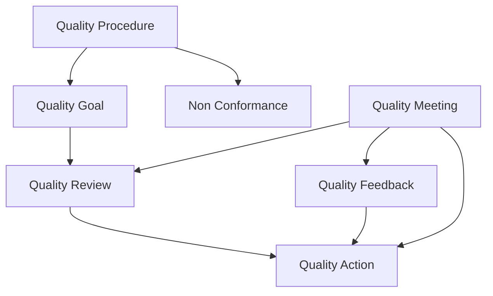

# Quality Management Core

## Direct ERPNext behavior

- The Quality workspace groups procedure, goal, feedback, meeting, review, action, non-conformance, and inspection records in one module landing page (`erpnext/erpnext/quality_management/workspace/quality/quality.json:13`, `erpnext/erpnext/quality_management/workspace/quality/quality.json:117`).
- `Quality Procedure` is a tree, not a workflow engine. It stores a name, optional parent, process owner, and linked child procedures (`erpnext/erpnext/quality_management/doctype/quality_procedure/quality_procedure.json:10`, `erpnext/erpnext/quality_management/doctype/quality_procedure/quality_procedure.json:64`, `erpnext/erpnext/quality_management/doctype/quality_procedure/quality_procedure.py:36`).
- `Quality Goal` stores monitoring frequency and objectives. Frequencies can be `Daily`, `Weekly`, `Monthly`, or `Quarterly` (`erpnext/erpnext/quality_management/doctype/quality_goal/quality_goal.json:20`, `erpnext/erpnext/quality_management/doctype/quality_goal/quality_goal.json:58`).
- ERPNext schedules review creation through `hooks.py`; `quality_review.review()` creates `Quality Review` records from due `Quality Goal` records (`erpnext/erpnext/hooks.py:455`, `erpnext/erpnext/quality_management/doctype/quality_review/quality_review.py:48`).
- `Quality Review` pulls target objectives from the linked goal and sets status to `Open`, `Passed`, or `Failed` from child review status (`erpnext/erpnext/quality_management/doctype/quality_review/quality_review.py:30`).
- `Quality Action` behaves like a manual action tracker. Status is `Open` while any child resolution remains open, otherwise `Completed` (`erpnext/erpnext/quality_management/doctype/quality_action/quality_action.py:21`, `erpnext/erpnext/quality_management/doctype/quality_action/quality_action.py:31`).
- `Non Conformance` is a manual record with `subject`, `procedure`, `status`, `details`, `corrective_action`, and `preventive_action` (`erpnext/erpnext/quality_management/doctype/non_conformance/non_conformance.json:22`, `erpnext/erpnext/quality_management/doctype/non_conformance/non_conformance.json:72`).
- `Quality Feedback` is limited to `User` or `Customer` as the feedback source, and it can feed a `Quality Action` (`erpnext/erpnext/quality_management/doctype/quality_feedback/quality_feedback.json:41`, `erpnext/erpnext/quality_management/doctype/quality_feedback/quality_feedback.py:28`).
- `Quality Meeting` stores agenda and minutes, and meeting minutes can point to `Quality Review`, `Quality Action`, or `Quality Feedback` (`erpnext/erpnext/quality_management/doctype/quality_meeting/quality_meeting.json:17`, `erpnext/erpnext/quality_management/doctype/quality_meeting_minutes/quality_meeting_minutes.py:18`).

## Architecture

## SOP-ready operating pattern

1. Maintain the procedure tree.
   - Quality leadership defines the top-level procedure and sub-procedure hierarchy in `Quality Procedure`.
   - Each procedure should have a named process owner.
2. Define measurable goals.
   - For each procedure that needs periodic monitoring, create a `Quality Goal`.
   - Fill its objective rows and set frequency.
3. Review at the ERP record level.
   - Let the scheduled review job create due `Quality Review` records.
   - Complete each review row and keep the parent review open until all child rows are closed.
4. Capture CAPA-like actions.
   - Open `Quality Action` from a failed review or formal feedback.
   - Keep each action open until all resolution rows are complete.
5. Record nonconformance and management review.
   - Log discrete issues in `Non Conformance`.
   - Use `Quality Meeting` minutes to tie review, feedback, and actions into one meeting record.

## Audit evidence to preserve

- Procedure hierarchy and ownership in `Quality Procedure`
- Objective definitions and frequencies in `Quality Goal`
- Auto-created and manually completed `Quality Review` records
- `Quality Action` with dated resolutions
- `Non Conformance` records with corrective and preventive text
- `Quality Meeting` agenda and minutes

## Inferred ISO 13485 gaps

- `Quality Procedure` is a procedure registry, not a controlled-document system.
  - The schema exposes name, parent, owner, and child procedures, but no explicit approval status, effective date, obsolete flag, training acknowledgment, or document version fields (`erpnext/erpnext/quality_management/doctype/quality_procedure/quality_procedure.json:10`, `erpnext/erpnext/quality_management/doctype/quality_procedure/quality_procedure.json:22`).
- `Non Conformance` is not automatically created from rejected inspections.
  - It exists as a separate manual record and is not linked by server logic from `Quality Inspection` (`erpnext/erpnext/quality_management/doctype/non_conformance/non_conformance.json:22`, `erpnext/erpnext/stock/doctype/quality_inspection/quality_inspection.py:233`).
- Feedback intake is narrow.
  - `Quality Feedback` only accepts `User` or `Customer`, not supplier, service ticket, complaint, device, lot, or returned-goods record (`erpnext/erpnext/quality_management/doctype/quality_feedback/quality_feedback.json:41`).
- Permissions are broad by default.
  - `Desk User` can create and write several quality records, so release authority and approval authority must be tightened by role design and SOP (`erpnext/erpnext/quality_management/doctype/quality_procedure/quality_procedure.json:125`, `erpnext/erpnext/quality_management/doctype/quality_goal/quality_goal.json:84`, `erpnext/erpnext/quality_management/doctype/quality_feedback/quality_feedback.json:69`).

