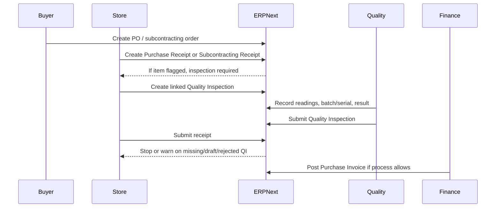

# Procurement and Inbound Quality

## Direct ERPNext behavior

- Incoming inspection is master-data driven from `Item`.
  - `inspection_required_before_purchase` and `quality_inspection_template` live on the item master (`erpnext/erpnext/stock/doctype/item/item.json:717`).
  - ERPNext also supports retained-sample behavior at item level, which is useful when the SOP requires sample retention for incoming lots.
- Transactional enforcement happens in `StockController.validate_inspection()`.
  - It applies to `Purchase Receipt`, `Purchase Invoice`, and `Subcontracting Receipt` (`erpnext/erpnext/controllers/stock_controller.py:1012`).
- If a row requires inspection, ERPNext checks for:
  - presence of a linked `Quality Inspection`
  - submitted inspection status
  - accepted vs rejected inspection outcome
  (`erpnext/erpnext/controllers/stock_controller.py:1049`, `erpnext/erpnext/controllers/stock_controller.py:1070`, `erpnext/erpnext/controllers/stock_controller.py:1085`)
- `Purchase Receipt` also validates that the linked inspection really belongs to the same receipt and item (`erpnext/erpnext/stock/doctype/purchase_receipt/purchase_receipt.py:320`).
- `Purchase Receipt Item` carries operational segregation fields such as rejected quantity, rejected storage, and retained-sample-related fields.
- `Purchase Invoice Item` can hold a `quality_inspection` link, which matters when the invoice is stock-affecting (`erpnext/erpnext/accounts/doctype/purchase_invoice_item/purchase_invoice_item.json:440`).
- `Subcontracting Receipt Item` also holds a `quality_inspection` link (`erpnext/erpnext/subcontracting/doctype/subcontracting_receipt_item/subcontracting_receipt_item.json:286`).
- The generic helper `make_quality_inspections()` can create incoming inspections from source document items and carries `reference_type`, `reference_name`, sample size, serial, and batch into the new inspection (`erpnext/erpnext/controllers/stock_controller.py:1608`).
- `Quality Inspection` supports `Purchase Receipt`, `Purchase Invoice`, and `Subcontracting Receipt` as reference types (`erpnext/erpnext/stock/doctype/quality_inspection/quality_inspection.json:67`, `erpnext/erpnext/stock/doctype/quality_inspection/quality_inspection.json:78`).
- Subcontracting behavior is explicitly tested: when an item is marked as requiring inspection before purchase, `Subcontracting Receipt.submit()` fails until an incoming `Quality Inspection` is linked (`erpnext/erpnext/subcontracting/doctype/subcontracting_receipt/test_subcontracting_receipt.py:862`).

## Inbound flow

## SOP-ready employee steps

1. Before ordering a controlled item:
   - Confirm the item master has the correct incoming inspection flag and template.
   - Confirm `Stock Settings` are configured to `Stop`, not `Warn`, unless management has approved a justified exception.
2. At receipt:
   - Create `Purchase Receipt` or `Subcontracting Receipt`.
   - Record batch and serial information accurately at row level.
   - Record accepted vs rejected quantity and the intended storage path for non-accepted material.
   - If the material class requires retained samples, follow the retained-sample step from the SOP.
3. Before release to usable stock:
   - Create the linked `Quality Inspection` from the source document.
   - Complete sample size and readings.
   - Submit the inspection.
4. Only after accepted inspection:
   - Submit the receipt.
   - Continue to stock-affecting `Purchase Invoice` only if your SOP allows invoice-after-receipt.
5. If inspection is rejected:
   - Do not rely on ERPNext alone for disposition.
   - Open a `Non Conformance` record and follow quarantine, disposition, and supplier escalation SOP.

## Audit evidence to preserve

- Item master with inspection flag and template
- Purchase Order or subcontracting order
- Purchase Receipt or Subcontracting Receipt
- Linked `Quality Inspection`
- Accepted quantity, rejected quantity, and rejected-location evidence
- Batch and serial evidence
- Retained sample evidence when required
- Purchase Invoice when financially relevant
- Nonconformance and action records for any rejected lot

## Inferred ISO 13485 gaps

- The pre-receipt gate can be weakened by configuration.
  - If `allow_to_make_quality_inspection_after_purchase_or_delivery` is enabled, ERPNext allows inspection after receipt/delivery for several document types (`erpnext/erpnext/stock/doctype/stock_settings/stock_settings.json:530`, `erpnext/erpnext/stock/doctype/quality_inspection/quality_inspection.py:146`).
- The gate can also be weakened to warning-only behavior.
  - Missing, unsubmitted, or rejected inspections can become warnings instead of hard stops (`erpnext/erpnext/controllers/stock_controller.py:1070`, `erpnext/erpnext/controllers/stock_controller.py:1085`).
- Supplier qualification is not the same as inbound release.
  - This packet found strong item/receipt inspection controls, but no direct server-side bridge from rejected receipt inspection to supplier block, supplier CAPA, or approved-supplier status in the traced paths.
- Rejection handling is manual outside the inspection gate.
  - ERPNext stops or warns, but it does not automatically create nonconformance, quarantine disposition, or supplier corrective action from the rejected inspection path (`erpnext/erpnext/controllers/stock_controller.py:1085`, `erpnext/erpnext/quality_management/doctype/non_conformance/non_conformance.json:22`).
- There is no native mandatory supplier CoA or incoming lot-document approval step in the traced flow.
  - If your process requires supplier certificates, incoming lot paperwork, or review-before-release, that has to be enforced by SOP or customization.
