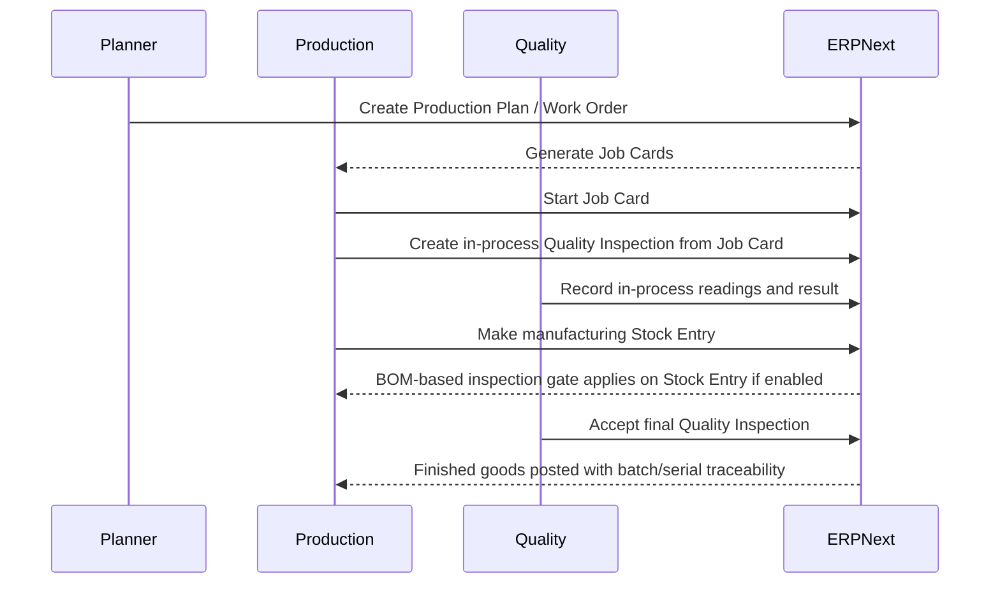

# Manufacturing and In-Process Quality

## Direct ERPNext behavior

- Manufacturing execution follows the document chain `Production Plan -> Work Order -> Job Card -> Stock Entry`.
- `Operation` can hold a `quality_inspection_template`, which is intended to flow into the job card context (`erpnext/erpnext/manufacturing/doctype/operation/operation.json:81`, `erpnext/erpnext/manufacturing/doctype/operation/operation.json:97`).
- `BOM` has `inspection_required` and `quality_inspection_template`, which define whether a manufacturing inspection gate should exist (`erpnext/erpnext/manufacturing/doctype/bom/bom.json:172`).
- `Job Card` has fields for `quality_inspection` and `quality_inspection_template` (`erpnext/erpnext/manufacturing/doctype/job_card/job_card.py:97`).
- The job card form scaffolds an in-process `Quality Inspection` with:
  - `inspection_type = "In Process"`
  - `reference_type = "Job Card"`
  - `reference_name = current job card`
  - the current item, serial, batch, and quality template
  (`erpnext/erpnext/manufacturing/doctype/job_card/job_card.js:137`)
- `Quality Inspection` explicitly supports `In Process` and `Job Card` references (`erpnext/erpnext/stock/doctype/quality_inspection/quality_inspection.json:67`, `erpnext/erpnext/stock/doctype/quality_inspection/quality_inspection.json:78`).
- On the finished-good side, `Stock Entry` updates the linked inspection references when the manufacturing stock entry is posted (`erpnext/erpnext/stock/doctype/stock_entry/stock_entry.py:2677`).
- `Work Order` can auto-create `Batch` and `Serial No` records for finished goods when manufacturing settings require it, which is a strong traceability primitive (`erpnext/erpnext/manufacturing/doctype/work_order/work_order.py:494`).

## Manufacturing flow

## SOP-ready employee steps

1. Before releasing a route for production:
   - Confirm controlled operations have a defined inspection template.
   - Confirm the BOM defines whether final inspection is required.
2. During execution:
   - Use `Job Card` as the execution record.
   - Create in-process `Quality Inspection` from the job card wherever the route requires inspection.
3. Before finished-good posting:
   - If BOM-level inspection is required, do not submit the manufacturing `Stock Entry` until the linked inspection is submitted and accepted.
4. For traceability:
   - Use batch and serial features for controlled finished goods.
   - Keep work-order, job-card, stock-entry, and inspection links intact.
5. For rejected or reworked material:
   - Open nonconformance and corrective action records.
   - Define rework authority and re-release criteria in SOP, not in tribal knowledge.

## Audit evidence to preserve

- Production Plan and Work Order
- Operation and BOM revision used
- Job Card execution history
- In-process and final `Quality Inspection`
- Manufacturing `Stock Entry`
- `Batch`, `Serial No`, and serial/batch bundle records

## Inferred ISO 13485 gaps

- In-process inspection on `Job Card` is scaffolded but not server-enforced.
  - The form helps users create the record, but the traced job-card server code does not impose a submit-time accepted-QI rule (`erpnext/erpnext/manufacturing/doctype/job_card/job_card.js:137`, `erpnext/erpnext/manufacturing/doctype/job_card/job_card.py:97`).
- Final inspection is enforced at the stock-entry stage, not at every in-process stage.
  - That is workable, but it means route-level control depends on SOP discipline if the organization needs mandatory stage release (`erpnext/erpnext/manufacturing/doctype/bom/bom.json:172`, `erpnext/erpnext/controllers/stock_controller.py:1012`).
- There is a template-source nuance in the in-process path.
  - When a `Quality Inspection` validates an in-process job-card inspection, it loads parameter details from the item-level inspection template, not from the job-card or operation template (`erpnext/erpnext/stock/doctype/quality_inspection/quality_inspection.py:67`).
  - If item and operation templates diverge, the organization should test and lock the intended design.
- ERPNext gives traceability records, but not one assembled device history record.
  - Evidence is spread across work order, job card, stock entry, inspection, batch, and serial records.

