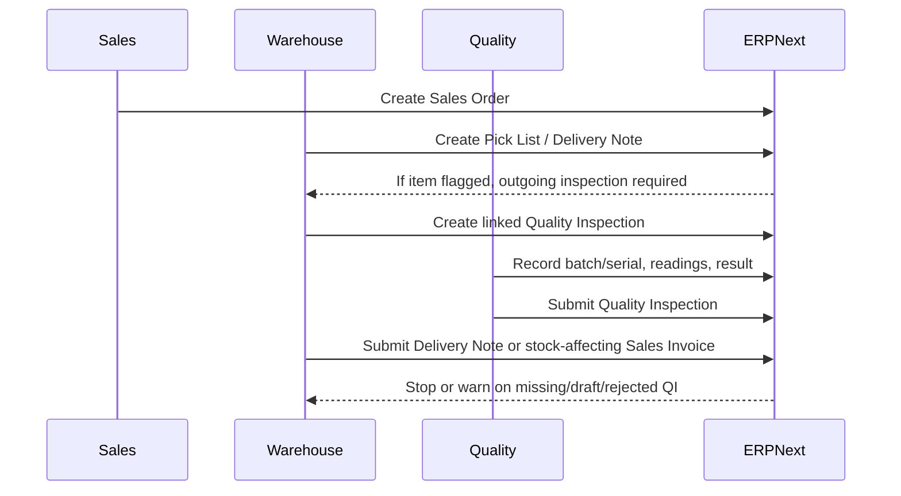

# Sales, Outbound Release, and Traceability

## Direct ERPNext behavior

- Outgoing inspection is item-driven.
  - `inspection_required_before_delivery` lives on `Item` (`erpnext/erpnext/stock/doctype/item/item.json:723`).
- Outbound quality gating happens on stock-affecting documents, not on quotation or sales-order approval.
  - `StockController.validate_inspection()` applies to `Delivery Note` and stock-affecting `Sales Invoice` (`erpnext/erpnext/controllers/stock_controller.py:1012`).
- Commercial flow and release flow are separate.
  - The normal outbound chain is `Sales Order -> Pick List -> Delivery Note`, with the enforceable quality gate appearing at the outbound stock document rather than at order acceptance.
- `Delivery Note Item` has a direct `quality_inspection` link (`erpnext/erpnext/stock/doctype/delivery_note_item/delivery_note_item.json:508`).
- `Sales Invoice Item` also has a `quality_inspection` link (`erpnext/erpnext/accounts/doctype/sales_invoice_item/sales_invoice_item.json:605`).
- `Quality Inspection` supports `Outgoing` inspections against `Delivery Note` and `Sales Invoice` (`erpnext/erpnext/stock/doctype/quality_inspection/quality_inspection.json:67`, `erpnext/erpnext/stock/doctype/quality_inspection/quality_inspection.json:78`).
- The inspection record stores `reference_type`, `reference_name`, `child_row_reference`, `batch_no`, and `item_serial_no`, then writes the inspection name back to the source row (`erpnext/erpnext/stock/doctype/quality_inspection/quality_inspection.py:89`, `erpnext/erpnext/stock/doctype/quality_inspection/quality_inspection.py:233`).

## Outbound release flow

## SOP-ready employee steps

1. Before accepting release to customer:
   - Confirm the shipped item master requires outgoing inspection where needed.
   - Confirm the lot, batch, or serial being shipped is exactly the one inspected.
2. At outbound preparation:
   - Use `Delivery Note` as the shipping release document.
   - Create the `Quality Inspection` from the delivery line for controlled items.
3. Before shipment leaves control:
   - Submit the inspection.
   - Only submit the delivery document when the inspection result is accepted.
4. For traceability:
   - Preserve lot, serial, and delivery references.
   - Do not bypass shipment through a commercial-only workflow.
5. For rejected outbound inspection:
   - Hold shipment.
   - Route the event into nonconformance and corrective action handling.

## Audit evidence to preserve

- Sales Order
- Pick List when used
- Delivery Note or stock-affecting Sales Invoice
- Linked `Quality Inspection`
- Batch and serial traceability
- Back-reference from delivery status to the originating sales order
- Customer shipment evidence

## Inferred ISO 13485 gaps

- There is no quality gate at `Sales Order`.
  - The enforceable gate starts later, on `Delivery Note` or stock-affecting `Sales Invoice`.
- Gate strength depends on stock settings.
  - `Warn` allows progression with draft or rejected inspection records (`erpnext/erpnext/controllers/stock_controller.py:1070`, `erpnext/erpnext/controllers/stock_controller.py:1085`).
- ERPNext does not build a single outbound release packet automatically.
  - The organization must define how to assemble order, pick, inspection, delivery, and traceability records for audit.
