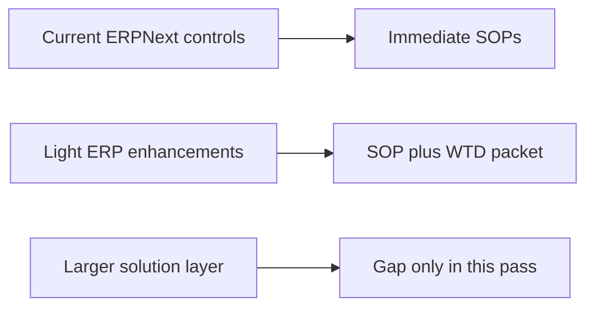

# SOP Portfolio And ERP Assessment

This file classifies the ISO 13485-oriented SOP set into:

- `A`: workable in current ERPNext with disciplined use
- `B`: workable if light ERP enhancement or customization is assumed
- `C`: not a good fit for built-in ERPNext without a larger solution layer

## Operating Rule

`A` release-control SOPs only remain truly workable if ERP quality gates are hardened:

- `Stock Settings` for missing or rejected inspection stay at `Stop`
- post-purchase and post-delivery inspection creation is not used as a bypass
- inspection-required flags are maintained on controlled `Item` and `BOM` records

## Architecture View

## A. Current ERPNext SOPs Authored In This Packet

| SOP | Title | ISO 13485 clauses | Assessment |
| --- | --- | --- | --- |
| `SOP-QMS-002` | Management review and quality review cadence | `5.4.1`, `5.6`, `8.4`, `8.5` | Built-in quality governance records already support a usable review loop |
| `SOP-PUR-001` | Incoming inspection and release of purchased or subcontracted product | `7.4.3`, `7.5.11`, `8.2.6`, `8.3.2` | Item inspection flags, `Quality Inspection`, rejected quantity handling, and stock-side validation already exist |
| `SOP-PUR-003` | Supplier evaluation and periodic re-evaluation | `7.4.1`, `8.4` | `Supplier Scorecard` and review evidence provide a workable supplier monitoring loop |
| `SOP-PUR-004` | Purchasing information and supplier communication | `7.4.2` | RFQ, quotation, PO, supplier item references, and attachments already create an auditable supplier communication record |
| `SOP-MFG-002` | Final manufacturing inspection and finished goods release | `7.5.1`, `7.5.8`, `7.5.9`, `8.2.6` | BOM inspection requirement, manufacturing stock entry, batch or serial records, and quality gates exist |
| `SOP-MFG-003` | Product realization planning and execution | `7.1`, `7.5.1` | BOM, operations, work order, job card, and stock entry already form an auditable execution chain |
| `SOP-SAL-001` | Outgoing inspection and shipment release | `7.5.8`, `7.5.9`, `8.2.6`, `8.3.2` | `Delivery Note` and stock-affecting sales documents can be hard-gated by `Quality Inspection` |
| `SOP-SRV-001` | Returns, service history, and post-delivery records | `7.5.4`, `7.5.8`, `8.3.3` | Warranty, maintenance, return, and serial records already create a post-delivery audit trail |
| `SOP-TRC-001` | Batch, serial, and record retrieval traceability | `4.2.5`, `7.5.8`, `7.5.9` | ERPNext already stores the link chain across item, lot, serial, quality, and transaction documents |

## B. Enhancement-Assumed SOPs Authored In This Packet

Priority note:

- `SOP-PUR-002` can be pulled forward as an early parallel implementation slice because ERP already has clean insertion points at `Purchase Order.validate_supplier()` and receipt-side stock validation; the missing piece is approved-supplier scope, not a full new purchasing workflow.
- `SOP-QMS-005` should follow immediately after that because it defines who is allowed to act, acknowledge revisions, inspect, review, and release.
- `SOP-MFG-001` should be the first manufacturing hard-stop slice after the initial shared gate foundation because ERP manufacturing already has the core records and only lacks enforced hold-point behavior.
- once those three foundation slices are in place, the next operational backbone should be `SOP-QMS-004` complaint handling, then `SOP-QMS-003` NCR and CAPA closure, followed by `SOP-TRC-002` release dossier or DHR assembly.
- after the exception backbone, the next lighter operational slices can safely widen the pack into customer property, workstation or environment readiness, and software validation or ERP change control.

| SOP | Title | ISO 13485 clauses | Why enhancement is needed | WTD |
| --- | --- | --- | --- | --- |
| `SOP-QMS-001` | Document and record control | `4.2.4`, `4.2.5` | ERPNext lacks full controlled-document revision, approval, and training acknowledgment | `WTD-SOP-QMS-001` |
| `SOP-QMS-003` | Nonconformance, CAPA, and effectiveness verification | `8.3`, `8.5.2`, `8.5.3` | Existing `Non Conformance` and `Quality Action` are too lightweight for closed-loop CAPA | `WTD-SOP-QMS-003` |
| `SOP-MFG-001` | In-process inspection and job card hold points | `7.5.1`, `8.2.6` | `Job Card` can link inspection, but in-process release is not server-enforced | `WTD-SOP-MFG-001` |
| `SOP-PUR-002` | Supplier qualification and approved supplier release | `7.4.1`, `7.4.2`, `7.4.3` | ERP has supplier-level warn or stop controls and receipt inspection gates, but no approved-supplier-by-item release control | `WTD-SOP-PUR-002` |
| `SOP-QMS-004` | Complaint handling and escalation | `8.2.1`, `8.2.2`, `8.3.3`, `8.5.2` | `Issue` and `Warranty Claim` exist, but complaint-to-QMS escalation is not native | `WTD-SOP-QMS-004` |
| `SOP-TRC-002` | Device history record and release dossier assembly | `4.2.5`, `7.5.1`, `7.5.9`, `8.2.6` | ERPNext stores the evidence, but does not assemble one release packet automatically | `WTD-SOP-TRC-002` |
| `SOP-QMS-005` | Controlled-role training, competence, and authority | `5.5.1`, `5.5.2`, `6.2`, `4.2.4` | HRMS has lifecycle and training events, but ERP/qms do not yet enforce qualification, acknowledgment, or release authority at transaction time | `WTD-SOP-QMS-005` |
| `SOP-SAL-002` | Customer requirement review and order acceptance | `5.2`, `7.2.1`, `7.2.2`, `7.2.3` | Quotation and sales order exist, but regulated requirement review and acceptance gates are not native | `WTD-SOP-SAL-002` |
| `SOP-QMS-006` | Monitoring and measuring equipment control | `6.3`, `7.6`, `8.2.6` | Asset maintenance exists, but quality-critical equipment release and block logic are not tied to inspection or release use | `WTD-SOP-QMS-006` |
| `SOP-QMS-007` | Internal quality audit and finding escalation | `8.2.4`, `8.4`, `8.5.2` | No first-class audit program exists in inspected ERPNext or `qms` surfaces | `WTD-SOP-QMS-007` |
| `SOP-SRV-002` | Installation verification and acceptance | `7.5.3`, `7.5.8`, `8.3.3` | `Installation Note` exists, but site acceptance criteria, sign-off, and failure-escalation structure are not native | `WTD-SOP-SRV-002` |
| `SOP-SRV-003` | Customer property and customer-owned product control | `7.5.10`, `7.5.4`, `8.3.3` | ERP service and asset records exist, but customer-property receipt, condition, and disposition are not governed across them | `WTD-SOP-SRV-003` |
| `SOP-WHS-001` | Preservation, storage, and dispatch-condition control | `7.5.11`, `7.5.8`, `7.5.9` | Warehouses, batches, serials, and dispatch documents exist, but storage-condition evidence and dispatch-condition confirmation are not first-class | `WTD-SOP-WHS-001` |
| `SOP-QMS-008` | Process monitoring and trend escalation | `5.4.1`, `8.1`, `8.2.5`, `8.4` | `Quality Goal` and `Quality Review` exist, but KPI-source linkage, thresholds, and escalation routing are too lightweight | `WTD-SOP-QMS-008` |
| `SOP-MFG-004` | Rework, re-inspection, and re-release | `7.5.1`, `8.2.6`, `8.3.4` | Corrective `Job Card` exists, but source-defect linkage and mandatory re-inspection before rerelease are not native | `WTD-SOP-MFG-004` |
| `SOP-MFG-005` | Workstation readiness and environment control | `6.3`, `6.4.1`, `7.5.2` | Workstation, maintenance, and shift structures exist, but governed pre-start readiness and environment checks are not native | `WTD-SOP-MFG-005` |
| `SOP-QMS-009` | Feedback capture and trend triage | `5.2`, `8.2.1`, `8.4`, `8.5.1` | `Issue`, `Warranty Claim`, `Maintenance Visit`, and `Quality Feedback` exist, but complaint-vs-feedback triage and trend escalation are not governed | `WTD-SOP-QMS-009` |
| `SOP-QMS-010` | Quality policy, internal communication, and controlled awareness | `5.3`, `5.5.3`, `6.2`, `4.2.4` | qms document release and distribution exist, but role-based applicability and acknowledgment are not governed | `WTD-SOP-QMS-010` |
| `SOP-QMS-011` | Computer software validation and ERP change control | `4.1`, `4.2.4`, `4.2.5` | qms already has document and change scaffolding, but software-specific validation evidence and deployment control are missing | `WTD-SOP-QMS-011` |
| `SOP-TRC-003` | Identifier, barcode, and label governance | `7.5.8`, `7.5.9` | ERP item barcodes and scan flows exist, but regulated label issuance and print authorization are not native | `WTD-SOP-TRC-003` |

## C. Assessed But Not Fully Authored In This Pass

| SOP area | Class | ISO 13485 clauses | Assessment |
| --- | --- | --- | --- |
| Regulatory reporting workflow | `C` | `8.2.3` | Requires jurisdiction-specific logic and is not naturally present in built-in ERPNext |
| Sterilization and sterile barrier validation | `C` | `7.5.5`, `7.5.6`, `7.5.7` | Needs process-specific validation artifacts beyond the traced ERPNext baseline |
| Full design controls and design history file | `C` | `7.3.x` | Possible only with a broader engineering and change-control layer, not this ERP baseline |

## File Set

### Current ERP SOPs

- [SOP-QMS-002_management_review_and_quality_review.md](/home/prince/frappe-bench-15/apps/erpnext/docs/iso13485/sops/current_erp/SOP-QMS-002_management_review_and_quality_review.md)
- [SOP-PUR-001_incoming_inspection_and_release.md](/home/prince/frappe-bench-15/apps/erpnext/docs/iso13485/sops/current_erp/SOP-PUR-001_incoming_inspection_and_release.md)
- [SOP-PUR-003_supplier_evaluation_and_periodic_re_evaluation.md](/home/prince/frappe-bench-15/apps/erpnext/docs/iso13485/sops/current_erp/SOP-PUR-003_supplier_evaluation_and_periodic_re_evaluation.md)
- [SOP-PUR-004_purchasing_information_and_supplier_communication.md](/home/prince/frappe-bench-15/apps/erpnext/docs/iso13485/sops/current_erp/SOP-PUR-004_purchasing_information_and_supplier_communication.md)
- [SOP-MFG-002_final_manufacturing_release.md](/home/prince/frappe-bench-15/apps/erpnext/docs/iso13485/sops/current_erp/SOP-MFG-002_final_manufacturing_release.md)
- [SOP-MFG-003_product_realization_planning_and_execution.md](/home/prince/frappe-bench-15/apps/erpnext/docs/iso13485/sops/current_erp/SOP-MFG-003_product_realization_planning_and_execution.md)
- [SOP-SAL-001_outgoing_inspection_and_shipment_release.md](/home/prince/frappe-bench-15/apps/erpnext/docs/iso13485/sops/current_erp/SOP-SAL-001_outgoing_inspection_and_shipment_release.md)
- [SOP-SRV-001_returns_service_history_and_post_delivery_records.md](/home/prince/frappe-bench-15/apps/erpnext/docs/iso13485/sops/current_erp/SOP-SRV-001_returns_service_history_and_post_delivery_records.md)
- [SOP-TRC-001_traceability_and_record_retrieval.md](/home/prince/frappe-bench-15/apps/erpnext/docs/iso13485/sops/current_erp/SOP-TRC-001_traceability_and_record_retrieval.md)

### Enhancement-Assumed SOPs

- [SOP-QMS-001_document_and_record_control.md](/home/prince/frappe-bench-15/apps/erpnext/docs/iso13485/sops/enhancement_assumed/SOP-QMS-001_document_and_record_control.md)
- [SOP-QMS-003_nonconformance_and_capa.md](/home/prince/frappe-bench-15/apps/erpnext/docs/iso13485/sops/enhancement_assumed/SOP-QMS-003_nonconformance_and_capa.md)
- [SOP-MFG-001_in_process_inspection_and_hold_points.md](/home/prince/frappe-bench-15/apps/erpnext/docs/iso13485/sops/enhancement_assumed/SOP-MFG-001_in_process_inspection_and_hold_points.md)
- [SOP-PUR-002_supplier_qualification_and_release.md](/home/prince/frappe-bench-15/apps/erpnext/docs/iso13485/sops/enhancement_assumed/SOP-PUR-002_supplier_qualification_and_release.md)
- [SOP-QMS-004_complaint_handling_and_escalation.md](/home/prince/frappe-bench-15/apps/erpnext/docs/iso13485/sops/enhancement_assumed/SOP-QMS-004_complaint_handling_and_escalation.md)
- [SOP-TRC-002_device_history_record_and_release_dossier.md](/home/prince/frappe-bench-15/apps/erpnext/docs/iso13485/sops/enhancement_assumed/SOP-TRC-002_device_history_record_and_release_dossier.md)
- [SOP-QMS-005_controlled_role_training_competence_and_authority.md](/home/prince/frappe-bench-15/apps/erpnext/docs/iso13485/sops/enhancement_assumed/SOP-QMS-005_controlled_role_training_competence_and_authority.md)
- [SOP-SAL-002_customer_requirement_review_and_order_acceptance.md](/home/prince/frappe-bench-15/apps/erpnext/docs/iso13485/sops/enhancement_assumed/SOP-SAL-002_customer_requirement_review_and_order_acceptance.md)
- [SOP-QMS-006_monitoring_and_measuring_equipment_control.md](/home/prince/frappe-bench-15/apps/erpnext/docs/iso13485/sops/enhancement_assumed/SOP-QMS-006_monitoring_and_measuring_equipment_control.md)
- [SOP-QMS-007_internal_quality_audit_and_finding_escalation.md](/home/prince/frappe-bench-15/apps/erpnext/docs/iso13485/sops/enhancement_assumed/SOP-QMS-007_internal_quality_audit_and_finding_escalation.md)
- [SOP-SRV-002_installation_verification_and_acceptance.md](/home/prince/frappe-bench-15/apps/erpnext/docs/iso13485/sops/enhancement_assumed/SOP-SRV-002_installation_verification_and_acceptance.md)
- [SOP-SRV-003_customer_property_and_customer_owned_product_control.md](/home/prince/frappe-bench-15/apps/erpnext/docs/iso13485/sops/enhancement_assumed/SOP-SRV-003_customer_property_and_customer_owned_product_control.md)
- [SOP-WHS-001_preservation_storage_and_dispatch_condition_control.md](/home/prince/frappe-bench-15/apps/erpnext/docs/iso13485/sops/enhancement_assumed/SOP-WHS-001_preservation_storage_and_dispatch_condition_control.md)
- [SOP-QMS-008_process_monitoring_and_trend_escalation.md](/home/prince/frappe-bench-15/apps/erpnext/docs/iso13485/sops/enhancement_assumed/SOP-QMS-008_process_monitoring_and_trend_escalation.md)
- [SOP-MFG-004_rework_reinspection_and_rerelease.md](/home/prince/frappe-bench-15/apps/erpnext/docs/iso13485/sops/enhancement_assumed/SOP-MFG-004_rework_reinspection_and_rerelease.md)
- [SOP-MFG-005_workstation_readiness_and_environment_control.md](/home/prince/frappe-bench-15/apps/erpnext/docs/iso13485/sops/enhancement_assumed/SOP-MFG-005_workstation_readiness_and_environment_control.md)
- [SOP-QMS-009_feedback_capture_and_trend_triage.md](/home/prince/frappe-bench-15/apps/erpnext/docs/iso13485/sops/enhancement_assumed/SOP-QMS-009_feedback_capture_and_trend_triage.md)
- [SOP-QMS-010_quality_policy_internal_communication_and_controlled_awareness.md](/home/prince/frappe-bench-15/apps/erpnext/docs/iso13485/sops/enhancement_assumed/SOP-QMS-010_quality_policy_internal_communication_and_controlled_awareness.md)
- [SOP-QMS-011_computer_software_validation_and_erp_change_control.md](/home/prince/frappe-bench-15/apps/erpnext/docs/iso13485/sops/enhancement_assumed/SOP-QMS-011_computer_software_validation_and_erp_change_control.md)
- [SOP-TRC-003_identifier_barcode_and_label_governance.md](/home/prince/frappe-bench-15/apps/erpnext/docs/iso13485/sops/enhancement_assumed/SOP-TRC-003_identifier_barcode_and_label_governance.md)

### Work To Be Done Files

- [WTD-SOP-QMS-001_document_and_record_control.md](/home/prince/frappe-bench-15/apps/erpnext/docs/iso13485/work_to_be_done/WTD-SOP-QMS-001_document_and_record_control.md)
- [WTD-SOP-QMS-003_nonconformance_and_capa.md](/home/prince/frappe-bench-15/apps/erpnext/docs/iso13485/work_to_be_done/WTD-SOP-QMS-003_nonconformance_and_capa.md)
- [WTD-SOP-MFG-001_in_process_inspection_and_hold_points.md](/home/prince/frappe-bench-15/apps/erpnext/docs/iso13485/work_to_be_done/WTD-SOP-MFG-001_in_process_inspection_and_hold_points.md)
- [WTD-SOP-PUR-002_supplier_qualification_and_release.md](/home/prince/frappe-bench-15/apps/erpnext/docs/iso13485/work_to_be_done/WTD-SOP-PUR-002_supplier_qualification_and_release.md)
- [WTD-SOP-QMS-004_complaint_handling_and_escalation.md](/home/prince/frappe-bench-15/apps/erpnext/docs/iso13485/work_to_be_done/WTD-SOP-QMS-004_complaint_handling_and_escalation.md)
- [WTD-SOP-TRC-002_device_history_record_and_release_dossier.md](/home/prince/frappe-bench-15/apps/erpnext/docs/iso13485/work_to_be_done/WTD-SOP-TRC-002_device_history_record_and_release_dossier.md)
- [WTD-SOP-QMS-005_controlled_role_training_competence_and_authority.md](/home/prince/frappe-bench-15/apps/erpnext/docs/iso13485/work_to_be_done/WTD-SOP-QMS-005_controlled_role_training_competence_and_authority.md)
- [WTD-SOP-SAL-002_customer_requirement_review_and_order_acceptance.md](/home/prince/frappe-bench-15/apps/erpnext/docs/iso13485/work_to_be_done/WTD-SOP-SAL-002_customer_requirement_review_and_order_acceptance.md)
- [WTD-SOP-QMS-006_monitoring_and_measuring_equipment_control.md](/home/prince/frappe-bench-15/apps/erpnext/docs/iso13485/work_to_be_done/WTD-SOP-QMS-006_monitoring_and_measuring_equipment_control.md)
- [WTD-SOP-QMS-007_internal_quality_audit_and_finding_escalation.md](/home/prince/frappe-bench-15/apps/erpnext/docs/iso13485/work_to_be_done/WTD-SOP-QMS-007_internal_quality_audit_and_finding_escalation.md)
- [WTD-SOP-SRV-002_installation_verification_and_acceptance.md](/home/prince/frappe-bench-15/apps/erpnext/docs/iso13485/work_to_be_done/WTD-SOP-SRV-002_installation_verification_and_acceptance.md)
- [WTD-SOP-SRV-003_customer_property_and_customer_owned_product_control.md](/home/prince/frappe-bench-15/apps/erpnext/docs/iso13485/work_to_be_done/WTD-SOP-SRV-003_customer_property_and_customer_owned_product_control.md)
- [WTD-SOP-WHS-001_preservation_storage_and_dispatch_condition_control.md](/home/prince/frappe-bench-15/apps/erpnext/docs/iso13485/work_to_be_done/WTD-SOP-WHS-001_preservation_storage_and_dispatch_condition_control.md)
- [WTD-SOP-QMS-008_process_monitoring_and_trend_escalation.md](/home/prince/frappe-bench-15/apps/erpnext/docs/iso13485/work_to_be_done/WTD-SOP-QMS-008_process_monitoring_and_trend_escalation.md)
- [WTD-SOP-MFG-004_rework_reinspection_and_rerelease.md](/home/prince/frappe-bench-15/apps/erpnext/docs/iso13485/work_to_be_done/WTD-SOP-MFG-004_rework_reinspection_and_rerelease.md)
- [WTD-SOP-MFG-005_workstation_readiness_and_environment_control.md](/home/prince/frappe-bench-15/apps/erpnext/docs/iso13485/work_to_be_done/WTD-SOP-MFG-005_workstation_readiness_and_environment_control.md)
- [WTD-SOP-QMS-009_feedback_capture_and_trend_triage.md](/home/prince/frappe-bench-15/apps/erpnext/docs/iso13485/work_to_be_done/WTD-SOP-QMS-009_feedback_capture_and_trend_triage.md)
- [WTD-SOP-QMS-010_quality_policy_internal_communication_and_controlled_awareness.md](/home/prince/frappe-bench-15/apps/erpnext/docs/iso13485/work_to_be_done/WTD-SOP-QMS-010_quality_policy_internal_communication_and_controlled_awareness.md)
- [WTD-SOP-QMS-011_computer_software_validation_and_erp_change_control.md](/home/prince/frappe-bench-15/apps/erpnext/docs/iso13485/work_to_be_done/WTD-SOP-QMS-011_computer_software_validation_and_erp_change_control.md)
- [WTD-SOP-TRC-003_identifier_barcode_and_label_governance.md](/home/prince/frappe-bench-15/apps/erpnext/docs/iso13485/work_to_be_done/WTD-SOP-TRC-003_identifier_barcode_and_label_governance.md)
