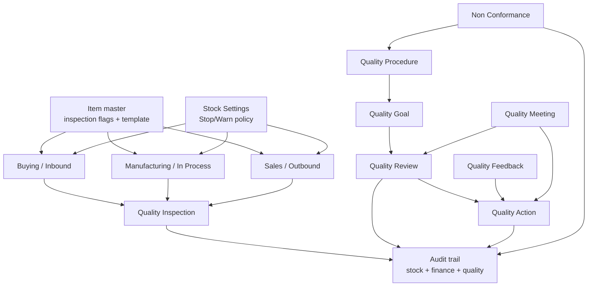

# ERPNext ISO 13485 Architecture Packet

This packet maps built-in ERPNext behavior to SOP-ready operating flows for organizations that want auditable records while operating under an ISO 13485-style quality system.

Folder rule:

- `docs/iso13485/` = SOP-facing ERP and implementation material
- `docs/existing_sop/` = current approved source SOPs and controlled forms
- `docs/reference/` = internal research, architecture, and presentation references used to write more SOPs

## Scope and assumptions

- Scope in this packet: core `erpnext` app, especially `quality_management`, `stock`, `buying`, `subcontracting`, `manufacturing`, `selling`, and `accounts`.
- Assumption: current-ERP SOPs in this folder stay anchored in built-in ERPNext behavior, while enhancement-assumed SOPs may rely on the local `qms` app, HRMS, and small bridge modules as described in the reference packet.
- Interpretation rule:
  - `Direct evidence` means the behavior is visible in local ERPNext code or schema.
  - `Inferred control` means the SOP or compliance expectation is not enforced by ERPNext and must be defined by the organization.
- This is an implementation and architecture packet, not legal advice and not a substitute for the ISO 13485 text.

## Coverage

| Module family | Primary ERPNext records | Quality role | Packet |
| --- | --- | --- | --- |
| Setup and master data | `Item`, `Stock Settings`, `Operation`, `BOM` | Defines where quality gates exist and how strict they are | `README.md` |
| Quality management core | `Quality Procedure`, `Quality Goal`, `Quality Review`, `Quality Action`, `Non Conformance`, `Quality Feedback`, `Quality Meeting` | Holds procedure hierarchy, review cadence, manual CAPA-like records, and meeting evidence | `01_quality_management_core.md` |
| Buying and inbound control | `Purchase Receipt`, `Purchase Invoice`, `Subcontracting Receipt`, `Quality Inspection` | Incoming inspection and release of purchased or subcontracted items | `02_procurement_and_inbound_quality.md` |
| Manufacturing and in-process control | `Production Plan`, `Work Order`, `Job Card`, `Stock Entry`, `Quality Inspection`, `Batch`, `Serial No` | In-process checks, final inspection, and lot/serial traceability | `03_manufacturing_and_in_process_quality.md` |
| Sales, outbound release, and traceability | `Sales Order`, `Delivery Note`, `Sales Invoice`, `Pick List`, `Quality Inspection` | Outgoing inspection and traceable release to customer | `04_sales_outbound_and_traceability.md` |
| Accounting and audit evidence | `Purchase Invoice`, `Sales Invoice`, stock-affecting source docs | Financial evidence tied to released material movements | `05_accounting_audit_and_record_control.md` |
| Gap register and SOP backlog | N/A | Records what ERPNext does not enforce and what SOPs must cover | `06_gap_register_and_sop_backlog.md` |
| SOP portfolio and implementation split | Current ERP SOPs, enhancement-assumed SOPs, work packets | Separates what can run now from what needs small ERP changes | `07_sop_portfolio_and_assessment.md` |
| Cross-app reference architecture | ERPNext + `qms` + `hrms` + bridge modules | Defines the real compliance-by-default target architecture beyond ERPNext core alone | `../reference/erp_qms_hrms_architecture/00_NORTH_STAR_AND_PROBLEM_STATEMENT.md` |
| Research and presentation references | Approved SOP alignment, research verdict, presentation pack, next iterations | Gives the reference reading order and the honest completion verdict | `../reference/erp_qms_hrms_architecture/README.md` |
| ERPNext-only baseline reference | Early ERPNext-only discovery notes | Gives the first-pass ERPNext reasoning if needed | `../reference/erpnext_baseline/README.md` |

## High-level architecture

## What ERPNext already gives you

- The Quality workspace exposes `Quality Goal`, `Quality Procedure`, `Quality Inspection`, `Quality Review`, `Quality Action`, and `Non Conformance` as first-class records (`erpnext/erpnext/quality_management/workspace/quality/quality.json:13`, `erpnext/erpnext/quality_management/workspace/quality/quality.json:159`).
- `Item` controls whether incoming or outgoing quality inspection is required and which inspection template should be used (`erpnext/erpnext/stock/doctype/item/item.json:717`).
- `Stock Settings` decides whether missing or rejected inspections stop submission or only warn, and whether inspection may happen after purchase or delivery (`erpnext/erpnext/stock/doctype/stock_settings/stock_settings.json:304`, `erpnext/erpnext/stock/doctype/stock_settings/stock_settings.json:530`).
- `StockController.validate_inspection()` is the main transactional gate for `Purchase Receipt`, `Purchase Invoice`, `Subcontracting Receipt`, `Sales Invoice`, `Delivery Note`, and inspection-required `Stock Entry` (`erpnext/erpnext/controllers/stock_controller.py:1012`).

## How to use this packet

1. Lock organizational policy first.
   - Decide whether all quality-related `Stock Settings` must be set to `Stop`.
   - Decide which item classes require incoming, in-process, and outgoing inspection.
2. Turn each packet into one or more SOPs.
   - Use [07_sop_portfolio_and_assessment.md](/home/prince/frappe-bench-15/apps/erpnext/docs/iso13485/07_sop_portfolio_and_assessment.md) to separate current-ERP SOPs from enhancement-assumed SOPs.
   - Use the cross-app reference packet under [00_NORTH_STAR_AND_PROBLEM_STATEMENT.md](/home/prince/frappe-bench-15/apps/erpnext/docs/reference/erp_qms_hrms_architecture/00_NORTH_STAR_AND_PROBLEM_STATEMENT.md) when the target design depends on the local `qms` app, HRMS, or a bridge module.
   - The active enhancement-assumed set now also covers controlled-role training and authority, customer requirement review, equipment control, internal audit, installation acceptance, customer property control, preservation and dispatch condition control, workstation or environment readiness, process monitoring or trend escalation, rework or rerelease control, structured feedback triage, quality-policy communication, computer software validation or ERP change control, and identifier or label governance for regulatory review.
   - If sequencing implementation work, pull [SOP-PUR-002_supplier_qualification_and_release.md](/home/prince/frappe-bench-15/apps/erpnext/docs/iso13485/sops/enhancement_assumed/SOP-PUR-002_supplier_qualification_and_release.md) forward with the first enhancement wave; it has clean ERP gate points and closes a major procurement compliance gap early.
   - Pair that with [SOP-QMS-005_controlled_role_training_competence_and_authority.md](/home/prince/frappe-bench-15/apps/erpnext/docs/iso13485/sops/enhancement_assumed/SOP-QMS-005_controlled_role_training_competence_and_authority.md) so the system knows who is allowed to perform sensitive actions.
   - Use [SOP-MFG-001_in_process_inspection_and_hold_points.md](/home/prince/frappe-bench-15/apps/erpnext/docs/iso13485/sops/enhancement_assumed/SOP-MFG-001_in_process_inspection_and_hold_points.md) as the first manufacturing hard-stop slice once the initial gate foundation exists.
   - After those foundation slices, use [SOP-QMS-004_complaint_handling_and_escalation.md](/home/prince/frappe-bench-15/apps/erpnext/docs/iso13485/sops/enhancement_assumed/SOP-QMS-004_complaint_handling_and_escalation.md) and [SOP-QMS-003_nonconformance_and_capa.md](/home/prince/frappe-bench-15/apps/erpnext/docs/iso13485/sops/enhancement_assumed/SOP-QMS-003_nonconformance_and_capa.md) as the first exception-backbone wave.
   - Follow that with [SOP-TRC-002_device_history_record_and_release_dossier.md](/home/prince/frappe-bench-15/apps/erpnext/docs/iso13485/sops/enhancement_assumed/SOP-TRC-002_device_history_record_and_release_dossier.md) so release evidence is assembled and frozen from the same ERP transactions rather than recreated manually.
   - Keep ERP steps, required roles, required evidence, and escalation paths in the SOP.
   - For enhancement-assumed SOPs, pair the SOP with its `WTD-SOP-*` implementation packet.
3. Do not confuse ERPNext records with compliance completeness.
   - ERPNext stores many useful records.
   - ERPNext does not by itself define approval authority, release authority, exception handling, training, or retention policy.

## External guardrails

- ISO official overview: <https://www.iso.org/standard/59752.html>
- ERPNext docs, Operation: <https://docs.frappe.io/erpnext/user/manual/en/operation>
- ERPNext docs, Quality Inspection Summary report: <https://docs.frappe.io/erpnext/v13/user/manual/en/manufacturing/reports/quality-inspction-summary>
