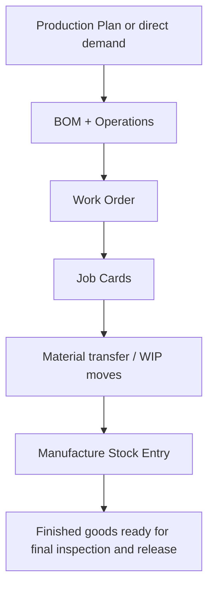

# SOP-MFG-003 Product Realization Planning And Execution

## Status

- ERP fit: `A` current ERPNext
- ISO clauses: `7.1`, `7.5.1`
- Primary ERP records: `BOM`, `Operation`, `Production Plan`, `Work Order`, `Job Card`, `Stock Entry`

## Purpose

Define how manufacturing work is planned, issued, executed, and recorded in ERPNext so production history remains auditable.

## Preconditions

- Approved `BOM` and `Operation` records exist for the product.
- Material, routing, and warehouse setup are complete.
- Inspection-required items and BOMs are configured before execution starts.

## Flow

## Procedure

1. Review demand and create the `Production Plan` or direct manufacturing instruction.
2. Confirm that the correct `BOM` revision and routing are selected.
3. Create the `Work Order` with the required quantity, dates, and warehouses.
4. Issue and transfer material using the appropriate stock transactions.
5. Execute operations through `Job Card` records so operator, time, and output history are retained.
6. Complete the manufacturing `Stock Entry` for finished output and WIP consumption.
7. Pass finished goods to the final inspection and release SOP before unrestricted use or shipment.

## Records To Retain

- `BOM`
- `Operation`
- `Production Plan`
- `Work Order`
- `Job Card`
- manufacturing `Stock Entry`

## ERP Control Notes

- ERPNext provides a strong execution chain from plan through production history.
- In-process hold points requiring mandatory inspection are handled in enhancement SOP `SOP-MFG-001`.
