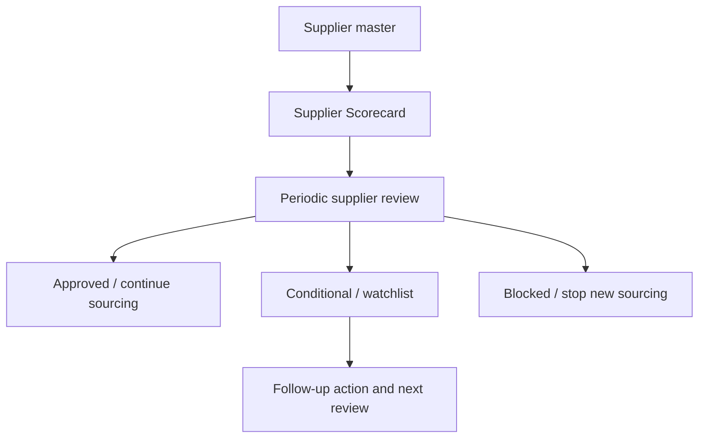

# SOP-PUR-003 Supplier Evaluation And Periodic Re-Evaluation

## Status

- ERP fit: `A` current ERPNext
- ISO clauses: `7.4.1`, `8.4`
- Primary ERP records: `Supplier`, `Supplier Scorecard`, `Supplier Quotation`, `Purchase Order`, `Quality Review`

## Purpose

Define how Purchasing and Quality evaluate suppliers, review supplier performance, and retain supplier-monitoring evidence in ERPNext.

## Preconditions

- Each controlled supplier has an active `Supplier` record.
- `Supplier Scorecard` criteria and review frequency are defined.
- The organization has documented score thresholds for approved, conditional, and blocked use.

## Flow

## Procedure

1. Create or update the `Supplier` master with correct contact, address, tax, and commercial details.
2. Maintain the `Supplier Scorecard` criteria relevant to delivery, quality, responsiveness, and other approved measures.
3. Review scorecard results at the defined interval.
4. Record the review outcome in ERP using the scorecard, comments, attachments, or a linked quality review record.
5. If performance is acceptable, continue approved sourcing.
6. If performance falls below threshold, place the supplier on conditional use or block new orders according to policy.
7. When follow-up is required, record actions and target review dates.

## Records To Retain

- `Supplier`
- `Supplier Scorecard`
- review notes and attachments
- related sourcing decisions
- follow-up actions for poor-performing suppliers

## ERP Control Notes

- ERPNext can hold a usable supplier-evaluation loop through `Supplier Scorecard`.
- Per-item approved-supplier enforcement is not covered here and belongs to enhancement SOP `SOP-PUR-002`.
