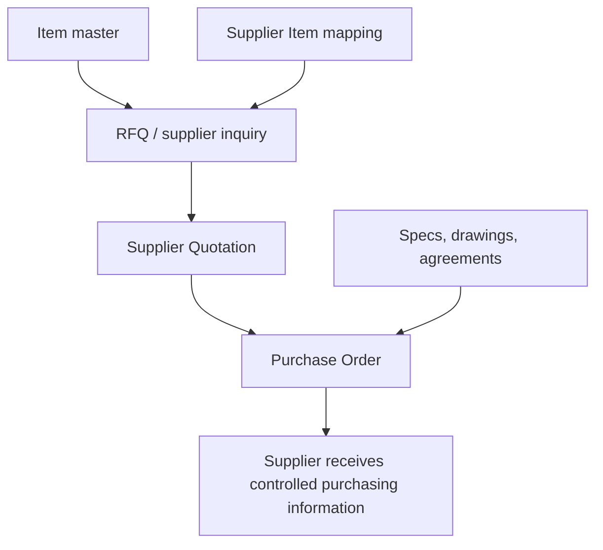

# SOP-PUR-004 Purchasing Information And Supplier Communication

## Status

- ERP fit: `A` current ERPNext
- ISO clauses: `7.4.2`
- Primary ERP records: `Item`, `Supplier`, `Supplier Item`, `Request for Quotation`, `Supplier Quotation`, `Purchase Order`, attachments

## Purpose

Define how controlled purchasing requirements are communicated to suppliers through ERPNext so the order record is complete and auditable.

## Preconditions

- `Item` master data is accurate for ordered part, description, unit, and inspection expectations.
- `Supplier Item` mappings are maintained where supplier-specific item references are needed.
- Controlled drawings, specifications, and agreements are attached or referenced from ERP records.

## Flow

## Procedure

1. Verify the ordered item master, quantity, UOM, and description before creating an RFQ or PO.
2. Maintain supplier-specific item references when the supplier uses a different part code.
3. Attach or reference the applicable specification, drawing, quality clause, or agreement on the sourcing record.
4. Create the `Request for Quotation` or `Purchase Order` with the correct supplier, item, quantity, delivery date, and commercial terms.
5. Confirm that the transaction record clearly communicates the ordered product and any controlled document references.
6. If purchasing requirements change, revise the ERP transaction and communicate the updated record to the supplier.

## Records To Retain

- `Item`
- `Supplier Item`
- `Request for Quotation`
- `Supplier Quotation`
- `Purchase Order`
- linked specifications and attachments

## ERP Control Notes

- ERPNext can store and communicate purchasing information cleanly.
- Formal controlled-document revision approval belongs to enhancement SOP `SOP-QMS-001`.
