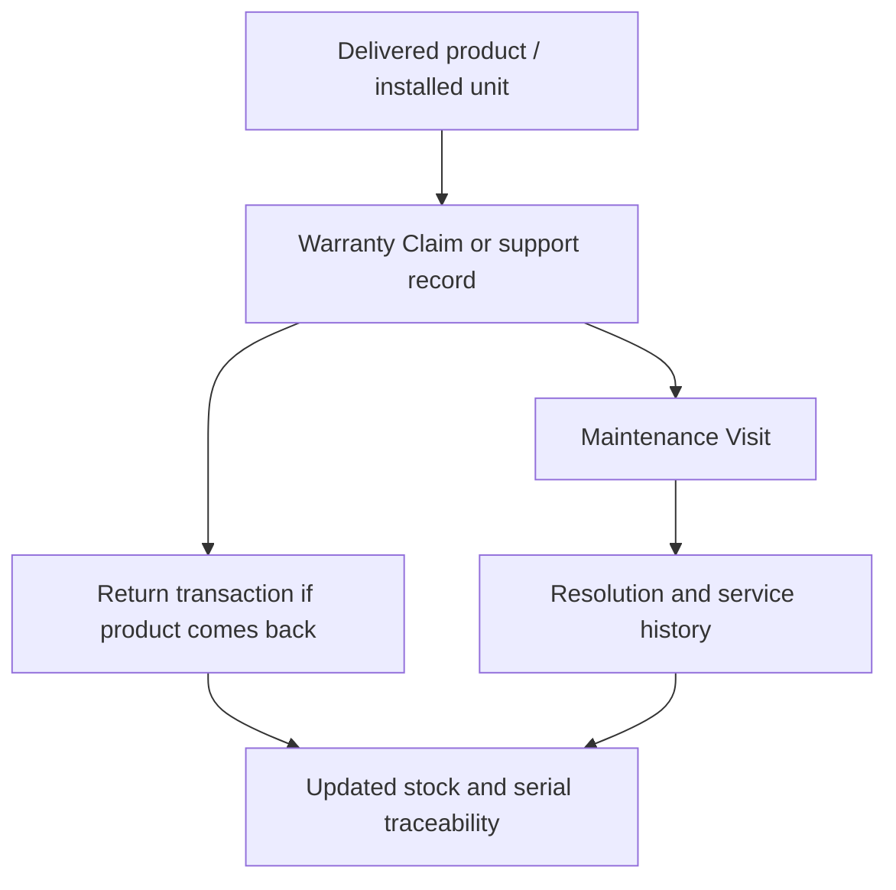

# SOP-SRV-001 Returns, Service History, And Post-Delivery Records

## Status

- ERP fit: `A` current ERPNext
- ISO clauses: `7.5.4`, `7.5.8`, `8.3.3`
- Primary ERP records: `Sales Return`, `Purchase Return`, `Warranty Claim`, `Maintenance Visit`, `Installation Note`, `Serial No`

## Purpose

Define how post-delivery issues, returns, and service activity are recorded in ERPNext so product history remains traceable after shipment.

## Preconditions

- Serialized products are shipped with correct `Serial No` records.
- Service and support teams use `Warranty Claim` and `Maintenance Visit` consistently.
- Return transactions reference the original delivery or receipt where possible.

## Flow

## Procedure

1. Record the customer issue, return need, or service request in ERP.
2. Link the affected customer, item, and serial or batch details.
3. Create the relevant return transaction when physical product is returned.
4. Create and complete the `Maintenance Visit` or other service record when field work is performed.
5. Record the work performed, dates, and responsible personnel.
6. Keep the serial-linked history complete so later complaint, trend, or recall review can reconstruct the product lifecycle.

## Records To Retain

- `Warranty Claim`
- `Maintenance Visit`
- `Installation Note`
- return transactions
- linked `Serial No`
- service resolution details

## ERP Control Notes

- ERPNext gives a workable post-delivery audit trail when serial and service records are used consistently.
- Formal complaint triage and CAPA escalation are handled in enhancement SOP `SOP-QMS-004`.
