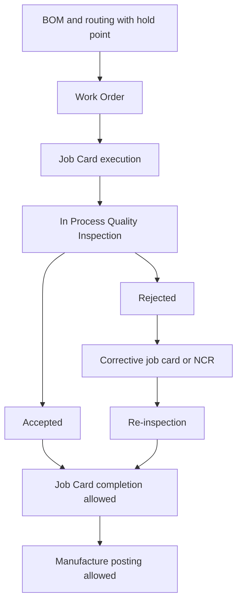

# SOP-MFG-001 In-Process Inspection And Job Card Hold Points

## Status

- ERP fit: `B` enhancement-assumed
- ISO clauses: `7.5.1`, `8.2.6`
- Primary ERP records: `BOM`, `Operation`, `Work Order`, `Job Card`, `Quality Inspection`, `Stock Entry`, optional `Batch`, optional `Serial No`

## Purpose

Define how operators, supervisors, and in-process QC users execute mandatory manufacturing hold points inside ERP so that production cannot proceed past a controlled operation without accepted in-process inspection evidence.

## Repo-Truth Starting Point

- ERPNext already has `BOM`-level manufacturing inspection intent through `inspection_required` and `quality_inspection_template`.
- `Work Order.make_stock_entry()` already copies the BOM inspection-required state into manufacturing `Stock Entry`.
- `Job Card` already carries `quality_inspection_template` and `quality_inspection`, and the client form already gives users a direct route to create an in-process `Quality Inspection` for that `Job Card`.
- `Quality Inspection` already supports `inspection_type = In Process` and `reference_type = Job Card`.
- `Stock Entry.check_if_operations_completed()` already blocks manufacture when the required operation quantities are not complete and sends the user back to the relevant `Job Card`.
- ERPNext already supports corrective job card creation from `Job Card`.
- The missing control is narrow: there is no server-side hard stop that requires an accepted in-process `Quality Inspection` before a defined hold-point operation can be completed or before finished output can be posted.

## Assumed ERP Enhancements

- Add explicit hold-point configuration at routing level, preferably on `BOM Operation`, and copy the effective flag to `Work Order Operation` and `Job Card`.
- Add a server-side validation that blocks completion of a hold-point `Job Card` unless an accepted in-process `Quality Inspection` linked to that `Job Card` exists.
- Add a second validation on manufacturing `Stock Entry` so finished output cannot be posted while required hold points remain incomplete or rejected.
- Add guided creation of corrective job card and NCR when inspection fails.
- Optionally call the shared qualification gate from `SOP-QMS-005` so only current operators or inspectors can clear the hold point where policy requires that control.

## Roles

- Planner or Process Engineer: defines which routing steps are hold points.
- Operator: performs work and records job-card execution.
- In-Process QC or Qualified Operator: performs and records the in-process inspection.
- Production Supervisor: resolves blockers, rework, and re-inspection routing.
- QA: reviews failures, NCR linkage, and rerelease where required.

## Flow

## Procedure

1. Define the controlled manufacturing hold points in the approved routing for the relevant item or process.
2. Create the `Work Order` from the approved BOM so the effective operation sequence and inspection intent are carried forward.
3. When the operator works on a hold-point operation, use the linked `Job Card` as the execution record.
4. From the `Job Card`, create the in-process `Quality Inspection` using the linked job-card context and the assigned inspection template.
5. Record the required readings, sample size, and serial or batch references where applicable.
6. If the in-process result is accepted, complete the `Job Card` and continue to the next operation.
7. If the result is rejected, stop progression immediately, segregate affected work as required, and create the corrective job card or NCR path defined for that process.
8. Do not post finished-goods manufacture until all required hold points for the quantity being completed are in an allowed state.
9. After correction or rework, perform a new in-process inspection and only then allow rerelease to the next step.
10. Retain the full trace of operation, inspection, failure, rework, re-inspection, and release decision inside the connected ERP records.

## User Guidance Inside ERP

- `Work Order` and `Job Card` should show whether the current operation is a hold point.
- `Job Card` should expose direct guided actions for:
  - `Create In Process Quality Inspection`
  - `Open Existing Inspection`
  - `Create Corrective Job Card`
  - `Open NCR`
- Operators should see a clear blocking message when they try to complete a hold-point `Job Card` without accepted inspection evidence.
- Supervisors should see blocked hold points and rejected inspections directly from manufacturing views.

## Records To Retain

- `BOM`
- `Work Order`
- `Job Card`
- in-process `Quality Inspection`
- manufacturing `Stock Entry`
- corrective job card where used
- linked NCR where required
- re-inspection evidence

## ERP Control Notes

- This SOP assumes a small server-side hardening of existing ERP manufacturing behavior, not a new manufacturing process.
- ERPNext already has the main manufacturing records and the in-process inspection document type; the required change is to make configured hold points non-optional.
- qms should supply the governed instruction and exception route, but ERPNext should remain the source of truth for manufacturing execution and in-process release evidence.
