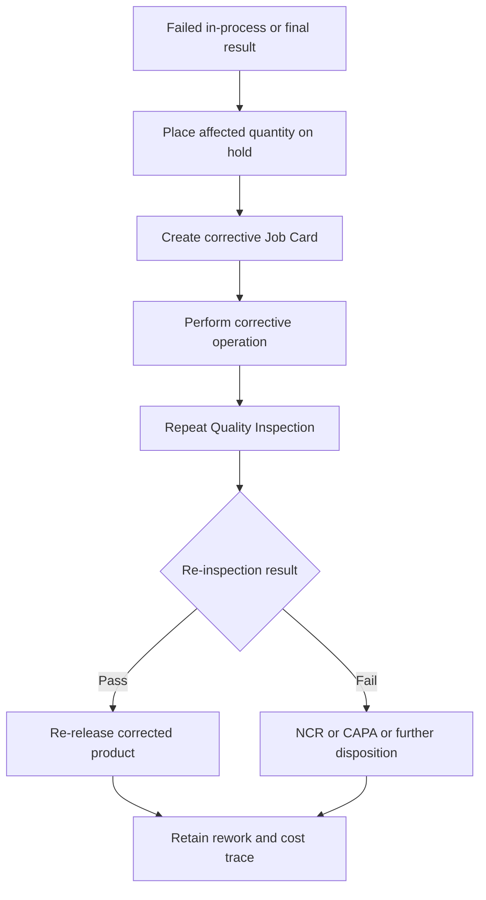

# SOP-MFG-004 Rework, Re-Inspection, And Re-Release

## Status

- ERP fit: `B` enhancement-assumed
- ISO clauses: `7.5.1`, `8.2.6`, `8.3.4`
- Primary records: `Job Card`, `Work Order`, `Quality Inspection`, `Stock Entry`, corrective `Job Card`, `Cost of Poor Quality Report`, assumed defect-source link, assumed mandatory re-inspection result, assumed NCR or CAPA link

## Purpose

Define how manufacturing rework is initiated, performed, re-inspected, costed, and re-released in ERP so corrected product does not re-enter the normal flow without documented verification.

## Assumed ERP Enhancements

- Reason code and source-defect link for each corrective or rework `Job Card`
- Mandatory re-inspection result before corrected product can be treated as released
- Explicit rework disposition path from failed in-process or final inspection into corrective work
- Hold on affected lot, batch, serial, or work-order quantity until rework and re-inspection are complete
- NCR or CAPA escalation where the defect pattern is recurring, critical, or systemic

## Flow

## Procedure

1. When in-process or final inspection identifies a defect that can be corrected, place the affected quantity, batch, or serial-controlled units under hold instead of treating them as released product.
2. Record the source defect, affected operation, and quantity on the manufacturing record chain.
3. Create a corrective `Job Card` from the original `Job Card` or manufacturing context using the corrective operation intended to address the defect.
4. Ensure the corrective `Job Card` identifies which original operation or step it corrects and who is performing the work.
5. Perform the rework in the corrective `Job Card`, recording time, workstation, affected batch or serial, and any additional remarks needed to explain the correction.
6. After rework is complete, create the required repeat `Quality Inspection` against the corrected manufacturing record.
7. Do not move reworked product back to released stock or shipment eligibility until the repeat inspection passes.
8. If re-inspection passes, record the corrected status and continue the normal manufacturing or release flow.
9. If re-inspection fails again, or if the defect indicates a recurring or systemic problem, escalate into NCR, CAPA, retraining, or change review as required.
10. Use the cost and history of corrective `Job Card` work as part of poor-quality review and management-review evidence.

## Records To Retain

- source `Job Card`
- corrective `Job Card`
- `Work Order`
- original and repeat `Quality Inspection`
- related `Stock Entry`
- affected batch or serial trace
- NCR, CAPA, or change records where escalation occurs
- `Cost of Poor Quality Report` output or equivalent review evidence

## ERP Control Notes

- ERPNext already supports corrective `Job Card` creation from a submitted `Job Card`.
- ERPNext already stores corrective operation cost back to the `Work Order` and provides a `Cost of Poor Quality Report` for submitted corrective job cards.
- ERPNext already allows in-process `Quality Inspection` links on `Job Card`, but the rework-to-reinspection-to-rerelease gate is not server-enforced today.
