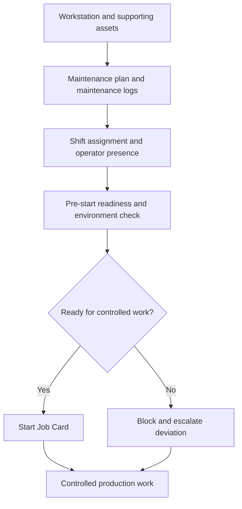

# SOP-MFG-005 Workstation Readiness And Environment Control

## Status

- ERP fit: `B` enhancement-assumed
- ISO clauses: `6.3`, `6.4.1`, `7.5.2`
- Primary records: `Workstation`, `Job Card`, `Work Order`, `Asset`, `Asset Maintenance`, `Asset Maintenance Log`, `Shift Assignment`, `Employee Checkin`, assumed workstation-readiness checklist, assumed environment-condition log, assumed contamination or cleanliness deviation

## Purpose

Define how workstation readiness, supporting infrastructure status, assigned personnel presence, and environment-sensitive pre-start checks are recorded in ERP before controlled manufacturing work begins.

## Assumed ERP Enhancements

- Identification of quality-critical workstations, areas, and supporting assets
- A workstation or shift pre-start checklist covering line clearance, cleaning, environment, and readiness items where required
- A way to record special-environment conditions or temporary special-condition supervision before controlled work starts
- A visible ready, blocked, or under-cleaning state for production-critical workstations or areas
- An exception path for readiness failures, contamination concerns, or environmental deviations

## Flow

## Procedure

1. Define the workstation, plant-floor location, working hours, and operational status in `Workstation`.
2. Register supporting production-critical assets and maintain their upkeep through `Asset Maintenance`, `Asset Maintenance Log`, and `Asset Repair` where applicable.
3. Assign the required shift coverage and responsible personnel through HRMS `Shift Assignment`.
4. Where location-based presence matters, retain attendance or presence evidence through `Employee Checkin`.
5. Before starting controlled production on a quality-sensitive workstation or area, complete the required workstation-readiness and environment checks.
6. Confirm the workstation is in the correct operational state, the required supporting assets are not overdue for maintenance, and the assigned operator or supervisor is available for the shift.
7. Where the process requires cleaning, line clearance, or controlled environmental conditions, record those checks before the related `Job Card` starts.
8. Do not start or complete the controlled manufacturing step when the workstation, environment, or supporting asset is in a blocked state.
9. If a readiness or environment check fails, record the reason and escalate through maintenance, complaint, NCR, or other quality deviation handling as required.
10. Retain the readiness evidence together with the manufacturing execution chain so later audit review can show the state of the workstation, personnel, and environment when work was performed.

## Records To Retain

- `Workstation`
- `Job Card`
- `Work Order`
- `Asset`
- `Asset Maintenance`
- `Asset Maintenance Log`
- `Asset Repair`
- `Shift Assignment`
- `Employee Checkin` where used
- workstation-readiness checklist
- environment-condition log
- linked readiness or contamination deviations

## ERP Control Notes

- ERPNext already supports `Workstation` status, working hours, holiday constraints, and workstation-driven job actions.
- ERPNext already updates workstation state from `Job Card` activity and keeps operator and time-log evidence in the job execution chain.
- ERPNext already supports supporting-equipment maintenance planning, maintenance logs, due status, and certificate attachments.
- HRMS already supports `Shift Assignment` and location-aware `Employee Checkin`.
- The missing part is the governed pre-start readiness and environment-control layer, especially where cleanliness, contamination control, or special environmental conditions matter to product quality.
