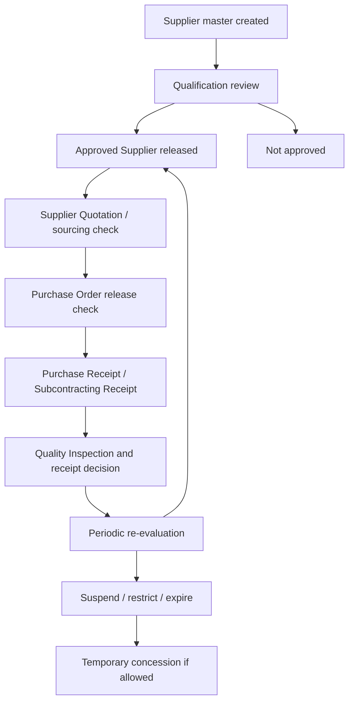

# SOP-PUR-002 Supplier Qualification And Approved Supplier Release

## Status

- ERP fit: `B` enhancement-assumed
- ISO clauses: `7.4.1`, `7.4.2`, `7.4.3`
- Primary ERP records: `Supplier`, `Supplier Scorecard`, `Supplier Quotation`, `Purchase Order`, `Purchase Receipt`, `Subcontracting Receipt`, `Quality Inspection`
- Assumed new controlled record: `Approved Supplier`

## Purpose

Define how purchasing, supplier quality, stores, and incoming QC users work in ERP so that supplier qualification, approved scope, sourcing release, receipt release, and supplier re-evaluation are all recorded inside normal transactions.

## Repo-Truth Starting Point

- ERPNext already has supplier-level scoring and blocking through `Supplier Scorecard`, which writes `prevent_pos`, `prevent_rfqs`, `warn_rfqs`, and `warn_pos` back to `Supplier`.
- `Purchase Order.validate_supplier()` already blocks or warns by supplier standing.
- `Purchase Receipt` and `Subcontracting Receipt` already rely on `StockController.validate_inspection()` for incoming quality-release gating.
- `Item Supplier` is only a reference child table with `supplier` and `supplier_part_no`; it is not an approved-supplier release control.

## Assumed ERP And qms Enhancements

- Add an `Approved Supplier` record with child scope rows by `Item`, `Item Group`, or both.
- Add status fields such as `Draft`, `Under Review`, `Approved`, `Conditional`, `Suspended`, and `Expired`.
- Add `effective_from`, `review_due_date`, `risk_class`, `change_notification_required`, `approved_by`, and linked concession or change references.
- Validate approved scope on `Supplier Quotation`, `Purchase Order`, `Purchase Receipt`, and `Subcontracting Receipt`.
- Link qualification evidence to qms controlled external records instead of duplicating supplier documents in multiple apps.

## Roles

- Buyer: creates supplier quotation and purchase order records.
- Supplier Quality or QA: reviews qualification evidence and releases approved scope.
- Stores or Incoming QC: receives material and records incoming inspection evidence.
- QA approver or MR: approves conditional use or temporary concession when normal approval is not available.

## Flow

## Procedure

1. Create the `Supplier` master in ERP and complete the standard commercial and contact data.
2. Start supplier qualification by collecting the required evidence for the intended supply scope.
3. Record qualification outcome in `Approved Supplier` with:
   - supplier
   - company
   - approved item or item-group scope
   - status
   - effective date
   - review due date
   - risk class
   - approving authority
4. File controlled supplier evidence in qms as linked external-origin records such as certificates, COA forms, supplier agreements, audit reports, or change notifications.
5. Buyer may prepare `Supplier Quotation` or `Purchase Order`, but controlled items must show a current approved-supplier result before release.
6. ERP blocks `Purchase Order` release when the supplier is outside approved scope, suspended, expired, or conditional without an approved concession.
7. ERP rechecks approved-supplier state again at `Purchase Receipt` or `Subcontracting Receipt` so receipt release cannot bypass sourcing controls.
8. Incoming QC records `Quality Inspection` and the existing ERP inspection gate still blocks receipt release when required inspection is missing, draft, or rejected.
9. If inspection rejects incoming product or if supplier performance degrades materially, open the formal supplier-deviation, NCR, or CAPA route and link it back to the supplier review record.
10. Re-evaluate the supplier before the due date using scorecard status, receipt defects, complaint trend, audit evidence, and supplier change notifications.
11. When a supplier is no longer acceptable, set the approved-supplier record to `Suspended`, `Conditional`, or `Expired` so new sourcing and receipt release follow the controlled rule.
12. If business continuity requires temporary use outside normal approval, raise an explicit concession that records the reason, approving authority, item scope, quantity or time limit, and follow-up action.

## User Guidance Inside ERP

- `Supplier Quotation`, `Purchase Order`, and `Purchase Receipt` should show the current approved-supplier status for each controlled item.
- Buyers should get direct buttons to open:
  - `Approved Supplier`
  - linked qms external supplier documents
  - temporary concession or exception request
- Stores and incoming QC should see the same approved-scope status at receipt time so supplier release cannot depend on memory or offline lists.

## Records To Retain

- `Supplier`
- `Supplier Scorecard`
- `Approved Supplier`
- approved-supplier scope rows
- linked qms external supplier documents
- concession or exception approvals
- `Supplier Quotation`
- `Purchase Order`
- `Purchase Receipt` or `Subcontracting Receipt`
- `Quality Inspection`
- supplier deviation, NCR, or CAPA links where applicable

## ERP Control Notes

- `Supplier Scorecard` remains a supplier-level health signal; it does not replace approved-scope release control.
- `Item Supplier` remains a commercial reference only unless explicitly extended.
- For controlled items, approved-supplier validation should be a hard stop at PO release and receipt release.
