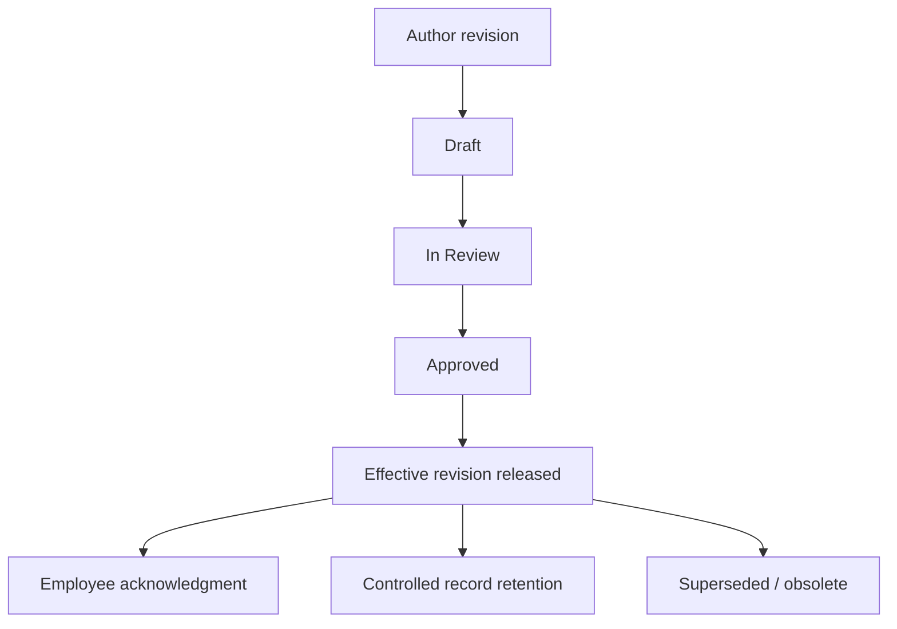

# SOP-QMS-001 Document And Record Control

## Status

- ERP fit: `B` enhancement-assumed
- ISO clauses: `4.2.4`, `4.2.5`
- Primary ERP records: `Quality Procedure`, `File`, assumed `Controlled Document Revision`, assumed training acknowledgment records

## Purpose

Define how controlled SOPs, work instructions, forms, and retained records are issued, revised, made effective, acknowledged, retrieved, and retired in ERPNext.

## Assumed ERP Enhancements

- A `Controlled Document Revision` record linked to `Quality Procedure`
- Workflow states: `Draft`, `In Review`, `Approved`, `Effective`, `Obsolete`
- One active effective revision per procedure
- Required effective date, reviewer, approver, superseded revision, and retention metadata
- Training acknowledgment assignment for affected employees

## Flow

## Procedure

1. Create or update the parent `Quality Procedure` so the document sits in the correct procedure hierarchy.
2. Create a new controlled revision record for the SOP, work instruction, or form.
3. Attach the draft file and complete author, reviewer, approver, effective date, and retention metadata.
4. Route the revision through review and approval before release.
5. Mark the approved revision effective and ensure the prior revision becomes obsolete.
6. Assign acknowledgment or training tasks to all affected employees before the effective date when required.
7. Use only the effective revision in operations, training, and audits.
8. Retain obsolete revisions and quality records according to the configured retention period.

## Records To Retain

- `Quality Procedure`
- controlled revision record
- attached approved document file
- approval history
- employee acknowledgment evidence
- retention and archival history

## ERP Control Notes

- Without enhancement, `Quality Procedure` behaves like a process register and not a revision-controlled document system.
- This SOP assumes light customization, not a separate document-management platform.
