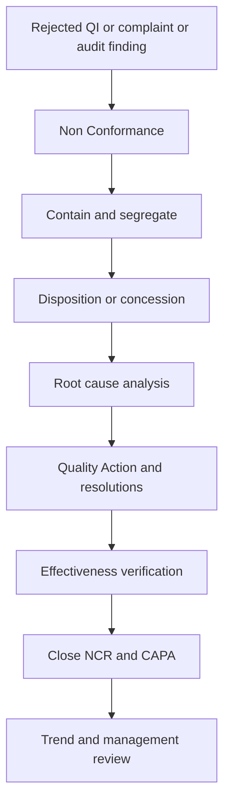

# SOP-QMS-003 Nonconformance, CAPA, And Effectiveness Verification

## Status

- ERP fit: `B` enhancement-assumed
- ISO clauses: `8.3`, `8.5.2`, `8.5.3`
- Primary ERP records: `Non Conformance`, `Quality Action`, `Quality Action Resolution`, `Quality Inspection`, `Issue`, `Warranty Claim`, `Quality Review`, `Quality Feedback`, assumed extended NCR and CAPA fields

## Purpose

Define how nonconforming product, process failures, and systemic quality issues are contained, dispositioned, investigated, corrected, prevented from recurrence, and verified for effectiveness inside ERP.

## Repo-Truth Starting Point

- `Non Conformance` is currently very shallow. It stores subject, procedure, process owner, details, corrective action text, preventive action text, and status, with no controller logic beyond the base document.
- `Quality Action` is partially useful. It supports corrective or preventive type, links to `Quality Review` or `Quality Feedback`, and uses `Quality Action Resolution` child rows with responsible user and completion date.
- `Quality Action.validate()` only derives overall status from whether any child resolution rows remain open.
- `Quality Review` already auto-creates scheduled reviews from `Quality Goal` frequency and can feed `Quality Action`.
- `Quality Feedback` can already link forward into `Quality Action`.
- No current local path creates a closed-loop chain across source event, containment, disposition, root cause, action plan, effectiveness review, and closure approval.
- No current local path links NCR directly to complaint, rejected inspection, or shipment traceability as a first-class governed route.

## Assumed ERP Enhancements

- Extend `Non Conformance` with:
  - source doctype and source name
  - item
  - quantity
  - serial number
  - batch
  - disposition
  - concession
  - containment
  - root cause
  - owner
  - effectiveness due date
  - effectiveness result
  - closure approval
- Extend `Quality Action` so it can link directly to NCR, complaint, audit, or review source and record effectiveness verification.
- Reuse `Quality Action Resolution` rows as the visible corrective and preventive task list.
- Add workflow states that separate containment, investigation, action implementation, effectiveness review, and closure.
- Add optional automation to seed NCR from rejected `Quality Inspection`, complaint severity, or other exception triggers.

## Roles

- Originating User: raises the exception from receipt, production, shipment, service, or audit activity.
- Quality Engineer: opens and governs the NCR path.
- Process Owner: owns containment, disposition, and root-cause follow-up.
- Responsible Users: execute corrective or preventive action tasks.
- Supervisor or QA Approver: approves disposition, concession, and closure where required.
- MR or Management: reviews recurrence and effectiveness trend.

## Flow

## Procedure

1. Create a `Non Conformance` record when a rejected receipt, process failure, shipment issue, complaint, audit finding, or other controlled event requires formal nonconformance handling.
2. Link the NCR to the originating ERP evidence, including transaction, item, quantity, and serial or batch context where available.
3. Record immediate containment and segregation before approving disposition.
4. Record the approved disposition, such as rework, return, concession, scrap, or rejection.
5. If the event indicates a systemic cause or repeated issue, open linked `Quality Action` records for corrective and preventive work.
6. Use `Quality Action Resolution` rows to assign responsible users, target dates, and completion status for each action item.
7. Record root cause and verify that the chosen actions address that cause instead of only the symptom.
8. Perform effectiveness verification after implementation and keep the NCR open until the result is known.
9. Close the NCR and linked CAPA only when containment, disposition, actions, and effectiveness evidence are complete.
10. Feed recurrence, overdue actions, and failed effectiveness results into management review and change-control consideration where required.

## User Guidance Inside ERP

- Exception-triggering forms should expose direct guided actions for:
  - `Create NCR`
  - `Open CAPA`
  - `Open Source Transaction`
  - `Open Complaint`
- The NCR form should show the current stage and the missing mandatory information before it can progress.
- Action owners should work inside `Quality Action` and its resolution rows rather than tracking corrective actions outside the ERP.

## Records To Retain

- `Non Conformance`
- `Quality Action`
- `Quality Action Resolution`
- source `Quality Inspection`, `Issue`, `Warranty Claim`, or other originating record
- containment and disposition evidence
- concession approval where used
- effectiveness review and closure approval
- trend and review outputs

## ERP Control Notes

- Native ERPNext provides useful starting objects for NCR and CAPA, but not a defensible closed loop yet.
- This SOP assumes a controlled extension of the existing ERP quality doctypes, not a separate standalone CAPA application.
- Complaint, rejected inspection, audit, and supplier-deviation routes should converge into the same governed NCR or CAPA backbone rather than fragment into separate logs.
