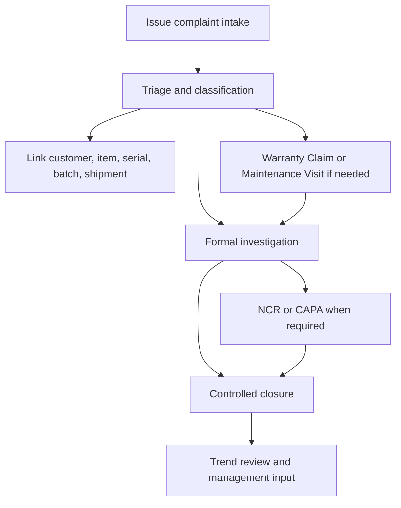

# SOP-QMS-004 Complaint Handling And Escalation

## Status

- ERP fit: `B` enhancement-assumed
- ISO clauses: `8.2.1`, `8.2.2`, `8.3.3`, `8.5.2`
- Primary ERP records: `Issue`, `Warranty Claim`, `Maintenance Visit`, `Task`, `Communication`, `Delivery Note`, `Serial No`, optional `Batch`, assumed complaint classification and escalation fields

## Purpose

Define how customer complaints are received, classified, traced, serviced, escalated, investigated, and closed inside ERP so the normal complaint path already creates the audit trail required by the quality system.

## Repo-Truth Starting Point

- `Issue` already supports complaint-like intake through customer, raised-by email, issue type, communication timeline, SLA fields, close or reopen actions, task creation, and split-thread handling.
- `Warranty Claim` already captures complaint date, customer, serial number, item, warranty or AMC context, and resolution details.
- `Warranty Claim` already gives users a direct button to create a linked `Maintenance Visit`.
- `Maintenance Visit` already records completion status, maintenance type, customer feedback, and on submit updates the linked `Warranty Claim` resolution and status through the mapped purpose row.
- None of these doctypes currently provide a governed complaint classification, severity or reportability assessment, mandatory investigation route, or controlled NCR/CAPA escalation.
- Current close behavior is operational, not quality-governed: `Issue` can be closed directly from the form, and `Warranty Claim` can be set closed with only basic resolution capture.

## Assumed ERP Enhancements

- Use `Issue` as the canonical complaint record because it already supports portal, email, communication timeline, SLA, and task-oriented intake.
- Add complaint-specific fields on `Issue`, including:
  - complaint category
  - severity
  - reportability assessment
  - investigation required
  - product family
  - item
  - serial number
  - batch
  - delivery note or shipment reference
  - warranty claim link
  - maintenance visit link
  - NCR link
  - CAPA link
  - closure code
- Add workflow states such as `Intake`, `Triage`, `Pending Service`, `Investigation`, `Escalated`, and `Closed`.
- Add mandatory closure rules so complaint records cannot be closed without required triage, investigation, and escalation outcomes.
- Auto-resolve owner, supervisor, and department context from HRMS to avoid duplicate assignment entry.

## Roles

- Complaint Intake User or Support: creates the initial complaint record.
- Service Coordinator: initiates warranty or service follow-up where required.
- Quality Engineer or QA: classifies complaint significance and decides escalation.
- Line Manager or Supervisor: owns local investigation and response actions.
- Service Engineer: performs maintenance or field action and records result.
- MR or Quality Authority: reviews serious complaints, concessions, and closure where policy requires it.

## Flow

## Procedure

1. Create the complaint in `Issue` at first receipt from portal, email, phone, or manual entry.
2. Record the complaint description, reporter, customer, and initial affected-product identity.
3. During triage, complete the complaint classification fields and determine whether the case requires:
   - immediate service response
   - formal investigation
   - reportability review
   - NCR or CAPA escalation
4. Link the complaint to the affected item, serial number, batch, and delivery or shipment record where available.
5. If the complaint involves field service, warranty, or repair activity, create or link `Warranty Claim` and `Maintenance Visit` records so service evidence stays in the operational transaction chain.
6. Record service findings, customer feedback, and temporary product disposition directly in the linked ERP records.
7. Escalate to NCR or CAPA when the complaint indicates nonconforming product, recurrence, possible systemic failure, or another condition defined by the quality policy.
8. Keep the complaint open until required investigation, service outcome, escalation decision, and closure rationale are complete.
9. Close the complaint only through the governed workflow so the closure record includes owner, dates, final code, and linked evidence.
10. Include complaint volume, aging, severity, recurrence, and complaint-to-NCR trend in periodic quality review and management review.

## User Guidance Inside ERP

- `Issue` should show direct guided actions for:
  - `Open Product Traceability`
  - `Create Warranty Claim`
  - `Create Maintenance Visit`
  - `Create NCR`
  - `Open CAPA`
- The complaint form should show the current workflow step and the exact missing fields before it can move to closure.
- Service users should be able to work in `Warranty Claim` and `Maintenance Visit` without retyping the complaint narrative.
- Quality users should see severity, recurrence, and escalation status directly on the complaint record.

## Records To Retain

- complaint `Issue`
- linked `Communication` and `Task`
- linked `Warranty Claim`
- linked `Maintenance Visit`
- product traceability evidence such as `Serial No`, `Batch`, and `Delivery Note`
- complaint investigation record and closure code
- linked NCR or CAPA records where applicable
- trend and review outputs

## ERP Control Notes

- `Issue` is the best local intake backbone because it already supports communication-driven support flow.
- `Warranty Claim` and `Maintenance Visit` should remain the operational service sidecars, not separate complaint universes.
- This SOP assumes explicit quality-classification and closure controls are added so complaints become governed quality records rather than ordinary support tickets.
