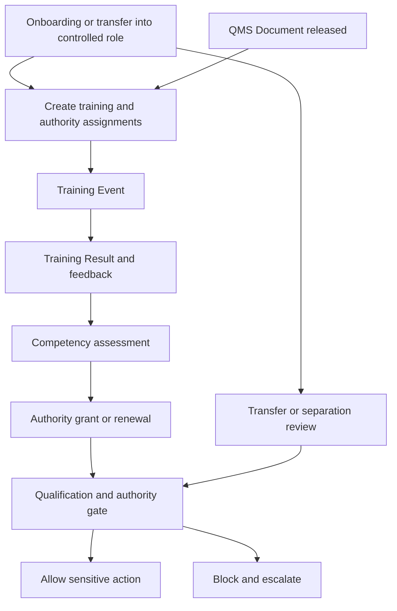

# SOP-QMS-005 Controlled-Role Training, Competence, And Authority

## Status

- ERP fit: `B` enhancement-assumed
- ISO clauses: `5.5.1`, `5.5.2`, `6.2`, `4.2.4`
- Primary records: `Employee`, `Employee Onboarding`, `Employee Transfer`, `Employee Separation`, `Training Event`, `Training Result`, `Training Feedback`, `QMS Document`, assumed `Training Assignment`, assumed `Training Acknowledgment`, assumed `Competency Requirement`, assumed `Competency Assessment`, assumed `Authority Grant`, assumed `Qualification Gate Log`

## Purpose

Define how employees are brought into controlled roles, trained on current effective SOP revisions, assessed for practical competence, granted authority for sensitive quality actions, and blocked when training or authority is no longer current.

## Repo-Truth Starting Point

- `QMS Document` already supports review, approval, release, prior-version archival, and released-document distribution.
- `qms` global hook wiring is still mostly commented out, so document release does not yet fan out revision-specific assignments automatically.
- `Organization Chart` exists in `qms`, but it is descriptive and free-text, not the live employee source of truth.
- HRMS already provides real `Employee Onboarding`, `Employee Transfer`, and `Employee Separation` workflows, including onboarding tasks that must be complete before employee creation.
- HRMS already provides `Training Event`, `Training Result`, and `Training Feedback`, but it does not create revision-specific SOP acknowledgment or governed authority state.
- `Skill Assessment` is only a lightweight child-table structure today and is not enough to prove who was competent for which controlled action, by whom, and until when.

## Assumed ERP, HRMS, And qms Enhancements

- Define controlled roles and sensitive actions by department, designation, process, operation, inspection role, or release role.
- Generate `Training Assignment` records from:
  - controlled-role onboarding
  - transfer into a controlled role
  - released SOP or work-instruction revisions
  - recurring recertification rules
- Add revision-specific `Training Acknowledgment` records linked to `QMS Document`.
- Add `Competency Requirement`, `Competency Assessment`, and `Authority Grant` records for practical qualification and release authority.
- Add a shared qualification and authority gate callable from sensitive ERP and qms actions.
- Log every allowed or blocked gate decision in a `Qualification Gate Log`.

## Roles

- HR: creates onboarding, transfer, and separation records and maintains employee master truth.
- Line Manager or Supervisor: confirms role applicability, practical readiness, and ongoing supervision.
- Trainer or Assessor: delivers training and records practical competence results.
- Quality Admin or QA: maintains applicability, acknowledgment, competence, and authority rules.
- Controlled-role Employee: completes assigned training and acknowledgment before performing sensitive work.
- Release Authority or MR: grants or removes approval and release authority where required.

## Flow

## Procedure

1. Define which departments, designations, processes, operations, inspections, and release actions are controlled roles or sensitive actions.
2. Use HRMS `Employee Onboarding` and `Employee Onboarding Template` to assign the mandatory setup tasks before the employee record is created for a controlled role.
3. When an employee is created, transferred, or reassigned into a controlled role, generate the required training, acknowledgment, and competency assignments without duplicate manual entry.
4. Release the governing SOP or work instruction through `QMS Document`; when the released revision applies to controlled users, create revision-specific acknowledgment and retraining assignments.
5. Deliver scheduled or instructor-led training through HRMS `Training Event` and record completion in `Training Result`; where required, capture follow-up understanding through `Training Feedback`.
6. Record practical qualification through `Competency Assessment` against the exact scope, such as:
   - incoming inspection
   - job-card hold point execution
   - final release
   - shipment release
   - document review, approval, or release
7. Grant `Authority Grant` only after required onboarding tasks, revision acknowledgment, training completion, and practical competence are current.
8. Before the user performs a configured sensitive action, run the qualification and authority gate and record whether the action is allowed or blocked.
9. If the user is not current, block the action, show the missing requirement, and route the case to the supervisor or quality owner instead of letting work proceed informally.
10. When an employee changes role, department, designation, or leaves the company, revoke obsolete authority, re-evaluate training applicability, and reassign open quality work as required.
11. Retain the complete trace of assignment, acknowledgment, training, competency, authority, and gate outcome so audit can prove who was current at the time of action.

## User Guidance Inside ERP

- Sensitive ERP and qms forms should show:
  - current effective SOP revision
  - acknowledgment status
  - competency status
  - authority result for the current user
- Users should get direct guided actions for:
  - `Open Current SOP`
  - `Acknowledge Revision`
  - `Open Training Assignment`
  - `Request Supervisor Review`
- Blocked users should see the exact missing prerequisite instead of a generic permission failure.

## Records To Retain

- `Employee`
- `Employee Onboarding`
- `Employee Transfer`
- `Employee Separation`
- `Training Event`
- `Training Result`
- `Training Feedback`
- `QMS Document`
- `Training Assignment`
- `Training Acknowledgment`
- `Competency Requirement`
- `Competency Assessment`
- `Authority Grant`
- `Qualification Gate Log`

## ERP Control Notes

- HRMS should remain the employee, department, designation, and lifecycle source of truth.
- `qms` should own controlled-document applicability, revision state, and authority rules, not raw people master data.
- `Organization Chart` may still be used as a visual or governed overlay, but it should not be treated as the primary employee truth while it remains free-text.
- This SOP assumes a bridge layer that makes the compliant path the easiest path by generating assignments automatically and gating sensitive actions server-side.
