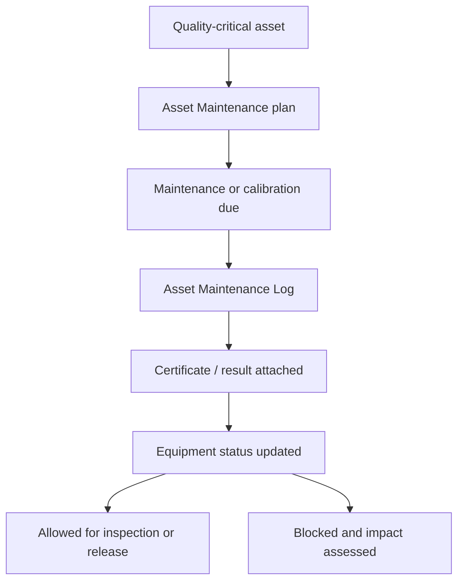

# SOP-QMS-006 Monitoring And Measuring Equipment Control

## Status

- ERP fit: `B` enhancement-assumed
- ISO clauses: `6.3`, `7.6`, `8.2.6`
- Primary records: `Asset`, `Asset Maintenance`, `Asset Maintenance Log`, `Asset Repair`, `Asset Activity`, assumed calibration status, assumed equipment release or block flag, assumed out-of-tolerance assessment

## Purpose

Define how inspection, test, measuring, and release equipment is identified, maintained, calibrated or verified, blocked when overdue or out of tolerance, and linked to product-quality decisions in ERP.

## Assumed ERP Enhancements

- Identification of quality-critical assets and inspection or release equipment
- Calibration or verification status, next due date, and current release flag on the equipment record
- Mandatory certificate attachment where the maintenance task or calibration requires evidence
- ERP restrictions so blocked or overdue equipment cannot be used for controlled inspection or release
- An out-of-tolerance assessment path linked to NCR, CAPA, or change review where product impact is possible

## Flow

## Procedure

1. Register every measuring, test, or release-critical device as an `Asset` and identify whether it is quality-critical.
2. Create an `Asset Maintenance` plan with the required maintenance, calibration, or verification tasks, responsible team members, and due dates.
3. Assign each task to a responsible user and maintain evidence requirements, including certificates where applicable.
4. Complete the `Asset Maintenance Log` with the performed action, completion date, and certificate attachment when the task requires documented evidence.
5. Treat overdue or incomplete maintenance or calibration as a blocked condition for quality-critical equipment.
6. Do not use blocked or overdue equipment for incoming inspection, in-process checks, final release, or other controlled quality decisions.
7. When equipment is found out of tolerance or otherwise invalid, assess product impact and escalate into NCR, CAPA, or change review as required.
8. After acceptable maintenance or calibration is completed, restore the equipment to released status and retain the evidence chain.

## Records To Retain

- `Asset`
- `Asset Maintenance`
- `Asset Maintenance Log`
- `Asset Repair`
- attached calibration or maintenance certificates
- equipment release or block history
- linked impact assessments where product quality may have been affected

## ERP Control Notes

- ERPNext already supports maintenance plans, assigned tasks, due dates, maintenance logs, and certificate attachments.
- The missing part is the quality-critical equipment classification and the release-block logic that ties equipment state to controlled inspection or release activity.
