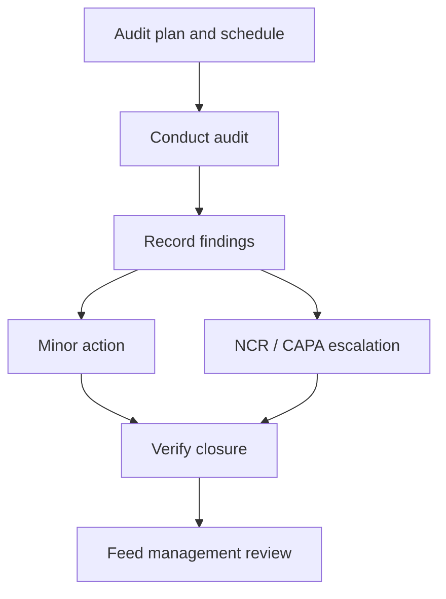

# SOP-QMS-007 Internal Quality Audit And Finding Escalation

## Status

- ERP fit: `B` enhancement-assumed
- ISO clauses: `8.2.4`, `8.4`, `8.5.2`
- Primary records: assumed `Internal Audit`, assumed `Audit Checklist`, assumed `Audit Finding`, `QMS Document`, `Non Conformance`, `Quality Action`, linked ERP transactions and HRMS qualification records

## Purpose

Define how internal audits are planned, executed, evidenced, escalated, and closed using ERP/qms/HRMS data so findings lead to traceable corrective action and management-review input.

## Assumed ERP Enhancements

- A small audit module with `Internal Audit`, `Audit Checklist`, and `Audit Finding` records
- Scope, auditor, auditee, clause, process, severity, due date, and evidence fields on audit records
- Quick links from findings into `Non Conformance`, `Quality Action`, change control, or retraining
- Closure blocked until finding evidence and linked action closure are complete

## Flow

## Procedure

1. Define the audit plan, scope, schedule, auditor, and auditee for the process, function, or clause being audited.
2. Before the audit, gather the current released SOPs, prior findings, training status, and operational records relevant to the audit scope.
3. Execute the audit against the controlled procedure, actual ERP workflow, and available records.
4. Record each finding with the affected clause, process, severity, objective evidence, and responsible owner.
5. Route significant findings into `Non Conformance`, `Quality Action`, retraining, or change control when the finding indicates systemic risk or repeated failure.
6. Track all findings to closure with due dates, responsible owners, and verification evidence.
7. Do not close the audit until all mandatory findings are dispositioned and linked actions are complete or formally accepted.
8. Feed the audit results, overdue actions, and recurrence trends into management review.

## Records To Retain

- audit plan and schedule
- audit checklist and executed evidence
- audit findings
- linked `Non Conformance` and `Quality Action` records
- retraining or change evidence where applicable
- audit closure verification and management-review references

## ERP Control Notes

- No first-class internal-audit workflow was found in the inspected ERPNext or `qms` surfaces.
- This SOP therefore assumes a small dedicated audit layer rather than pretending the current apps already provide a defensible audit program.
