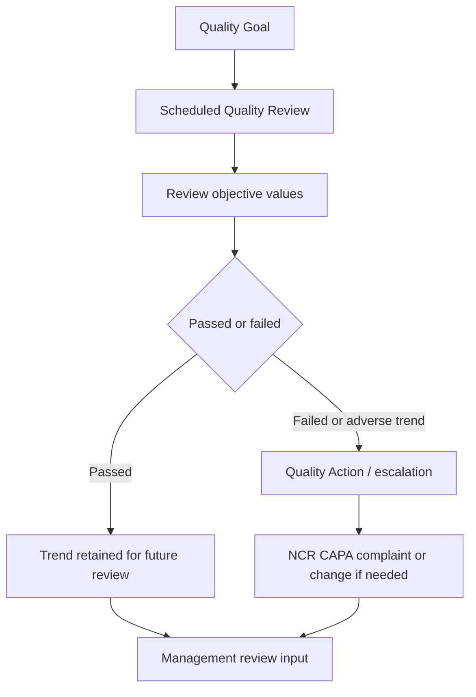

# SOP-QMS-008 Process Monitoring And Trend Escalation

## Status

- ERP fit: `B` enhancement-assumed
- ISO clauses: `5.4.1`, `8.1`, `8.2.5`, `8.4`, `8.5.1`
- Primary records: `Quality Goal`, `Quality Review`, `Quality Action`, `Quality Feedback`, ERP operational reports, assumed KPI source mapping, assumed threshold and escalation rules

## Purpose

Define how process performance, recurring quality signals, and adverse trends are reviewed in ERP so normal business activity creates the data and structured quality follow-up starts when thresholds are missed.

## Assumed ERP Enhancements

- Mapping between each monitored objective and its ERP data source, report, or transaction set
- Owner, threshold, and escalation rule for each monitored objective
- Automatic or guided prefill of KPI values into `Quality Review`
- Required escalation from failed or adverse-trend reviews into `Quality Action`, NCR, CAPA, complaint, or management review input
- Dashboard views for overdue reviews, failed objectives, and repeated trend deterioration

## Flow

## Procedure

1. Define each controlled process or monitored quality topic as a `Quality Goal` with the correct monitoring frequency and linked procedure.
2. Set objective lines that describe the metric, target, and unit to be reviewed for that process.
3. On the due date, open the generated `Quality Review` and review the actual process evidence using the linked ERP reports or operational records.
4. Record the result for each objective, mark it passed or failed, and explain any missed target, deterioration, or abnormal trend.
5. Where user or customer feedback is part of the monitored input, record the relevant `Quality Feedback` and link it into the review or follow-up action.
6. If the process remains within target, complete the review so the trend history is retained in ERP.
7. If an objective fails, or if repeated deterioration shows a meaningful adverse trend, create or link the required `Quality Action`.
8. Escalate the failed review further into NCR, CAPA, complaint, supplier action, retraining, or change review when the issue affects product quality, compliance, or process capability.
9. Include open failed reviews, repeated trends, and unresolved actions in the next management-review pack.
10. Do not maintain a separate offline KPI tracker when the same evidence can be derived from ERP transactions and reports.

## Records To Retain

- `Quality Goal`
- `Quality Review`
- `Quality Action`
- `Quality Feedback`
- linked ERP source reports and transaction evidence
- linked NCR, CAPA, complaint, supplier, training, or change records where escalation occurred

## ERP Control Notes

- ERPNext already supports `Quality Goal`, scheduled `Quality Review` creation, and review-status logic.
- ERPNext already allows follow-up `Quality Action` records, but the built-in structure is lightweight and does not automatically evaluate ERP trends or create the right downstream quality objects.
- The missing part is the governed KPI source mapping, threshold logic, and escalation backbone that turns failed trends into first-class quality work.
