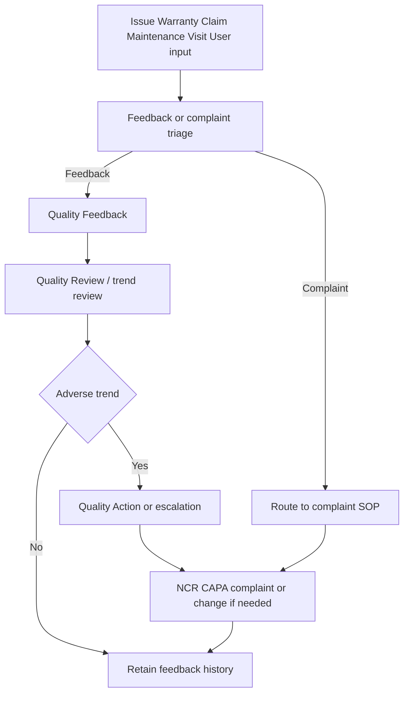

# SOP-QMS-009 Feedback Capture And Trend Triage

## Status

- ERP fit: `B` enhancement-assumed
- ISO clauses: `5.2`, `8.2.1`, `8.4`, `8.5.1`
- Primary records: `Issue`, `Warranty Claim`, `Maintenance Visit`, `Quality Feedback Template`, `Quality Feedback`, `Quality Goal`, `Quality Review`, `Quality Action`, assumed complaint-triage decision, assumed escalation rule set

## Purpose

Define how user, customer, and service feedback is captured in ERP, distinguished from formal complaints, and trended so meaningful adverse signals are escalated before they become unmanaged quality failures.

## Assumed ERP Enhancements

- Triage decision between routine feedback and formal complaint at intake
- Required source-document and product linkage for feedback that relates to an item, batch, serial, service event, or customer case
- Feedback category, severity, and trend-review ownership
- Escalation rules from feedback trends into complaint, NCR, CAPA, supplier action, retraining, or management review
- Dashboards for recurring feedback themes, unresolved quality feedback, and service-derived trends

## Flow

## Procedure

1. Record customer, user, or service-originated quality signals in the ERP record where the work already occurs, such as `Issue`, `Warranty Claim`, or `Maintenance Visit`.
2. At intake, decide whether the signal is a formal complaint or routine feedback requiring trend monitoring.
3. Route formal complaints into the complaint-handling SOP instead of leaving them only as service or support records.
4. For routine or low-severity signals, create `Quality Feedback` using the relevant `Quality Feedback Template` so comparable parameters can be trended over time.
5. Link the feedback to the relevant product, customer, process, or service context where available.
6. Include service feedback, repeated support observations, and user-reported quality concerns in the periodic `Quality Review` process.
7. When feedback shows repeated negative themes, worsening ratings, or a meaningful adverse trend, create the required `Quality Action`.
8. Escalate the action further into complaint, NCR, CAPA, supplier action, retraining, or change review when the signal indicates product-quality risk or systemic process weakness.
9. Keep the original source record, the feedback record, the review, and the action chain linked so later management review can show how the signal was handled.
10. Do not keep a separate offline feedback tracker when the same signal can be captured and reviewed inside ERP.

## Records To Retain

- `Issue`
- `Warranty Claim`
- `Maintenance Visit`
- `Quality Feedback Template`
- `Quality Feedback`
- `Quality Goal`
- `Quality Review`
- `Quality Action`
- linked complaint, NCR, CAPA, supplier, training, or change records where escalation occurs

## ERP Control Notes

- ERPNext already supports customer-facing `Issue` records, `Warranty Claim`, `Maintenance Visit`, and standalone `Quality Feedback`.
- `Quality Feedback` can be standardized through templates, and `Quality Review` plus `Quality Action` already provide a basic trend-to-action path.
- The missing part is governed triage between complaint and feedback, structured source linkage, and consistent automatic escalation when recurring patterns emerge.
