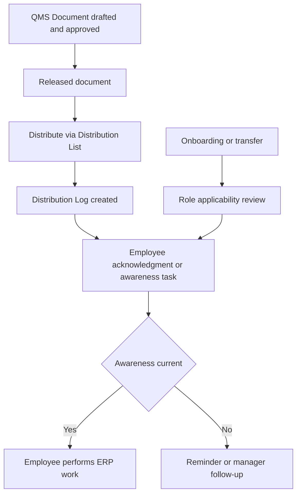

# SOP-QMS-010 Quality Policy, Internal Communication, And Controlled Awareness

## Status

- ERP fit: `B` enhancement-assumed
- ISO clauses: `5.3`, `5.5.3`, `6.2`, `4.2.4`
- Primary records: `QMS Document`, `Distribution List`, `Distribution Log`, `Organization Chart`, `Employee Onboarding`, `Employee Transfer`, `Training Event`, `Training Result`, assumed revision-specific acknowledgment, assumed applicability and communication matrix

## Purpose

Define how quality-policy and controlled internal communications are issued, distributed, acknowledged, and refreshed through qms and HRMS so employees receive the current controlled information and evidence of awareness is retained.

## Assumed ERP Enhancements

- Role- or department-based applicability rules linking controlled documents to HRMS and `Organization Chart`
- Revision-specific read-and-understand acknowledgment for distributed policy, SOP, and critical communication documents
- Automatic awareness or retraining assignment on onboarding, transfer, and document revision
- Dashboards for overdue acknowledgment, distribution completeness, and controlled communication status
- Contextual surfacing of current effective policy or critical communication inside relevant ERP forms

## Flow

## Procedure

1. Maintain quality policy, critical internal communications, and controlled awareness documents as released `QMS Document` records rather than unmanaged files.
2. Ensure the `QMS Document` is approved, released, effective-dated, and has the correct controlled file attached before it is distributed.
3. Build the target audience using `Distribution List`, HRMS department or role context, and the governed organizational structure for who must receive the communication.
4. Distribute released documents only through the controlled qms distribution path so a `Distribution Log` is created with the recipient snapshot and attached released document.
5. Use `Organization Chart`, HRMS onboarding, and HRMS transfer events to review whether a user has newly entered or moved into a role that requires awareness of the document.
6. Require affected users to complete read-and-understand acknowledgment or the defined awareness activity for policy and critical communications.
7. When a document revision changes employee obligations, retrain or re-acknowledge the affected users instead of relying on general announcement alone.
8. Managers and process owners shall review overdue awareness or unacknowledged critical communications and follow up with the affected employees.
9. Do not communicate controlled policy or procedural changes only through informal chat, email, or verbal instruction when the change affects regulated work.
10. Retain the released document, the distribution evidence, the recipient snapshot, and the resulting awareness or training completion in one governed record chain.

## Records To Retain

- `QMS Document`
- `Distribution List`
- `Distribution Log`
- `Organization Chart`
- `Employee Onboarding`
- `Employee Transfer`
- `Training Event`
- `Training Result`
- revision-specific acknowledgment or awareness records

## ERP Control Notes

- The local `qms` app already enforces that only released `QMS Document` records with attached files can be distributed through `distribute_document()`.
- `Distribution List` already validates duplicate members, and `Distribution Log` already snapshots recipients, distribution date and time, distributor, and attachment.
- The missing part is governed applicability resolution, acknowledgment enforcement, and live linkage between HRMS role changes and qms awareness obligations.
