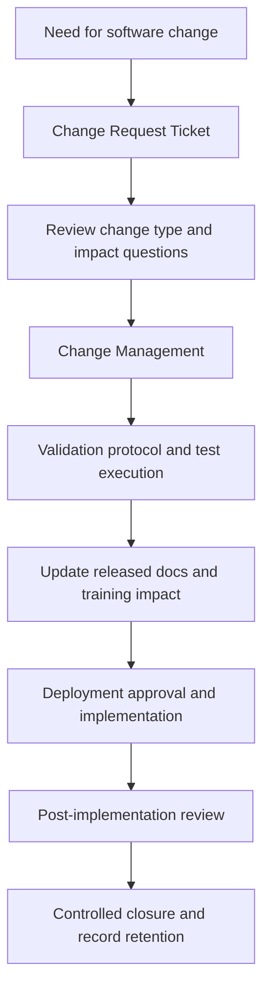

# SOP-QMS-011 Computer Software Validation And ERP Change Control

## Status

- ERP fit: `B` enhancement-assumed
- ISO clauses: `4.1`, `4.2.4`, `4.2.5`
- Primary records: `QMS Document`, `Change Request Ticket`, `Change Management`, `Questionnaire`, `Distribution Log`, `External Origin Document`, `Obsolete Document`, assumed software application register, assumed validation protocol and result records, assumed deployment approval and post-implementation review

## Purpose

Define how changes to ERPNext, `qms`, HRMS, integrations, and other QMS-relevant software are requested, impact-assessed, validated, released, and retained as evidence so the organization can show software used in the quality system remains controlled.

## Assumed ERP Enhancements

- A software-application inventory identifying which systems, modules, integrations, or scripts are quality-relevant
- Software-specific change-type and questionnaire content covering functional impact, data impact, security, training, rollback, and regulatory effect
- Validation protocol, test execution, defect, approval, and post-implementation review records linked to the software change
- A deployment-approval gate so implementation cannot be closed on planning data alone
- Training or acknowledgment generation where the software change changes work instructions, forms, or daily user behavior

## Flow

## Procedure

1. Raise a `Change Request Ticket` for any ERPNext, `qms`, HRMS, integration, report, print format, script, workflow, or other software change that affects quality-system operation or records.
2. Record the reason for change, impacted controlled documents, and the applicable change types so the impact questions are defined before implementation begins.
3. Move the change into `Change Management` only after the required review inputs are complete.
4. Define the required validation evidence, including what must be tested, what data or records are affected, who approves the result, and whether retraining or document revision is required.
5. Attach the new version files, change evidence, validation protocol, and validation results to the controlled change package.
6. Do not treat software change as implementation-complete until the defined validation evidence exists and the required controlled documents are updated or linked.
7. Release revised affected documents through `QMS Document` so the instruction set and software behavior remain aligned.
8. Distribute the revised documents and trigger the required training or acknowledgment actions before or with go-live where process behavior changes.
9. Record the implementation date, deployment approval, and any post-implementation findings before closing the software change.
10. Retain the full software-change chain so the organization can reconstruct the request, impact review, validation evidence, approved release, superseded document set, and final close decision.

## Records To Retain

- software application register
- `Change Request Ticket`
- `Change Management`
- `Questionnaire`
- linked `QMS Document` revisions
- `Distribution Log`
- `External Origin Document` for vendor or third-party software documents where applicable
- validation protocol and results
- deployment approval and post-implementation review
- obsolete or superseded software-related documents

## ERP Control Notes

- The local `qms` app already supports controlled document review, approval, release, archive, and distribution through `QMS Document`.
- `Change Request Ticket` already enforces one active ticket per impacted document and can expand impact questions through `Questionnaire`.
- `Change Management` already validates released affected documents and creates new `QMS Document` versions when the controlled change advances.
- `External Origin Document` and `Obsolete Document` already provide external-document and superseded-document handling.
- The missing part is software-specific validation rigor: software inventory, test evidence, deployment approval, post-change effectiveness evidence, and active hook-driven automation across the apps.
