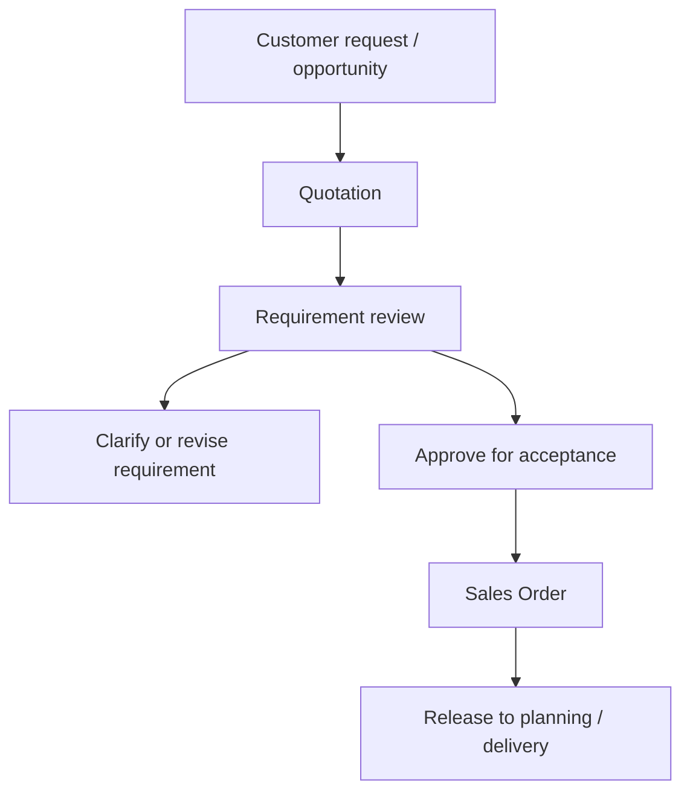

# SOP-SAL-002 Customer Requirement Review And Order Acceptance

## Status

- ERP fit: `B` enhancement-assumed
- ISO clauses: `5.2`, `7.2.1`, `7.2.2`, `7.2.3`
- Primary records: `Opportunity`, `Quotation`, `Sales Order`, `Customer`, `Item`, attachments, assumed requirement-review checklist, assumed concession or change link

## Purpose

Define how customer, product, labeling, delivery, and regulatory requirements are reviewed in ERP before quotation acceptance or sales-order commitment so that only understood and acceptable requirements move into execution.

## Assumed ERP Enhancements

- A controlled requirement-review checklist on `Quotation` or `Sales Order`
- Mandatory review fields for regulated or controlled products, markets, or customer-specific requirements
- Approval routing when an order requires exception review, change review, or regulatory confirmation
- Quick links from the commercial record to complaint, concession, or change-control records where required

## Flow

## Procedure

1. Capture the customer request, product need, and commercial context in `Opportunity` or `Quotation`.
2. Confirm the customer, item or product family, quantity, delivery expectations, and any referenced customer purchase-order details.
3. Attach or reference the applicable controlled specification, labeling requirement, IFU, contract term, or special quality requirement where relevant.
4. Complete the requirement-review checklist for controlled or regulated orders before the quotation is accepted or the sales order is submitted.
5. Verify that the organization can meet the requested product, configuration, delivery, labeling, traceability, and post-delivery obligations.
6. If a requirement is unclear, outside approved scope, or requires deviation, route it into clarification, change review, or formal concession before acceptance.
7. Approve the quotation or sales order only after the requirement review is complete and all required clarifications are resolved.
8. Keep all revisions, attachments, and communication inside the ERP record so the accepted requirement set is auditable.
9. If customer requirements change after acceptance, revise the ERP record and repeat the review before downstream release.

## Records To Retain

- `Opportunity`
- `Quotation`
- `Sales Order`
- linked customer communication and attachments
- requirement-review checklist and approval evidence
- linked concession or change-control evidence where applicable

## ERP Control Notes

- ERPNext already stores party, opportunity, item, PO number, PO date, terms, addresses, and attachments in the commercial flow.
- The missing part is the formal regulated requirement-review gate that stops acceptance until review is complete.
