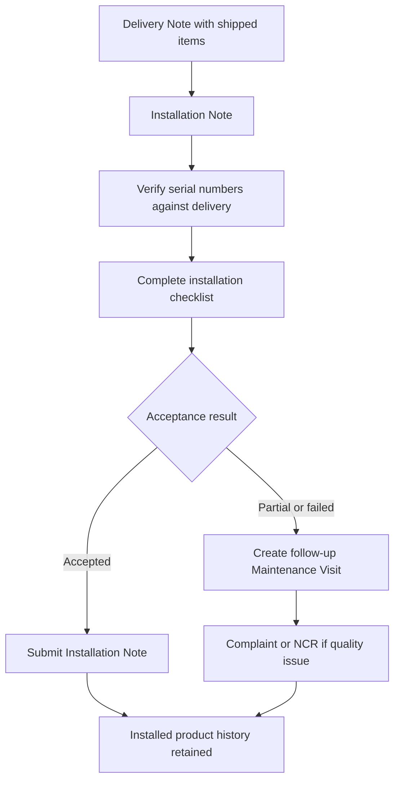

# SOP-SRV-002 Installation Verification And Acceptance

## Status

- ERP fit: `B` enhancement-assumed
- ISO clauses: `7.5.3`, `7.5.8`, `8.3.3`
- Primary records: `Installation Note`, `Delivery Note`, `Serial No`, `Maintenance Visit`, `Warranty Claim`, assumed installation acceptance checklist, assumed site-acceptance result, assumed failure-escalation link

## Purpose

Define how installation activity, site acceptance, and post-install punch-list or failure handling are recorded in ERP so the installation record is auditable and traceable to the delivered serialized product.

## Assumed ERP Enhancements

- Installation acceptance checklist and acceptance-result fields on `Installation Note`
- Mandatory customer or customer-representative sign-off, attachment, or equivalent acknowledgment
- Clear accepted, partially accepted, and failed installation result states
- Automatic follow-up path into `Maintenance Visit`, complaint, or NCR when installation acceptance fails or reveals a product-quality issue
- Dashboard or queue for delivered-but-not-yet-accepted installations

## Flow

## Procedure

1. After product delivery, plan installation against the correct `Delivery Note` and customer site.
2. Create an `Installation Note` by pulling the delivered items so the record stays tied to the original shipment.
3. Verify the delivered `Serial No` values at site and ensure the installed units match the delivered units.
4. Perform installation according to the current released work instruction or service procedure referenced for that product.
5. Complete the installation acceptance checklist and record any site observations, punch-list items, or deviations.
6. Record the installation date, time, customer contact, and remarks directly in `Installation Note`.
7. If installation meets all acceptance criteria, obtain customer acceptance and submit the `Installation Note`.
8. If installation is only partially accepted or fails, do not treat the unit as fully accepted; open the required follow-up `Maintenance Visit` and record the unresolved items.
9. If the failed or partial installation indicates a product defect, labeling issue, missing component, or other quality problem, escalate into complaint or NCR handling as required by the quality SOP set.
10. Keep all follow-up service work linked to the same customer, item, and `Serial No` chain so later investigation can reconstruct the installation history.

## Records To Retain

- `Delivery Note`
- `Installation Note`
- linked `Serial No`
- installation acceptance checklist
- customer acceptance evidence
- `Maintenance Visit` for punch-list or corrective site work
- linked complaint or NCR records where quality issues are found

## ERP Control Notes

- ERPNext already validates that installation serial numbers exist and belong to the linked `Delivery Note`.
- ERPNext already prevents installation dates earlier than the delivery date and updates delivery-item installation status on submit.
- The missing part is the governed acceptance checklist, explicit acceptance result, and enforced escalation when installation reveals a quality exception.
