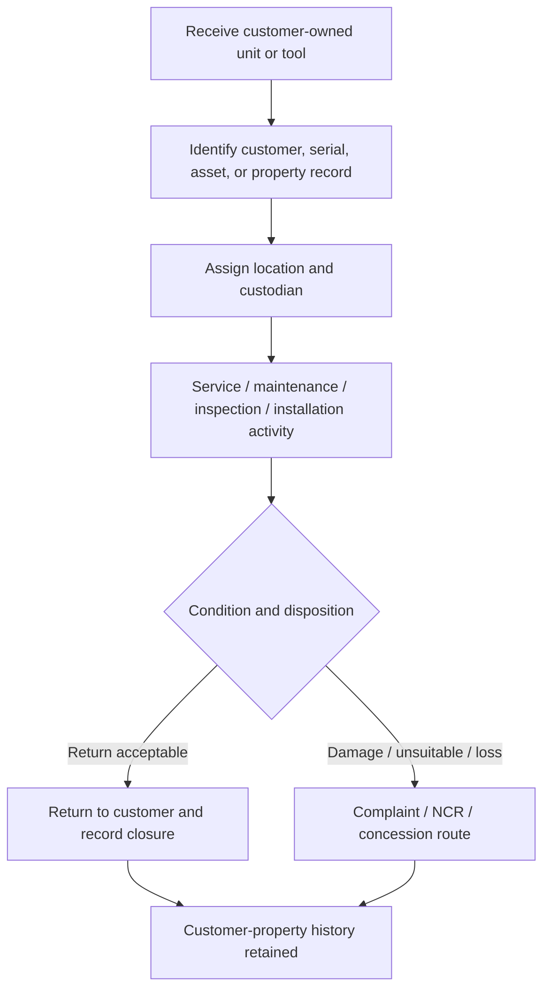

# SOP-SRV-003 Customer Property And Customer-Owned Product Control

## Status

- ERP fit: `B` enhancement-assumed
- ISO clauses: `7.5.10`, `7.5.4`, `8.3.3`
- Primary records: `Asset`, `Asset Movement`, `Asset Activity`, `Asset Maintenance`, `Asset Maintenance Log`, `Asset Repair`, `Installation Note`, `Warranty Claim`, `Maintenance Visit`, `Issue`, assumed customer-property receipt and disposition fields

## Purpose

Define how customer-owned product, tooling, samples, service-returned units, or other customer property is identified, safeguarded, moved, serviced, and returned in ERP so loss, damage, unsuitable condition, and disposition are auditable.

## Assumed ERP Enhancements

- A clear customer-property classification on the receiving or service record so teams distinguish customer-owned property from company-owned stock
- Mandatory linkage from service or complaint records to either a customer-owned `Asset`, a serialized product, or a controlled customer-property receipt record
- Explicit condition-on-receipt, loss or damage, unsuitable-for-use, and final disposition fields
- An exception path that routes damaged, lost, or unsuitable customer property into complaint, NCR, or concession review where required
- A visible queue for customer property currently in-house, under service, awaiting return, or awaiting disposition

## Flow

## Procedure

1. When customer-owned product, tooling, or other property is received, identify the customer and determine whether the property should be tracked as a customer-owned `Asset`, a serialized returned unit, or a controlled customer-property receipt record.
2. If the property is treated as a managed object in-house, register it as an `Asset` and set ownership to customer so the record clearly shows it is not company property.
3. Record the current location and custodian using `Asset Movement` so custody changes are traceable.
4. Record any service, maintenance, repair, installation, or inspection work against the same customer-owned property chain using `Asset Maintenance`, `Asset Maintenance Log`, `Asset Repair`, `Installation Note`, `Warranty Claim`, `Maintenance Visit`, or `Issue` as applicable.
5. Record the property condition on receipt and after service, including any visible damage, missing parts, unsuitable condition, or customer-reported issue.
6. Where serialized delivered product is involved, keep the `Serial No`, delivery, installation, warranty, maintenance, and complaint chain intact.
7. Do not move or hand over customer-owned property without updating the responsible custodian or target location in ERP.
8. If customer property is lost, damaged, or found unsuitable for use while under company control, record the event immediately and escalate it through the complaint, NCR, or concession process required by the quality system.
9. When the property is returned, transferred back, or otherwise disposed of, record the final disposition and close the open in-house customer-property loop.
10. Retain the full history so the organization can reconstruct who held the property, what work was performed, what condition was observed, and how the property was returned or otherwise resolved.

## Records To Retain

- customer-owned `Asset` where used
- `Asset Movement`
- `Asset Activity`
- `Asset Maintenance`
- `Asset Maintenance Log`
- `Asset Repair`
- `Installation Note`
- `Warranty Claim`
- `Maintenance Visit`
- `Issue`
- linked serial or delivery records
- customer-property condition and disposition evidence
- linked complaint, NCR, or concession records where applicable

## ERP Control Notes

- ERPNext already supports customer ownership on `Asset` through `asset_owner = Customer` and a linked `customer`.
- ERPNext already updates asset custody and location through `Asset Movement` and writes a visible `Asset Activity` trail.
- ERPNext already supports service and repair history through `Asset Maintenance`, `Asset Maintenance Log`, `Asset Repair`, `Warranty Claim`, `Maintenance Visit`, and `Installation Note`.
- The missing part is a governed customer-property receipt, condition, loss or damage, and disposition layer across these records so customer property cannot disappear into generic remarks.
