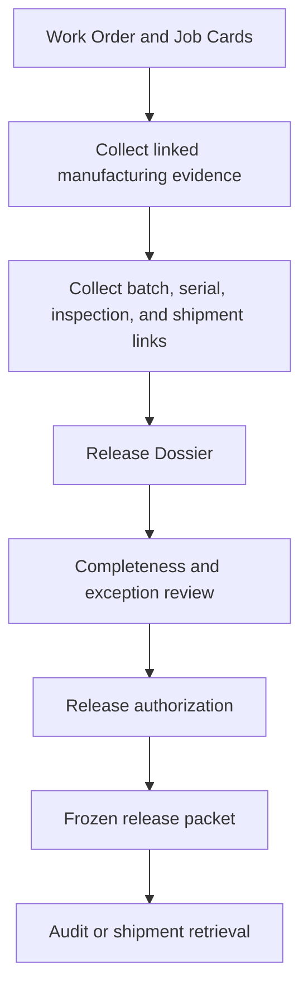

# SOP-TRC-002 Device History Record And Release Dossier

## Status

- ERP fit: `B` enhancement-assumed
- ISO clauses: `4.2.5`, `7.5.1`, `7.5.9`, `8.2.6`
- Primary ERP records: `Work Order`, `Job Card`, `Stock Entry`, `Quality Inspection`, `Batch`, `Serial No`, `Delivery Note`, assumed `Release Dossier`

## Purpose

Define how ERP assembles one governed release packet for a manufactured lot, batch, or serialized device scope before final release, shipment, or audit retrieval.

## Repo-Truth Starting Point

- ERPNext already stores most of the required evidence separately across manufacturing, quality, lot, serial, and shipment documents.
- `Stock Entry` already updates `Work Order` quantities and status and also writes quality-inspection references back into linked lines.
- `Quality Inspection.update_qc_reference()` already writes the current inspection link back to `Job Card` or child transaction rows.
- `Batch` already stores supplier plus source document type and source document name, along with manufacturing and expiry context.
- `Serial No` already stores work order, batch, employee, warranty, and maintenance status context.
- `Delivery Note` already carries batch or serial bundle information and shipment context, but its built-in approving-authority check is commercial, not a quality release-dossier approval.
- There is no current `Release Dossier` or frozen DHR-style snapshot record in the repo.

## Assumed ERP Enhancements

- Add a `Release Dossier` record that can be generated from:
  - finished-goods `Stock Entry`
  - `Batch`
  - `Serial No`
  - `Delivery Note`
- Add dossier scope fields for item, work order, batch, serial set, and shipment reference.
- Gather linked evidence automatically from manufacturing, inspection, traceability, and exception records.
- Add completeness checks, unresolved-exception checks, release authority, approval timestamp, and freeze behavior.
- Add a printable or exportable packet view for audit and release use.

## Roles

- Production or Warehouse: initiates the release dossier for the completed lot or serial scope.
- Final QC or QA: reviews completeness and linked quality evidence.
- Release Authority: approves the final release packet where policy requires it.
- Dispatch: uses the released packet status before shipment.
- Audit or Regulatory User: retrieves the frozen packet later without rebuilding it manually.

## Flow

## Procedure

1. Generate the release dossier for the relevant batch, lot, serialized device set, or shipment scope.
2. Pull in the linked `Work Order`, `Job Card`, `Stock Entry`, `Quality Inspection`, `Batch`, `Serial No`, and shipment references.
3. Confirm that the packet also shows linked complaint, NCR, CAPA, or concession records where they affect release.
4. Review the dossier for completeness and unresolved exceptions before final release.
5. Record the release authorizer, release decision, and approval date in the dossier record.
6. Freeze the approved packet so later changes in operational records do not silently alter the released evidence view.
7. Use the dossier as the official retrieval point for audit, shipment review, and lot or serial traceability response.

## User Guidance Inside ERP

- Manufacturing and shipment users should get guided actions for:
  - `Generate Release Dossier`
  - `Open Existing Dossier`
  - `Open Missing Evidence`
  - `Open Linked Exceptions`
- The dossier should show a visible completeness checklist before release approval is allowed.
- Release users should see exactly which evidence is missing or which linked exception is still unresolved.

## Records To Retain

- `Release Dossier`
- linked `Work Order`
- linked `Job Card`
- manufacturing `Stock Entry`
- linked `Quality Inspection`
- `Batch`
- `Serial No`
- linked `Delivery Note`
- linked NCR, CAPA, complaint, or concession references where applicable

## ERP Control Notes

- ERPNext already contains most of the evidence chain; the missing layer is governed assembly and freeze, not basic traceability storage.
- This SOP assumes a lightweight assembly and approval layer so reviewers do not have to reconstruct release evidence from many disconnected documents every time.
- The packet should remain a quality-release artifact, not just a printable report, so approval, freeze, and retrieval are explicit and auditable.
