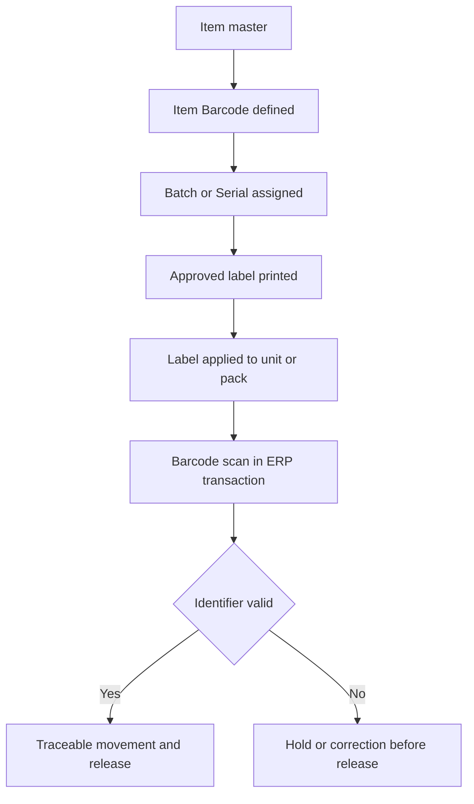

# SOP-TRC-003 Identifier, Barcode, And Label Governance

## Status

- ERP fit: `B` enhancement-assumed
- ISO clauses: `7.5.8`, `7.5.9`
- Primary records: `Item`, `Item Barcode`, `Batch`, `Serial No`, `Delivery Note`, `Stock Reconciliation`, barcode-enabled stock transactions, assumed controlled label template, assumed label issuance log, assumed print authorization and approval

## Purpose

Define how product identifiers, barcodes, and regulated labels are controlled in ERP so the approved identifier is unique, scannable, traceable, and only issued through the current released label content.

## Assumed ERP Enhancements

- Controlled label template and print format release tied to the current approved document set
- Explicit designation of regulated identifier type such as UDI or internal product identifier at item level
- Label issuance log with who printed, what template revision was used, and for which batch or serial population
- Print authorization and reprint controls for regulated labels
- Scan verification during receipt, manufacture, pack, or shipment for controlled identifier classes

## Flow

## Procedure

1. Define the controlled product identifier at `Item` level and maintain the approved barcode or code structure in `Item Barcode`.
2. Ensure barcode values are unique and use the correct barcode type for the intended identifier format.
3. Where batch or serial traceability is required, ensure the final product identifier is linked to the correct `Batch` or `Serial No` records.
4. Use only the current approved label template or print format when printing regulated labels for controlled products.
5. Record who printed the label set, for which item and batch or serial range, and which approved template revision was used.
6. Apply labels only to the correct unit, pack, or shipping level and prevent uncontrolled copying or unofficial reprinting.
7. Use barcode scanning in ERP transactions where controlled verification is required, including stock counting, stock movement, packing, or shipment.
8. Do not release product with missing, duplicate, unreadable, or incorrect identifiers.
9. When identifier or label discrepancies are found, place the affected product on hold and escalate into NCR, complaint, or change review as required.
10. Retain the identifier definition, print evidence, and scan-linked transaction history so the identifier chain can be reconstructed during audit or field investigation.

## Records To Retain

- `Item`
- `Item Barcode`
- `Batch`
- `Serial No`
- `Delivery Note`
- barcode-driven stock transaction records
- controlled label template revision
- label issuance and reprint log
- linked exception records for mislabeling or identifier failure

## ERP Control Notes

- ERPNext already validates uniqueness and code validity for `Item Barcode` values and supports types including `GS1` and `GTIN`.
- ERPNext already supports barcode scanning that can resolve `Item Barcode`, `Serial No`, or `Batch` values during stock operations.
- The missing part is regulated label issuance control, print authorization, and the governed linkage between approved label content and the released identifier used on product.
