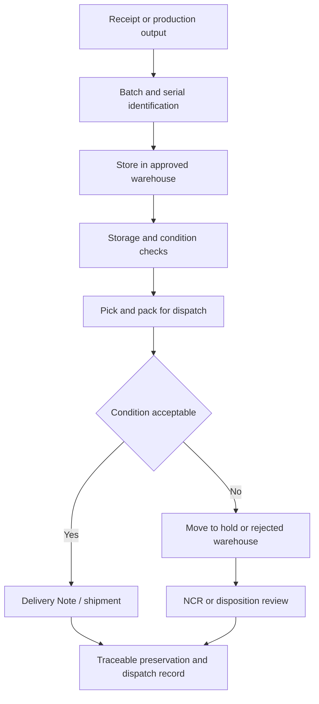

# SOP-WHS-001 Preservation, Storage, And Dispatch Condition Control

## Status

- ERP fit: `B` enhancement-assumed
- ISO clauses: `7.5.11`, `7.5.8`, `7.5.9`
- Primary records: `Warehouse`, `Batch`, `Serial No`, `Pick List`, `Stock Entry`, `Delivery Note`, `Serial and Batch Bundle`, assumed storage-condition class, assumed dispatch-condition checklist, assumed excursion or hold record

## Purpose

Define how stored, picked, packed, and dispatched product is preserved in ERP so batch, serial, expiry, hold, rejection, and dispatch-condition evidence remains auditable.

## Assumed ERP Enhancements

- Controlled storage-condition class on item or warehouse, such as ambient, dry, cold, or quarantine
- Explicit warehouse approval for controlled material classes
- Dispatch-condition or packaging checklist before shipment release
- Excursion, damage, or packaging-failure route into hold, quarantine, or NCR handling
- Near-expiry and storage-condition exception dashboards for controlled material

## Flow

## Procedure

1. Define each controlled storage location as a `Warehouse` and identify the locations used for released stock, quarantine, rejected stock, dispatch staging, and transit.
2. On receipt or production, ensure controlled items carry the required `Batch` or `Serial No` information before they are stored or issued.
3. Store product only in the approved warehouse or warehouse class intended for that material and status.
4. Move rejected, damaged, suspect, or condition-excursion material into the rejected or quarantine location instead of leaving it mixed with released stock.
5. Maintain batch expiry and lot information correctly so picking and dispatch use valid, non-expired inventory.
6. Before picking or shipment, verify packaging condition, quantity, label accuracy, and the correct batch or serial assignment.
7. Use the dispatch transaction chain such as `Pick List`, `Delivery Note`, and serial or batch bundle records so the shipped material stays fully traceable.
8. Do not dispatch product that is expired, damaged, condition-excursion affected, or otherwise under hold.
9. When storage or dispatch conditions are not met, record the exception, isolate the product, and escalate to NCR or other disposition review as required.
10. Retain the final shipment link so any later complaint, return, or recall analysis can reconstruct where the product was stored and how it was dispatched.

## Records To Retain

- `Warehouse`
- `Batch`
- `Serial No`
- `Pick List`
- `Stock Entry`
- `Delivery Note`
- `Serial and Batch Bundle`
- dispatch-condition or packaging checklist
- hold, quarantine, or NCR records for exceptions

## ERP Control Notes

- ERPNext already supports rejected warehouses, warehouse types, serialized and batched stock, and stock reports for batch balance and stock ageing.
- ERPNext already blocks use of expired batches during stock transactions and surfaces batch-expiry reporting.
- The missing part is governed storage-condition evidence, dispatch-condition confirmation, and explicit excursion-to-quality-exception routing.
