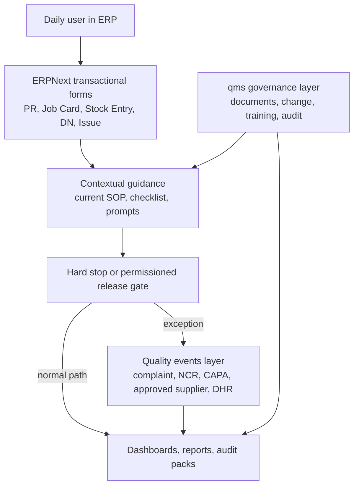

# North Star And Problem Statement

## Scope

This packet is the cross-app reference architecture for the local bench. It now lives under `erpnext/docs/reference/erp_qms_hrms_architecture/*`, reuses the ERPNext-core baseline already documented under `erpnext/docs/iso13485/*`, and adds repo-truth findings from the local `qms` app at `qms/qms/*` plus the local `hrms` app at `hrms/hrms/*`.

## Problem Statement

Today the bench has two useful but incomplete layers:

- ERPNext already enforces some hard transactional quality gates through stock and quality inspection flows.
- The local `qms` app already implements a real document-control and change-control foundation.

The current system still falls short of compliance-by-default because:

- normal ERP transactions do not automatically route exceptions into formal quality records
- training, competency, complaint, NCR, CAPA, approved supplier, and DHR-style records are not first-class working objects
- several `qms` automation surfaces exist in code but are not wired in `hooks.py`
- the user must still rely too heavily on external SOP reading instead of guided behavior inside ERP

## North Star

The compliant path must be the easiest path:

- users act inside the transaction they are already working on
- the form shows the current effective instruction and the next valid action
- required evidence is created automatically as part of normal work
- exceptions create their own quality records instead of staying in comments or email
- bypasses are explicit, role-restricted, time-stamped, and reportable

## Architecture Intent

## Design Rules

1. ERPNext remains the system of execution for material, batch, serial, service, and shipment history.
2. `qms` becomes the system of governance for controlled documents, external documents, change control, training acknowledgment, audit, and management review.
3. New quality-event modules are used only where neither ERPNext nor `qms` has a credible working record today.
4. Cross-system links use source document references; duplicate master data should be avoided.
5. If a rule matters during work, it must appear on-screen as a prompt, gate, checklist, or button, not only in a PDF.

## Immediate Architectural Conclusion

The best end state is not "move everything into qms" and not "keep everything in ERPNext." It is a four-part model:

- ERPNext for operational execution and release control
- `qms` for controlled content, acknowledgment, competency rules, and governed review processes
- HRMS for people, lifecycle, training-event history, and reporting structure
- a new quality-operations bridge for exception records, qualification gates, and release assemblies across the three
