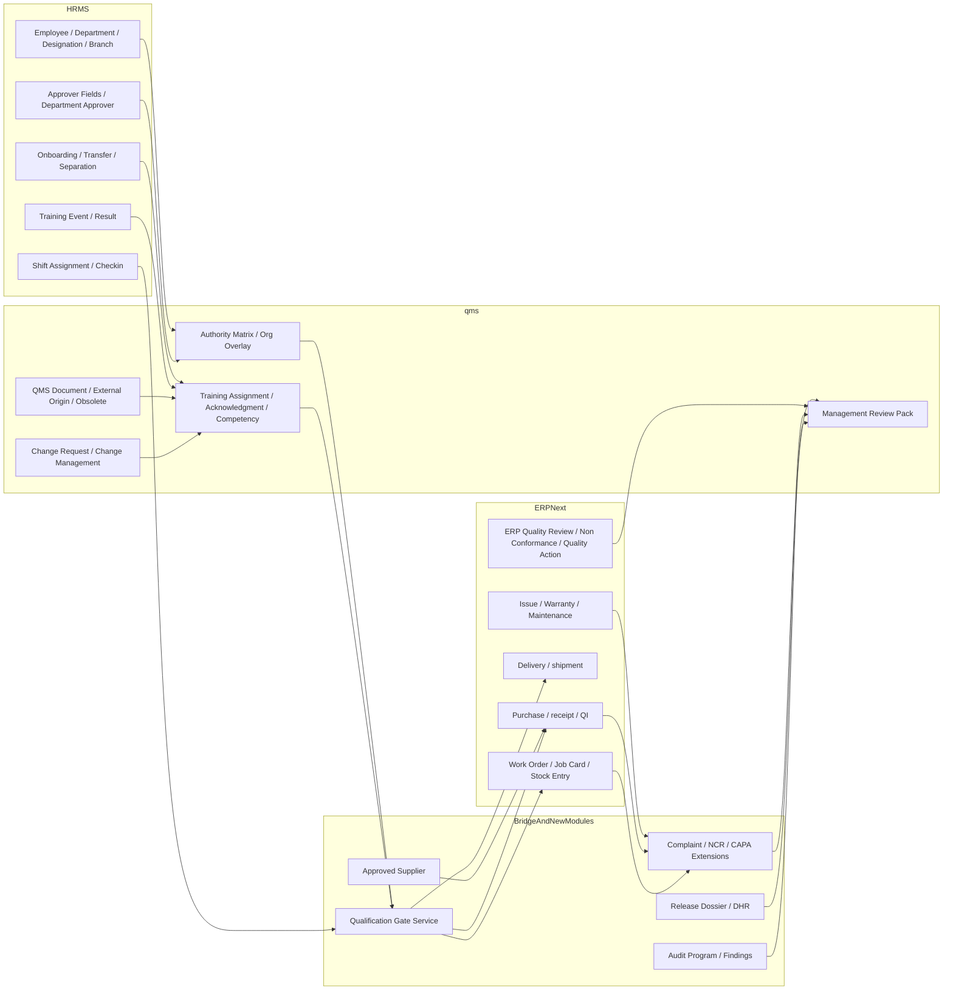

# System Boundaries: ERPNext Vs QMS Vs HRMS Vs Custom

## Boundary Rule

Use the system that already owns the work as the primary record:

- operational execution stays in ERPNext
- governed content and quality rules stay in `qms`
- employee lifecycle, assignment, and formal people structure stay in HRMS
- reusable cross-app enforcement and exception orchestration becomes a small bridge or new quality modules

## Primary Ownership Matrix

| Domain | Primary system | Why | Secondary system use |
| --- | --- | --- | --- |
| Purchase, receipt, stock, manufacture, shipment, service | ERPNext | Material and device history already lives there | qms shows SOP context; bridge enforces prerequisites |
| Controlled SOPs, external docs, obsolescence, change packages | `qms` | The app already has real document and change surfaces | ERPNext shows current effective doc context |
| Employee identity, department, designation, branch, reporting line, active status | HRMS plus ERP employee master extended by HRMS | HRMS already drives onboarding, transfer, separation, and approver-role updates | qms references this data; ERP consumes it |
| Onboarding, role change, offboarding, training-event attendance, shifts | HRMS | These are already active workflows with real history | qms derives training or authority impacts; ERP reads gate state |
| Read-and-understand, competency requirements, quality authority, approval permissions | `qms` extension | These are quality-governance decisions, not generic HR records | HRMS supplies the people and role context |
| Gate evaluation at time of sensitive action | Bridge | No existing app cleanly owns cross-app prerequisite checks | ERP calls it; qms and HRMS feed it |
| Approved supplier register | New quality module | Not present cleanly in any inspected app today | ERP sourcing validations read it |
| Complaint intake | ERPNext | Customer and service context already exists in `Issue` and `Warranty Claim` | QMS dashboards aggregate metrics |
| NCR / CAPA | ERPNext quality module extended, plus new exception workflow fields | Exception sources are transactional and already close to ERPNext quality records | qms contributes change and training impact links |
| Release dossier / DHR | New quality-release module | Needs one assembled packet over ERP transactions and gate results | ERP provides source evidence; qms provides release criteria |
| Internal audit | New audit module | Missing in all inspected apps | Feeds qms and ERP management review |
| Management review pack | qms aggregation over ERP + HRMS + qms data | Needs one governed evidence pack across all domains | ERP and HRMS remain source records |

## System Of Record Rules

### HRMS owns the people truth

Use HRMS or the HRMS-extended employee master as the source of truth for:

- employee active status
- department
- designation
- branch
- reporting line
- approver relationships
- onboarding, transfer, and separation status
- shift and assignment history
- formal training event attendance and completion

### qms owns the governed quality truth

Use `qms` as the source of truth for:

- current effective SOP revision
- document applicability by process, role, or controlled position
- mandatory read-and-understand status
- competency requirements and validity rules
- quality-specific authority mapping
- change impact on docs, training, and release rules

### ERPNext owns action and release evidence

Use ERPNext as the source of truth for:

- who performed the transaction
- what material or device was received, produced, shipped, or serviced
- inspection results
- release or rejection actions
- complaint intake and service evidence
- traceability chain by lot, batch, serial, work order, delivery, and customer

### Bridge owns cross-app enforcement state

The bridge layer should own:

- event-driven synchronization between HRMS and qms
- gate evaluation APIs called by ERP forms and server validations
- immutable evidence of what qualification and authority checks passed or failed at time of action
- shortcut actions that create downstream quality records without duplicate data entry

## End-State Architecture Diagram

## Key Boundary Decisions

### Do not let qms `Organization Chart` compete with HRMS org truth

The current `qms` `Organization Chart` should not remain a parallel free-text org tree.

End-state decision:

- HRMS owns actual employee-to-manager and department placement
- qms keeps only a quality authority overlay:
  - who can approve
  - who can release
  - who can concede
  - who owns escalation
- the overlay must reference HRMS persons, departments, designations, or controlled positions

### Do not store QMS acknowledgment only in HRMS training records

`Training Event` and `Training Result` are valuable, but they are not enough for:

- revision-specific read-and-understand
- immediate acknowledgment after document release
- immutable linkage to a specific SOP revision

That belongs in qms.

### Do not move operational release into qms or HRMS

Receipt, manufacture, shipment, and service must stay inside ERPNext transactions.

The role of qms and HRMS is to:

- teach the user in context
- decide whether the user is currently authorized and qualified
- create governed follow-up records when exceptions occur

## What Stays In ERPNext

These flows should not be duplicated in qms or HRMS forms:

- purchase receipt and receipt release
- supplier scorecard scoring
- quality inspection execution
- material issue, WIP, manufacture, and stock posting
- delivery release and shipment traceability
- customer support, warranty, and field service activity

## What Extends qms

These are natural extensions of existing qms surfaces:

- controlled document lifecycle hardening
- controlled distribution and read-and-understand
- document-to-role or process applicability
- competency requirements and recertification rules
- quality authority rules linked to HRMS structure
- change control impact assessment and implementation evidence
- management review pack assembly for document, training, and change domains

## What HRMS Should Own Or Strongly Support

HRMS should remain primary for:

- employee lifecycle and employment state
- department and designation alignment
- branch and reporting line
- controlled-role onboarding and transfer triggers
- instructor-led or scheduled training event completion
- supervisor ownership and escalation routing
- shift context when audit evidence needs to show who was scheduled to perform controlled work

## What Requires New Modules Or New Workflow Surfaces

These are missing enough that they should not be forced awkwardly into current doctypes:

- approved supplier by item or item-group scope
- complaint-quality escalation workflow if `Issue` remains the intake record
- NCR / CAPA closure model
- release dossier / DHR packet
- internal audit program and findings
- cross-app qualification gate service and gate log
