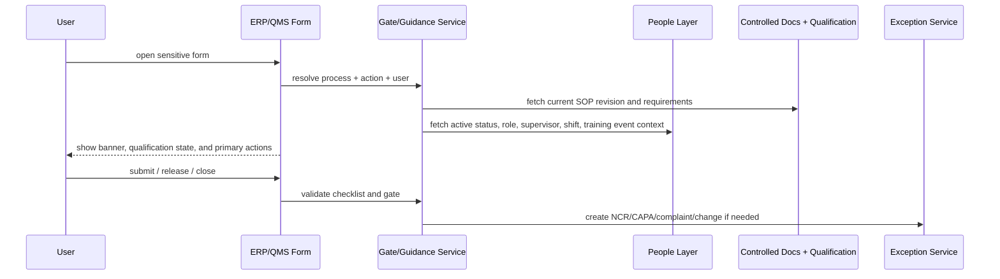

# User Guidance And Training Model

The end-state system should teach the user inside ERP, not only in external SOP PDFs.

## Design Principle

For every sensitive action:

- show the current effective instruction
- show whether the user is currently allowed to perform the action
- tell the user what evidence is missing
- block release when the evidence is required
- log acknowledgment, qualification checks, and exception handling

## System Split For Teaching And Training

| Need | Primary owner | Why |
| --- | --- | --- |
| Current effective SOP revision and applicability | `qms` | This is governed document truth |
| Who the employee is, where they sit, who they report to, whether they are active | HRMS | This is people and org truth |
| Whether the transaction happened and what evidence it produced | ERPNext | This is execution truth |
| Whether the user was allowed at time of action | Bridge | This requires cross-app evaluation |

## Guidance Mechanism Library

| Mechanism | Where to use it | Current repo evidence | End-state design |
| --- | --- | --- | --- |
| Form intro / contextual instructions | `Purchase Receipt`, `Job Card`, `Delivery Note`, `Issue`, `QMS Document`, `Change Management` | Existing qms pages and custom buttons show the pattern is already used in app code | Add role-based banners that show current SOP title, revision, qualification state, and next required action |
| Guided action buttons | `QMS Document` already has workflow buttons and change-request button | `QMS Document` JS adds `Send for Review`, `Approve`, `Release`, `Create Change Request`, `Distribute Document` | Extend the pattern to ERP forms: `Acknowledge SOP`, `Request Training`, `Raise NCR`, `Start Complaint Assessment`, `Build Release Dossier` |
| Required checklist before submit | receipt release, hold-point completion, shipment release, complaint closure | Not present as a general pattern today | Add child-table or checklist widgets enforced by server validation |
| Hard stop vs warning policy | stock transactions and quality release | ERPNext already has `Stop` / `Warn` settings on quality inspection enforcement | Keep release-critical gates as hard stops; use warnings only for coaching and upcoming tasks |
| Training prerequisite check | approve, release, inspect, close, authorize | Not present today | Add a shared server method that checks HRMS active status plus qms training and competency before allowing sensitive actions |
| Visible current SOP revision | transaction and quality forms | qms already has effective document metadata and viewer | Add a linked `Current Effective SOP` panel on forms by process, role, and operation |
| Acknowledgment logging | document release and read-and-understand | qms has activity logging but not acknowledgment | Add explicit acknowledgment records separate from passive view logs |
| Supervisor and escalation prompts | overdue training, complaint investigation, CAPA actions | HRMS already holds `reports_to`, department alignment, and approver patterns | Use HRMS supervisor context in banners, reminders, and escalations |
| Exception-triggered record creation | QI reject, complaint severity, audit finding | ERPNext and qms both have partial trigger points | Auto-suggest or auto-create NCR, CAPA, complaint, change, and supplier review records from the exception source |

## Training And Qualification Model

### What HRMS already gives us

- `Employee Onboarding` and `Employee Transfer` for lifecycle triggers
- `Training Event` and `Training Result` for scheduled training completion evidence
- `Department`, `Designation`, `reports_to`, and approver fields for ownership
- `Shift Assignment` for who was scheduled to perform controlled work

### What qms must add

- `Training Assignment`
- `Training Acknowledgment`
- `Competency Requirement`
- `Competency Assessment`
- quality authority mapping linked to HRMS people or positions

### What the bridge must do

1. Listen to HRMS onboarding, transfer, separation, and training-completion events.
2. Re-evaluate who needs which controlled documents or competencies.
3. Create or close qms assignments.
4. Expose one gate-check API to ERPNext.
5. Write immutable gate results for audit retrieval.

## Training Logic

### Initial assignment

1. HRMS identifies the employee, department, designation, branch, reporting line, and controlled role.
2. qms resolves applicable SOPs, work instructions, forms, and competency requirements.
3. The bridge creates `Training Assignment` records.
4. If training is instructor-led, the assignment can require a linked HRMS `Training Event` and `Training Result`.
5. If training is read-and-understand only, qms records direct acknowledgment without requiring an HRMS event.

### Revision-driven acknowledgment

1. A released `QMS Document` revision resolves the affected audience from HRMS role and org data.
2. qms creates new assignment and acknowledgment requirements.
3. ERP forms show the new revision and the employee's acknowledgment state.
4. Sensitive actions can be blocked after the effective date if acknowledgment remains overdue.

### Competency and recertification

1. qms defines the requirement and validity period by process, operation, or approval role.
2. HRMS provides assessor, trainer, employee, and formal training-event context.
3. qms stores the actual pass or fail result and expiry.
4. The bridge exposes current versus expired status to ERP transaction gates.

## Sensitive Actions That Should Check Qualification State

| Action | Why the check matters |
| --- | --- |
| Review / approve / release controlled documents | authority and revision-control integrity |
| Submit inbound `Quality Inspection` | controlled inspection execution |
| Complete manufacturing hold-point steps | process control and in-process quality |
| Authorize finished-goods release dossier | release authority |
| Close serious complaints | consistent escalation and closure rationale |
| Approve NCR / CAPA closure | effectiveness verification integrity |
| Grant or delegate quality approval authority | avoid unapproved delegations |

## HRMS-Aware Form-Level Teaching Examples

### Purchase Receipt

- Show incoming-inspection SOP revision and sample-plan note.
- Show whether the current inspector or releaser is qualified.
- If supplier is not approved for the item scope, show a red blocker before submit.
- If QI is missing, explain why the receipt is blocked and offer a `Create Quality Inspection` shortcut.

### Job Card

- Show the hold-point instruction for the current operation.
- Display whether the operator has current training and competency for the operation.
- If a shift assignment exists, show whether the logged-in operator is part of the scheduled shift.
- If inspection is required, show one primary action: `Run In-Process Inspection`.

### Delivery Note / Release

- Show the release SOP revision and release-authority requirement.
- Display whether the current releaser is an active authorized person.
- If unresolved NCR, CAPA, or concession items exist, show the blocking reason and the exact next action.

### Issue / Warranty Claim

- Show a complaint triage panel:
  - severity
  - serial or batch traceability
  - complaint classification
  - assigned owner and supervisor from HRMS
  - whether NCR or CAPA escalation is required
- Keep support users inside the existing ERP form while surfacing QMS decisions.

### QMS Document

- Keep current workflow buttons.
- Add release impact preview:
  - users who must acknowledge
  - documents to obsolete
  - training assignments to create
  - training events to schedule where needed
  - transactions or templates impacted by the revision

## Teaching Architecture

## Core Rules

- Passive file access is not enough.
- `QMS Document Activity` can remain as a viewing trace.
- Training and read-and-understand need explicit acknowledgment records and due-date management.
- HRMS training events should support, not replace, revision-specific QMS acknowledgment.
