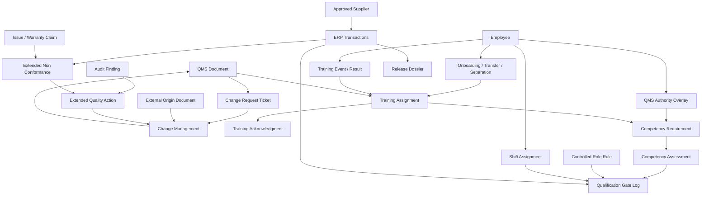

# Domain Model And Doctypes

This file defines the proposed end-state data model and which records should be extended, consolidated, or newly created.

## 1. Existing ERPNext Doctypes To Extend

| Doctype | Why extend it instead of duplicating it | Key additions |
| --- | --- | --- |
| `Quality Inspection` | It is already the transaction-adjacent quality record across purchase, manufacture, and delivery | mandatory source context, exception button hooks, inspector qualification check, link to NCR and release dossier |
| `Non Conformance` | It is already the ERP quality exception placeholder | source transaction, item, supplier or customer, batch or serial, containment, disposition, concession, root cause, effectiveness |
| `Quality Action` | It is already the ERP action placeholder | CAPA ownership, due dates, effectiveness review, source NCR or complaint, closure approval |
| `Issue` | Best front door for complaint intake because it already supports service workflows and email append | complaint class, severity, item, serial, batch, delivery note, investigation required, reportability flag, NCR link |
| `Warranty Claim` | Already device-aware and serial-aware for service context | complaint linkage, investigation outcome, field correction result |
| `Purchase Order` | Existing sourcing release point | approved-supplier validation and exception logging |
| `Job Card` | Existing operator execution record | hold-point enforcement, qualification prerequisite check, NCR shortcut |
| `Stock Entry` and `Delivery Note` | Existing release points | release dossier link, unresolved-deviation validation, release-authority check |

## 2. Existing qms Doctypes To Extend

| Doctype | Current role | End-state extension |
| --- | --- | --- |
| `QMS Document` | controlled document and revision shell | effective revision governance, acknowledgment trigger, linked training requirement, transaction applicability metadata |
| `External Origin Document` | external controlled document register | owner, linked supplier or regulator, expiry action, affected process, linked change request |
| `Obsolete Document` | archive and disposal record | disposal approval, retention rule source, audit retrieval metadata |
| `Change Request Ticket` | request intake | ERP impact metadata, risk flag, linked NCR or CAPA, requester role |
| `Change Management` | change implementation package | implementation evidence, linked ERP items or BOMs or templates, training impact resolution, approval authority |
| `Distribution List` | recipient groups | role-based targeting, process targeting, training applicability |
| `Distribution Log` | point-in-time distribution evidence | acknowledgment summary, release linkage, exception to mandatory acknowledgment |
| `Organization Chart` | hierarchy tree | repurpose into a quality authority overlay referencing HRMS people, departments, or designations instead of maintaining a parallel org tree |
| `Records` | basic file holder | only keep if expanded into a true controlled-record register; otherwise retire in favor of specific record doctypes |

## 3. Existing HRMS Doctypes To Use As Sources

| Doctype / construct | Why it matters in the end state | End-state role |
| --- | --- | --- |
| `Employee` with HRMS override | active employee identity and org placement | people source of record |
| `Department`, `Designation`, `Branch`, `reports_to` | role, authority, and training applicability inputs | people structure source |
| `Employee Onboarding` and template | new-hire workflow and controlled-role setup trigger | lifecycle trigger |
| `Employee Transfer` | role-change and authority-review trigger | lifecycle trigger |
| `Employee Promotion` | designation or grade change that may affect authority or qualification scope | lifecycle trigger |
| `Employee Separation` and template | offboarding and authority revocation trigger | lifecycle trigger |
| `Exit Interview` | end-of-employment evidence and cleanup support | supporting offboarding evidence |
| `Training Event` and `Training Result` | scheduled and completed instructor-led training evidence | training evidence source |
| `Training Feedback` | feedback and training effectiveness input | supporting evidence |
| `Shift Assignment`, `Shift Schedule Assignment`, `Employee Checkin` | qualification-at-time-of-action and scheduled-work context | audit support |
| `Department Approver` and approver fields | existing approver-resolution pattern | supervisor and approval mapping input |
| `Skill`, `Skill Assessment`, `Employee Skill Map` | optional skill evidence reuse | supporting evidence, not sole qualification source |

## 4. qms Extension Doctypes To Add

| New doctype | Purpose |
| --- | --- |
| `Training Assignment` | assign document or process training to employees, roles, or controlled positions |
| `Training Acknowledgment` | explicit read-and-understand log tied to a specific released revision |
| `Competency Requirement` | define what a role, operation, or approval function must be trained or assessed on |
| `Competency Assessment` | record practical, quiz-based, or supervisor-approved competency evidence and expiry |
| `Authority Matrix` or equivalent child tables on `Organization Chart` | map who can review, approve, release, close, or concede by process or scope |
| `Management Review Pack` | assemble review inputs from ERP, qms, and HRMS |

## 5. Bridge And New Doctypes To Add

### Bridge set

| New doctype or service | Purpose |
| --- | --- |
| `Controlled Role Rule` | maps ERP actions or processes to required docs, competency, and authority |
| `Qualification Gate Log` | immutable result of the qualification and authority check at time of sensitive action |
| `Lifecycle Sync Job` optional utility | records and retries HRMS to qms sync actions where needed |

### new quality-exception and release set

| New doctype | Purpose |
| --- | --- |
| `Approved Supplier` | supplier approval by item, item group, or process scope |
| `Release Dossier` | DHR-like assembled release packet over ERP transactions and gate results |
| `Audit Program` | annual or periodic audit schedule |
| `Audit Plan` | defined audit event and scope |
| `Audit Finding` | finding record that can escalate to CAPA |
| `Quality Exception Link` optional utility | generic cross-reference layer when one source needs to open multiple downstream records |

## 6. Consolidation Decisions

### Document master data

Keep:

- `QMS Document-Record Type`
- `QMS Process Abbreviation`

Retire or freeze:

- `Document Types`
- `Process Abbreviations`

### Organization model

Recommended end-state:

- HRMS is the source of truth for departments, designations, employee-manager relationships, and branch placement
- `qms` `Organization Chart` becomes a quality overlay only
- do not maintain two independent organization trees

### Distribution model

Recommended end-state:

- `Distribution List` = reusable audience definition
- `Distribution Log` = immutable broadcast evidence snapshot
- `QMS Document Distribution` = repurpose into per-user acknowledgment rows, or remove if redundant

### Record model

Recommended end-state:

- do not use generic `Records` for complaint, NCR, CAPA, audit, or DHR
- each controlled quality record should have its own domain-specific doctype

## 7. Proposed Relationship Model

## 8. Scope Boundary For Design Controls

Design controls, DHF, and DMR are not present in a meaningful form today.

Recommendation:

- do not force them into the first implementation slice
- reserve a later module if product-development scope truly requires:
  - design input
  - design output
  - verification and validation
  - design review
  - DMR / DHF package assembly
