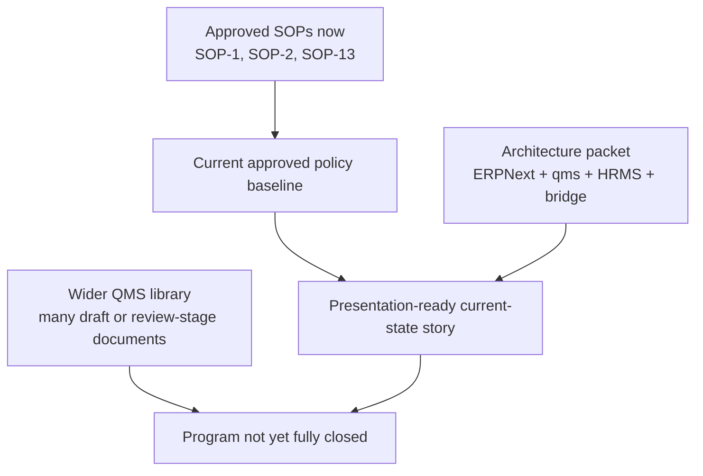

# Approved SOP Alignment And Research Verdict

## Scope And Evidence Base

This review uses the currently approved documents under:

- `erpnext/docs/existing_sop/SOP-1 Control of Documents`
- `erpnext/docs/existing_sop/SOP-2 Control of Records`
- `erpnext/docs/existing_sop/SOP-13 Suppliers Control and Purchasing`

Reviewed corpus in this pass:

- 18 DOCX artifacts
- 0 Excel workbooks found in `existing_sop`

The review also uses the already-built architecture packet under `erpnext/docs/reference/erp_qms_hrms_architecture/*`.

## What The Approved SOP Set Already Establishes

| Domain | What the approved SOPs already establish | Practical meaning |
| --- | --- | --- |
| Document control | Draft, review, approval, release, master copies, controlled copies, obsolete copies, external-origin documents, review frequency, retention, archival, Google Drive storage and access control | The policy model for controlled documents is already written and approved |
| Record control | Record classification, master list of records, obsolete records, disposition log, retention, annual review, controlled copies, confidential health data handling, archival and deletion approval | The policy model for controlled records is already written and approved |
| Supplier control and purchasing | Supplier qualification, supplier criticality, supplier agreements, supplier audit criteria, trial orders, approved supplier list, incoming inspection, quarantine, accept/reject/hold, annual supplier rating, CAPA trigger on significant supplier downgrade | The policy model for supplier qualification and supplier-linked incoming quality is already written and approved |

## What The Existing SOPs Still Assume As Manual Or External To ERP

The approved SOPs are strong on policy and role accountability, but they are still largely built around:

- Google Drive as the primary controlled-document and controlled-record store
- RAE-managed folder permissions and manual archival
- manual distribution, review, and release activity
- manual supplier and incoming-inspection follow-through
- manual linkage from changes, CAPA, complaints, audits, and training into daily operating work

That means the approved SOPs do not by themselves answer:

- how ERPNext becomes the transaction system of evidence
- how `qms` becomes the governed document and change layer
- how HRMS becomes the people, authority, and qualification source
- how qualification or authority is checked at time of transaction
- how exceptions automatically become first-class records

## What The Architecture Packet Adds Beyond The Approved SOPs

| Area | Added by the architecture packet |
| --- | --- |
| System-of-record split | ERPNext for execution, `qms` for governed content and quality rules, HRMS for people and lifecycle truth, bridge layer for cross-app enforcement |
| Interactive teaching | Contextual SOP banners, guided buttons, hard stops, training prerequisites, acknowledgment logging |
| People and authority | HRMS-driven active employee, department, designation, reporting line, onboarding, transfer, separation, shift, and supervisor ownership |
| Qualification enforcement | qms training assignments, acknowledgments, competency rules, authority matrix, and gate checks against sensitive actions |
| Exception routing | Complaint, NCR, CAPA, supplier deviation, audit finding, and release-dossier flows tied back to source transactions |
| Audit retrieval | Dashboards, gate logs, release dossiers, and management-review packs instead of only folder-based retrieval |

## Strong Evidence That The Wider QMS Library Is Not Yet Fully Closed

### QMS Documents Tracking List shows only a small approved subset

The approved `QMS Documents Tracking List` shows a much larger document universe than the three approved SOP families currently available in `existing_sop`.

Document status snapshot from the tracking list:

- `Approved`: 4
- `Under final review`: 1
- `Under 2nd review`: 3
- `Under 1st review`: 10 plus 1 variant typed as `Under 1st  review`
- `Draft`: 78

Approved rows currently visible in the tracking list:

1. `TCR-COD-SOP-1` Procedure for Control of Documents
2. `TCR-COR-SOP-2` Procedure for Control of Records
3. `TCR-SCP-SOP-13` Procedure for Supplier Control and Purchasing
4. `TCR-QMM-ANNEX-001` Organizational Chart

This is the clearest evidence that the approved SOP corpus is still partial.

### Many critical domains are still in draft or review

The same tracking list explicitly shows draft or review-stage documents for:

- Change Management
- Management Review
- Competence, Awareness and Training
- Product Realization
- Design and Development
- Identification and Traceability
- Internal Quality Audit
- Control of Non-conforming Product and Rework
- CAPA
- Complaint Handling
- Vigilance
- PMS
- Risk Management
- Performance Evaluation
- Packaging and Labelling
- Stability Studies

### QMS Records Tracking List is populated as a library, but not as a released evidence register

The approved `QMS Records Tracking List` lists many planned forms and reports, but the status, effective date, archival date, and retention fields are mostly blank.

Practical meaning:

- the record universe is identified
- the live release state of those records is not yet proven from this artifact alone

## Domain Verdict

| Domain | Research verdict |
| --- | --- |
| SOP-1 Document Control | Presentation-ready for current-state and target-state discussion |
| SOP-2 Record Control | Presentation-ready for current-state and target-state discussion |
| SOP-13 Supplier Control and Purchasing | Presentation-ready for current-state and target-state discussion |
| End-to-end ISO 13485 operating model across all major domains | Not yet closed |

## Overall Research Verdict

The correct statement is:

- research is complete for the architecture baseline and for the three approved SOP domains now in hand
- research is not complete for declaring the full ISO 13485 operating model fully documented, approved, and system-mapped

## Safe Presentation Position

You can now present:

- what is currently approved
- what the target ERPNext plus qms plus HRMS architecture is
- what remains to be completed before claiming full program closure

You should not yet present:

- that the entire QMS library is already approved
- that complaint, CAPA, audit, training, traceability, and release-dossier domains are already fully closed by approved SOPs and implemented system behavior

## Visual Summary

