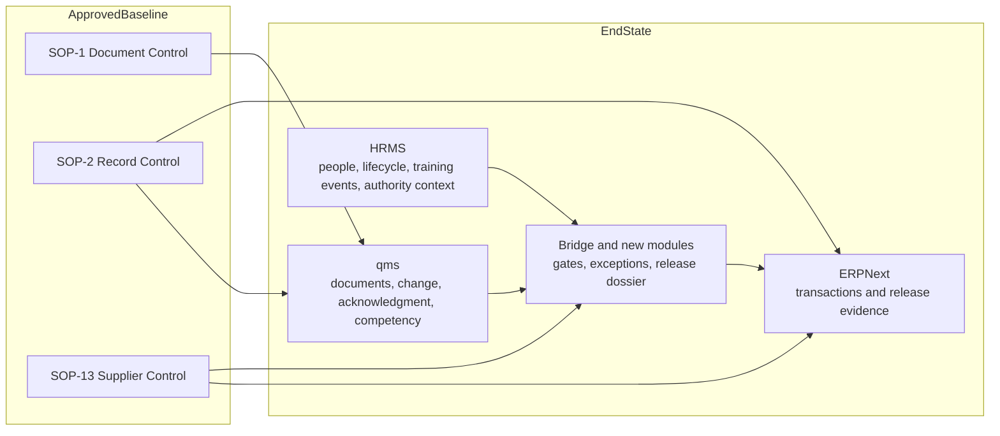

# Authority Presentation Pack

## Presentation Position

The strongest defensible position today is:

- the organization has approved foundational SOPs for document control, record control, and supplier control
- those approved SOPs have been analyzed against the local ERPNext, `qms`, and HRMS codebase
- a concrete end-state system architecture has been defined for compliance-by-default in daily ERP use
- the wider QMS program is still progressing through draft and review for multiple additional domains

This is a strong current-state and target-state presentation.

It is not yet a claim that the whole program is fully closed.

## What You Can Say Clearly

### Current approved foundation

- Document control is approved and defines review, release, obsolescence, retention, external-origin document control, and tracked master lists.
- Record control is approved and defines record identification, retention, disposition, archival, confidentiality, and record tracking.
- Supplier control and purchasing is approved and defines supplier qualification, criticality, agreement, incoming inspection expectations, re-evaluation, and supplier blocking logic.

### System architecture target

- ERPNext remains the transaction and release-evidence layer.
- `qms` remains the governed document, change, acknowledgment, competency-rule, and review-pack layer.
- HRMS remains the employee, lifecycle, reporting-line, training-event, and authority-context layer.
- A small bridge or exception layer is still needed for qualification gates, approved supplier enforcement, exception routing, and release dossier assembly.

### Honest program status

- The approved SOP set is only part of the full QMS library.
- The tracking list shows many additional domains still in draft or review.
- The architecture research is mature enough to guide implementation and authority discussion.
- The whole QMS evidence model is not yet fully closed across all domains.

## Presentation Architecture

## Authority-Safe Narrative

Use this framing:

1. We have already approved and released the foundational SOPs for controlled documents, controlled records, and supplier control.
2. We have mapped those approved procedures onto our actual software landscape, not just a theoretical process chart.
3. The resulting target architecture places transaction evidence in ERPNext, governed quality content in `qms`, employee and authority truth in HRMS, and only a small amount of bridge logic where cross-system enforcement is required.
4. We are not overstating closure: the larger QMS library still contains additional domains in draft or review, and those are the next structured iterations.

## What Not To Claim Yet

Do not claim that:

- all ISO 13485 procedures are already approved
- all training, complaint, CAPA, internal audit, PMS, risk, and release-dossier processes are already fully implemented in system
- the proposed bridge modules already exist as finished operating software

## Recommended Reading Order For Presentation

1. `11_EXECUTIVE_SUMMARY_FOR_PRESENTATION.md`
2. `12_APPROVED_SOP_ALIGNMENT_AND_RESEARCH_VERDICT.md`
3. `03_SYSTEM_BOUNDARIES_ERP_VS_QMS_VS_CUSTOM.md`
4. `04_EVENT_AND_INTEGRATION_MATRIX.md`
5. `09_PHASED_IMPLEMENTATION_ROADMAP.md`

## Bottom-Line Recommendation

Yes, present the research now as:

- a completed architecture and evidence-mapping exercise for the approved baseline
- a clearly scoped target-state design
- a controlled next-step program

No, do not present it as:

- final proof that the entire QMS research effort is finished

That distinction keeps the presentation credible.
