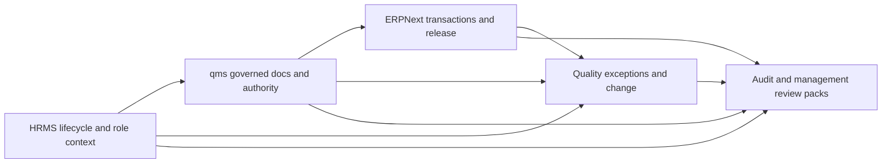

# Operational Clause To System Map

This file reorganizes the clause matrix into operational domains that can become future SOP and workflow packs.

## North-Star Rule

Normal daily work should create the evidence.

- ERPNext stays the transaction and release-evidence layer
- HRMS stays the people, reporting-line, assignment, and lifecycle layer
- `qms` stays the governed-document, acknowledgment, authority, and change layer
- a small bridge or new quality-exception modules should only exist where cross-app enforcement is unavoidable

## Operational Architecture

## Domain Map

| Domain | ISO clauses | Users doing the work | ERP docs | HRMS docs | qms docs | Evidence created by normal work | Gate and exception logic |
| --- | --- | --- | --- | --- | --- | --- | --- |
| Document and record control | 4.2.1 to 4.2.5 | author, reviewer, approver, affected employee | none as primary | employee, department, designation for applicability resolution | `QMS Document`, `Distribution List`, `Distribution Log`, `Obsolete Document`, `External Origin Document`, `Records` | release metadata, revision history, distribution log, obsolete link, record-list entry | released doc only; revision can auto-create acknowledgment and training assignments |
| Management review and communication | 5.1, 5.4, 5.5.3, 5.6, 8.4 | MR, QA head, process owners, top management | `Quality Goal`, `Quality Review`, `Quality Meeting` | department owners, supervisors, functional heads | review pack, change state, training status, authority state | review inputs, minutes, action list, KPI pack | close review only after mandatory inputs and actions are captured |
| Training, competence, and authority | 5.5.1, 5.5.2, 6.2 | HR, line manager, trainer, QA authority, employee | sensitive ERP forms consume gate result | `Employee Onboarding`, `Employee Transfer`, `Employee Separation`, `Training Event`, `Training Result`, `Employee`, `Department`, `Designation`, `reports_to` | training assignment, acknowledgment, competency requirement, competency assessment, authority overlay | assignment, completion, acknowledgment, assessor approval, validity dates, authority log | block sensitive actions for inactive, untrained, or unauthorized users |
| Supplier qualification and purchasing | 7.4.1, 7.4.2 | buyer, supplier quality, approver | `Supplier`, `Supplier Scorecard`, `Supplier Quotation`, `Purchase Order` | none primary | approved supplier register, external supplier documents, change records | supplier qualification, approved scope, PO approval, supplier score | block PO or receipt release if supplier is outside approved scope |
| Incoming inspection and receipt release | 7.4.3, 8.2.6, 8.3.2 | stores, incoming QC, buyer | `Purchase Receipt`, `Subcontracting Receipt`, `Quality Inspection` | employee qualification state for inspector/releaser | approved supplier link, training state, NCR/CAPA link | QI result, receipt record, lot or serial, reject/accept decision | hard stop on missing or rejected QI; rejected QI should open NCR route |
| Manufacturing control and in-process hold points | 7.1, 7.5.1, 7.5.2, 7.5.6, 8.2.5, 8.2.6, 8.3.4 | operator, supervisor, in-process QC | `Work Order`, `Job Card`, `Stock Entry`, `Quality Inspection` | active employee, shift assignment, training and competency context | competency requirement, change impact, NCR/CAPA links | operation execution, readings, in-process checks, corrective job cards, rework evidence | server-side hold points should block completion and trigger NCR or retraining |
| Identification, traceability, final release, and shipment | 7.5.8, 7.5.9, 7.5.11 | final QC, QA release authority, warehouse, dispatch | `Batch`, `Serial No`, `Stock Entry`, `Delivery Note`, `Sales Invoice`, `Quality Inspection` | authority holder status | release dossier, training/authority state, applicable spec docs | lot/serial chain, final inspection, release approval, shipment linkage | release blocked for unresolved deviations, expired authority, or incomplete dossier |
| Service, feedback, and complaints | 7.5.3, 7.5.4, 8.2.1, 8.2.2, 8.3.3 | support, service, quality, RAE | `Issue`, `Warranty Claim`, `Maintenance Visit`, return docs | owner, supervisor, service employee context | complaint record, linked NCR/CAPA, external authority docs if needed | complaint intake, field evidence, service outcome, escalation ownership | severe or recurring issues should auto-route to NCR/CAPA and management review |
| NCR, CAPA, and change control | 5.4.2, 7.3.9, 8.3, 8.5 | quality engineer, process owner, approver | source transaction, `Non Conformance`, `Quality Action` | owner, supervisor, department context | `Change Request Ticket`, `Change Management`, training impact, authority impact | containment, root cause, action plan, effectiveness, implementation evidence | close only after actions, retraining, and effectiveness are complete |
| Audit, monitoring, and data analysis | 8.2.4, 8.2.5, 8.4 | auditor, auditee, QA head, MR | ERP KPI and exception reports | training and qualification reports | audit module, review pack, document and change status | audit plan, findings, closure actions, trend analysis | open findings should feed NCR/CAPA and next management review |
| Design, MDF, DHF, DMR boundary | 4.2.3, 7.3.x | design, RAE, QA | item/BOM/spec release data when relevant | role and training context | design/change docs | design file, review evidence, transfer evidence | keep visible, but defer outside the first operational-QMS implementation slice |

## Domain Flow Notes

### 1. Document issuance and revision should stay in qms, but should not remain isolated there

Required pattern:

- release a `QMS Document`
- resolve affected roles and employees from HRMS
- create acknowledgment and training assignments in qms
- expose the current effective document inside the affected ERP transactions

### 2. Training and authority should start from HRMS events, not from duplicate qms person records

Required pattern:

- onboarding, transfer, separation, and training completion originate in HRMS
- qms resolves document applicability, competency, and authority rules
- ERP forms ask one gate service whether the user is currently allowed to act

### 3. Receipt, manufacture, shipment, and service must remain ERP-led

Required pattern:

- user works inside the ERP transaction they already use
- the transaction shows the current SOP and gate state
- required evidence is captured without duplicate forms
- deviation paths create first-class quality records

### 4. Exceptions should become reusable quality objects

Required pattern:

- complaint, rejected inspection, supplier issue, audit finding, and release deviation all enter the same governed quality-exception backbone
- CAPA, retraining, and change-control impacts re-use that same backbone

## SOP Drafting Implications

This domain map points to the next SOP set that should be drafted or upgraded with embedded ERP behavior.

Highest-value authored or immediate next SOPs:

- already authored in the active pack: competence and authority, customer requirement review, equipment control, internal audit, installation acceptance, customer property control, preservation or dispatch condition control, workstation or environment readiness, process monitoring, rework or rerelease control, structured feedback triage, quality-policy communication, controlled awareness, computer software validation or ERP change control, and identifier or label governance
- still highest-value implementation-following SOPs: complaint handling, nonconforming product and CAPA, approved-supplier scope control, in-process hold points, and DHR or release dossier assembly

These SOPs should be written in the `iso13485/` tree.

The system-design and implementation reasoning for them should remain in this `reference/` tree.
