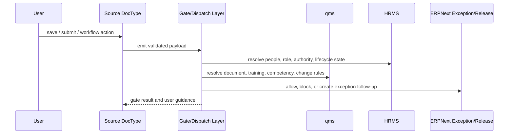

# Frappe Event And Automation Blueprint

This blueprint defines how daily ERP, HRMS, and `qms` activity should dispatch the records needed for ISO 13485 operational compliance.

## Design Rules

- use normal Frappe document events, controllers, workflow actions, and schedulers first
- keep release-critical checks synchronous and server-side
- use warnings only for coaching or near-due obligations
- use background jobs only for assignment generation, reminders, and review-pack aggregation
- write one gate log whenever a sensitive action is permitted or blocked

## Repo-Truth Trigger Surfaces Already Present

| Surface | Repo evidence | Current state |
| --- | --- | --- |
| ERP receipt and delivery inspection gate | `erpnext/erpnext/controllers/stock_controller.py:1012` to `1098` | `Hard gate` when stock settings are set to `Stop`; can degrade to warning if settings allow it |
| Job Card in-process inspection link | `erpnext/erpnext/manufacturing/doctype/job_card/job_card.js:137` to `150` | `Available but unused as hard gate`; client side only prepares a new `Quality Inspection` route |
| BOM to manufacturing inspection flag | `erpnext/erpnext/manufacturing/doctype/work_order/work_order.py:1447` and `bom.json` inspection fields | `Available but partial`; inspection intent flows to stock entry, not to enforced Job Card hold points |
| qms document status workflow | `qms/qms/qms/doctype/qms_document/qms_document.py:32` to `109`; `qms_document.js:78` to `146` | `Available but local to qms`; document release, archive, and distribution exist |
| qms global automation wiring | `qms/qms/hooks.py` document events and scheduler sections are commented out | `Missing live wiring`; app-level automation is mostly not activated |
| qms change request to change management handoff | `qms/qms/qms/doctype/change_request_ticket/change_request_ticket.py:13` to `99` | `Available` for document-change flow only |
| HRMS onboarding task generation | `hrms/hrms/controllers/employee_boarding_controller.py:26` to `155` | `Available`; on submit creates project and tasks |
| HRMS onboarding validation for employee creation | `hrms/hrms/hr/doctype/employee_onboarding/employee_onboarding.py:37` to `50` | `Hard gate` for mandatory onboarding tasks before employee creation |
| HRMS transfer effect on employee state | `hrms/hrms/hr/doctype/employee_transfer/employee_transfer.py:21` to `48` | `Available`; updates employee work history and can retire old employee |
| HRMS separation task generation | `hrms/hrms/hr/doctype/employee_separation/employee_separation.py:12` to `19` | `Available`; separation uses the same boarding controller patterns |
| HRMS training event and result completion | `hrms/hrms/hr/doctype/training_event/training_event.py:18` to `38`; `training_result.py:20` to `29` | `Available but cleanup needed`; attendance and completion states exist, but no qms linkage and the current result submit path should be aligned with the declared event-status field |
| HRMS employee update hooks | `hrms/hrms/hooks.py:199` to `211`; `overrides/employee_master.py:29` to `105` | `Available`; employee validate/on_update hooks already exist for onboarding validation and approver-role updates |

## End-State Event Matrix

| Priority | Source app and DocType | Trigger point | Payload to dispatch | Downstream action | Evidence generated | Enforcement mode | Current repo status |
| --- | --- | --- | --- | --- | --- | --- | --- |
| P0 | `qms` `QMS Document` | `on_update` when status becomes `Released` | document, revision, effective date, superseded doc, applicable process or role | create acknowledgment and training assignments; resolve HRMS audience; mark prior rev obsolete | assignment set, release log, obsolete link, future gate prerequisites | synchronous for release checks, async for assignment fan-out | current release exists; assignment fan-out missing |
| P0 | HRMS `Employee Onboarding` | `on_submit` and `on_update_after_submit` | employee or applicant, department, designation, template tasks, expected role | resolve controlled-role profile and create qms training or document assignments | onboarding-to-qualification trace | async after submit | available HRMS event, qms sync missing |
| P0 | HRMS `Employee` | `validate` and `on_update` | active status, user, reports_to, department, designation, approvers | recalculate authority overlay and gate cache | authority-effective record, audit trail | synchronous for master integrity, async for sync | HRMS hook exists, qms consumer missing |
| P0 | HRMS `Employee Transfer` | `on_submit` | old role, new role, company, department, designation, transfer date | revoke old authority, re-evaluate training and competency, reassign open quality work | qualification review record, authority revocation log | async plus immediate revocation for sensitive roles | transfer event exists, quality sync missing |
| P0 | HRMS `Employee Separation` | `on_submit` | employee, relieving date, department, open assignments | disable authority, freeze future approvals, reassign open NCR/CAPA/complaint/audit tasks | offboarding quality review record | synchronous for authority revoke, async for reassignment | separation event exists, quality sync missing |
| P1 | HRMS `Training Result` | `on_submit` | event, employees, completion result, trainer | close linked qms training assignments and update competency evidence | training completion trace, qualification refresh | async | available HRMS event, qms linkage missing |
| P1 | HRMS `Training Event` | `on_update_after_submit` when completed | attendance state and employees | update pending scheduled-training obligations | attendance evidence and reminder status | async | available but not linked to qms |
| P1 | ERPNext `Supplier Quotation` | `validate` | supplier, items, company, requester | resolve approved supplier scope and show sourcing guidance before PO creation | sourcing gate log | synchronous warning or stop by policy | new bridge/module needed |
| P1 | ERPNext `Purchase Order` | `validate` or `before_submit` | supplier, items, company, requester, approver | verify supplier approval scope and required controlled attachments/specs | approved-supplier gate log | synchronous warning or stop, depending on policy | new bridge/module needed |
| P1 | ERPNext `Purchase Receipt` / `Subcontracting Receipt` | existing controller `validate_inspection`; add doc-event to call supplier gate | item, supplier, QI, batch or serial, inspector | enforce QI + approved supplier + qualified inspector rule | receipt gate log, release evidence | synchronous hard stop | QI gate exists now; supplier and qualification overlay missing |
| P1 | ERPNext `Quality Inspection` | `on_submit` or `on_update_after_submit` | result, status, reference type/name, item, batch or serial, inspector | if rejected, prompt or auto-create NCR and supplier or process exception | NCR seed record, supplier defect trace | synchronous prompt + async record creation | new route needed |
| P1 | ERPNext `Job Card` | `validate` when status transitions to complete/submit, or custom server method on completion action | work order, operation, completed qty, operator, linked QI, workstation | enforce operation hold point, operator qualification, and retraining rules | in-process gate log, hold-point evidence | synchronous hard stop | no current server gate; client-side inspection shortcut only |
| P1 | ERPNext `Stock Entry` for manufacture | `validate` or `before_submit` | work order, batch/serial bundle, inspection_required, releaser | block finished-goods completion if hold points or final release are incomplete | manufacture release gate log | synchronous hard stop | partial via stock inspection; full release logic missing |
| P1 | ERPNext `Delivery Note` / `Sales Invoice` | existing stock controller validation plus custom authority check on submit | item, batch/serial, final QI, releaser, unresolved deviations | verify final release, authority, and unresolved exception state | shipment gate log and release evidence | synchronous hard stop | QI gate exists; authority and unresolved-exception logic missing |
| P2 | ERPNext `Issue` / `Warranty Claim` | `after_insert`, `validate`, or workflow action | customer, item, serial or batch, severity, source, owner | create or link complaint record, assign owner and supervisor from HRMS, decide escalation | complaint intake record, triage log | synchronous required classification, async escalations | intake docs exist; complaint-quality layer missing |
| P2 | ERPNext `Non Conformance` | `after_insert` and `on_update` | source event, disposition, owner, status | drive CAPA, change, and retraining links | NCR lifecycle history | synchronous status rules + async linked work | current doctype is shallow and needs extension |
| P2 | ERPNext `Quality Action` | `validate` and `on_update` | corrective/preventive type, resolutions, owner, status | enforce action completeness, effectiveness due dates, and management-review feed | CAPA history, effectiveness evidence | synchronous rule checks + async review aggregation | current doctype is shallow and partially usable |
| P2 | `qms` `Change Request Ticket` / `Change Management` | existing `on_update` and later implementation-complete event | reason, impacted docs, impacted ERP masters, training impact | generate retraining, release blockers, and changed-document list | change implementation dossier | synchronous close checks + async assignment generation | document-change backbone exists; ERP impact wiring missing |
| P2 | bridge `Release Dossier` | `validate`, `before_submit`, and explicit freeze action | release scope, linked work order or batch or serial, linked QI, unresolved exceptions, releaser | gather execution evidence, verify completeness, and freeze the dossier snapshot | frozen release packet, approval log, completeness trace | synchronous close and freeze checks + async pack refresh | new |
| P3 | bridge scheduler | daily | overdue acknowledgments, expired competency, pending audit or CAPA actions | send reminders, suspend authority, update dashboard counts | overdue status and escalation log | async | new |
| P3 | review-pack scheduler | monthly or on-demand | KPI snapshots, complaint metrics, supplier quality, training, authority, audit, NCR/CAPA | assemble management review pack | dated review evidence packet | async | new |

## Enforcement Policy

### Hard stops

Use synchronous server-side blocking for:

- missing or rejected incoming and outgoing inspection
- missing approved-supplier scope on controlled purchases
- in-process hold points before job-card completion or manufacture posting
- expired or missing release authority
- expired or missing mandatory qualification for sensitive actions

### Warnings

Use warnings only for:

- upcoming retraining due dates
- upcoming document-review dates
- low-severity feedback that does not yet meet complaint criteria
- advisory prompts to create NCR/CAPA where policy allows manual justification

### Background sync

Use asynchronous processing for:

- training assignment generation
- document acknowledgment fan-out
- lifecycle-driven reassignment of open quality work
- management-review pack assembly
- dashboard refreshes and escalation summaries

## Event Dispatch Pattern

## Immediate Implementation Order

1. Activate the minimum intentional `qms` automation around document release and assignment generation.
2. Build the approved-supplier fast track: `Approved Supplier` register plus supplier-scope gates on quotation, PO, and receipt.
3. Build the controlled-role training and authority bridge from `SOP-QMS-005`, starting with release-driven assignments and one shared qualification gate service.
4. Build HRMS-to-qms lifecycle sync for onboarding, transfer, separation, and cleaned-up training-result completion.
5. Enforce one manufacturing hold-point gate end to end from `SOP-MFG-001`, then extend the same gate approach to other release-critical transactions.
6. Add complaint intake and escalation on top of `Issue`, `Warranty Claim`, and `Maintenance Visit` from `SOP-QMS-004`.
7. Deepen NCR and CAPA lifecycle and closure checks from `SOP-QMS-003`, including rejected-inspection routing.
8. Build `Release Dossier` freeze and completeness checks from `SOP-TRC-002`.

## Why This Blueprint Is Defensible

- It uses controller and hook surfaces that already exist in the local repos.
- It keeps release-critical checks inside transaction server logic.
- It avoids a generic event bus and stays within normal Frappe patterns.
- It minimizes duplicate entry by letting user work in the documents they already use.
