# Approved Supplier Control Architecture

This note captures the focused architecture decision for approved-supplier control after the cross-app pass and the supplier-control delegation wave.

## Why This Moved Up

- The approved baseline already expects controlled supplier qualification and approved-supplier behavior.
- Local ERPNext code already exposes supplier-level gating in `Purchase Order.validate_supplier()`.
- Local ERPNext stock flow already exposes receipt-side quality-release gating in `StockController.validate_inspection()`.
- The missing gap is narrow: item or item-group approval scope, not an entirely new procurement process.

## Current Repo Truth

### ERPNext

- `Supplier Scorecard.update_standing()` writes `prevent_pos`, `prevent_rfqs`, `warn_rfqs`, and `warn_pos` back to `Supplier`.
- `Purchase Order.validate()` already calls `validate_supplier()`.
- `Purchase Order.validate_supplier()` already throws for `prevent_pos` and warns for `warn_pos`.
- `StockController.validate_inspection()` already hard-gates `Purchase Receipt` and `Subcontracting Receipt` when inspection-required items are missing, draft, or rejected.
- `Item Supplier` is only a child table with `supplier` and `supplier_part_no`; it is not approval scope.

### qms

- qms has no approved-supplier register or supplier-qualification workflow.
- qms can still contribute controlled external supplier documents because `External Origin Document` supports `Supplier Document` as a source type.

### HRMS

- HRMS is not the supplier system of record.
- HRMS contributes only employee identity, onboarding, training, and approver context.
- HRMS `Training Program` and `Training Event` include an optional `Supplier` link, but that is not approved-supplier control.

## Recommended System Split

| Capability | System of record | Reason |
| --- | --- | --- |
| Supplier master, quotation, PO, receipt, incoming inspection | ERPNext | these are the live transactional records and release gates |
| Controlled supplier documents such as certificates, COA forms, and agreements | qms | document governance and external-origin control already live there |
| Approving employee identity and authority context | HRMS plus qms authority overlay | approver identity should come from people data, not be re-entered |
| Approved-supplier-by-item logic | new bridge or small quality module | neither ERPNext nor qms models item-scope approval cleanly today |

## Minimal Domain Model

```mermaid
flowchart TD
    Supplier[Supplier]
    Scorecard[Supplier Scorecard]
    Scope[Approved Supplier]
    ScopeItems[Approved Supplier Scope]
    ExtDocs[qms External Origin Document]
    SQ[Supplier Quotation]
    PO[Purchase Order]
    PR[Purchase Receipt]
    QI[Quality Inspection]
    HR[HRMS approver identity]

    Supplier --> Scorecard
    Supplier --> Scope
    Scope --> ScopeItems
    Scope --> ExtDocs
    HR --> Scope
    Scope --> SQ
    Scope --> PO
    Scope --> PR
    PR --> QI
    QI --> Scorecard
```

## Minimal New Records

- `Approved Supplier`
  - supplier
  - company
  - status
  - effective date
  - review due date
  - risk class
  - approving authority
  - qms linked documents
  - concession reference
- `Approved Supplier Scope`
  - item
  - item group
  - allowed purpose such as `Purchase`, `Subcontract`, or `Both`

## Trigger And Gate Plan

| Trigger | Action | Mode |
| --- | --- | --- |
| `Supplier Quotation.validate` | show or enforce approved-scope result before buyer proceeds | warning first, then optional hard stop |
| `Purchase Order.validate` or `before_submit` | hard-stop if controlled item is outside approved scope | hard stop |
| `Purchase Receipt.validate` or `before_submit` | hard-stop if supplier approval is invalid even when PO exists | hard stop |
| `Subcontracting Receipt.validate` or `before_submit` | same as purchase receipt | hard stop |
| `Quality Inspection.on_submit` with rejected result | create supplier-deviation or NCR seed and feed supplier-quality trend | prompt plus async follow-up |
| scheduler on due date | mark due or expired reviews and notify owners | async |

## Parallel Implementation Decision

Approved-supplier control should be pulled forward immediately after Phase 0 and run in parallel with training and authority work because:

- it already has clear ERP insertion points
- qms dependency is light and mostly document-linking
- HRMS dependency is light and mostly approver identity
- it closes a material ISO-facing procurement gap earlier than waiting for the broader exception layer

## Practical Reading Order

1. `SOP-PUR-002_supplier_qualification_and_release.md`
2. `WTD-SOP-PUR-002_supplier_qualification_and_release.md`
3. `04_EVENT_AND_INTEGRATION_MATRIX.md`
4. `17_FRAPPE_EVENT_AND_AUTOMATION_BLUEPRINT.md`
5. `09_PHASED_IMPLEMENTATION_ROADMAP.md`
