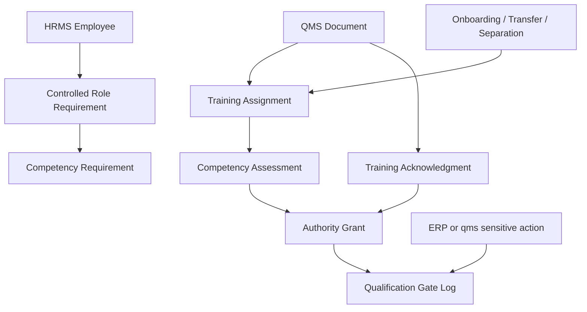

# Controlled-Role Training And Authority Architecture

This note captures the focused architecture decision for controlled-role training, revision acknowledgment, competence, and authority after the HRMS pass and the training-and-competence delegation wave.

## Why This Moved Up

- The approved baseline assumes competent personnel and controlled authority, but the current repo does not yet make those controls happen by default through daily work.
- HRMS already contains real employee-lifecycle and training-event surfaces.
- `qms` already contains real controlled-document release behavior.
- The missing gap is the cross-app bridge that turns those real surfaces into revision-specific obligations, governed authority, and transaction-time gate decisions.

## Current Repo Truth

### qms

- `QMS Document` already performs review, approval, release, previous-version archival, and document distribution.
- `qms` app-wide `doc_events` and schedulers are still commented out in `hooks.py`, so release-driven assignment fan-out is not live.
- `Organization Chart` is a nested descriptive tree with free-text employee and department fields; it is not the live HR employee truth.

### HRMS

- `Employee Onboarding` and `Employee Separation` already create checklist projects and tasks from templates and can assign by user or role.
- `Employee Onboarding.validate_employee_creation()` already blocks employee creation until mandatory onboarding tasks are complete.
- `Employee Transfer` already updates employee work history and can retire the old employee identifier when needed.
- `Training Event`, `Training Result`, and `Training Feedback` already record attendance and completion-type evidence.
- `Skill Assessment` is currently only a child-table structure and is too lightweight for controlled-role qualification.

### Cross-app gap

- No current inspected path creates revision-specific training acknowledgment from `QMS Document` release.
- No current inspected path creates governed competence or authority records tied to controlled actions.
- No current inspected path writes an auditable gate log for allowed or blocked sensitive actions.
- `Training Result.on_submit()` writes `training_event.status`, while `Training Event` exposes `event_status`; this should be treated as a cleanup prerequisite before relying on that event for authority renewal.

## Recommended System Split

| Capability | System of record | Reason |
| --- | --- | --- |
| Employee lifecycle, department, designation, reporting line, and training-event attendance | HRMS | these are the real people and lifecycle records already present |
| Controlled-document revision, release, and applicability rules | `qms` | document governance belongs with released document control |
| Sensitive transaction execution | ERPNext | execution evidence should stay in the transaction where work happens |
| Assignment generation, competence resolution, authority decision, and gate logging | new bridge or small quality module | no current app owns this cross-app enforcement cleanly |

## Minimal Domain Model

## Minimal New Records

- `Controlled Role Requirement`
  - scope by department, designation, process, operation, inspection role, or release role
- `Training Assignment`
  - employee, source, due date, linked document revision
- `Training Acknowledgment`
  - employee, document, revision, timestamp
- `Competency Requirement`
  - action, assessor type, validity period
- `Competency Assessment`
  - employee, action, assessor, result, valid until
- `Authority Grant`
  - employee, authority type, scope, effective dates, approver
- `Qualification Gate Log`
  - action, acting user, source record, allowed or blocked result, reason

## Trigger And Gate Plan

| Trigger | Action | Mode |
| --- | --- | --- |
| `QMS Document.on_update` when status becomes `Released` | resolve audience and create revision assignments and acknowledgments | sync release checks, async assignment fan-out |
| `Employee Onboarding.on_submit` and `on_update_after_submit` | create controlled-role assignments after onboarding tasks exist | async |
| `Employee.on_update` | refresh authority when employee status, department, designation, or reports-to changes | sync for integrity, async for recalculation |
| `Employee Transfer.on_submit` | revoke obsolete authority and create new-role obligations | sync plus async fan-out |
| `Employee Separation.on_submit` | disable future approvals and reassign open quality work | sync revoke plus async reassignment |
| `Training Result.on_submit` | close linked assignments and refresh competence or authority after field cleanup | async |
| `QMS Document` review/approve/release action | verify acting user has current authority | hard stop |
| selected ERP sensitive action | verify training, acknowledgment, competence, and authority | hard stop |

## Parallel Implementation Decision

Controlled-role training and authority should start immediately after Phase 0 and run in parallel with approved-supplier control because:

- approved supplier closes the sourcing side
- controlled-role authority closes the people side
- both are prerequisites for later receipt, manufacturing, and shipment hard stops

The first end-to-end gate should be:

1. release a controlled `QMS Document`
2. create assignments from that release
3. close one assignment through HRMS training or acknowledgment
4. enforce one authority check on a real sensitive action

## Practical Reading Order

1. `SOP-QMS-005_controlled_role_training_competence_and_authority.md`
2. `WTD-SOP-QMS-005_controlled_role_training_competence_and_authority.md`
3. `05_USER_GUIDANCE_AND_TRAINING_MODEL.md`
4. `17_FRAPPE_EVENT_AND_AUTOMATION_BLUEPRINT.md`
5. `09_PHASED_IMPLEMENTATION_ROADMAP.md`
