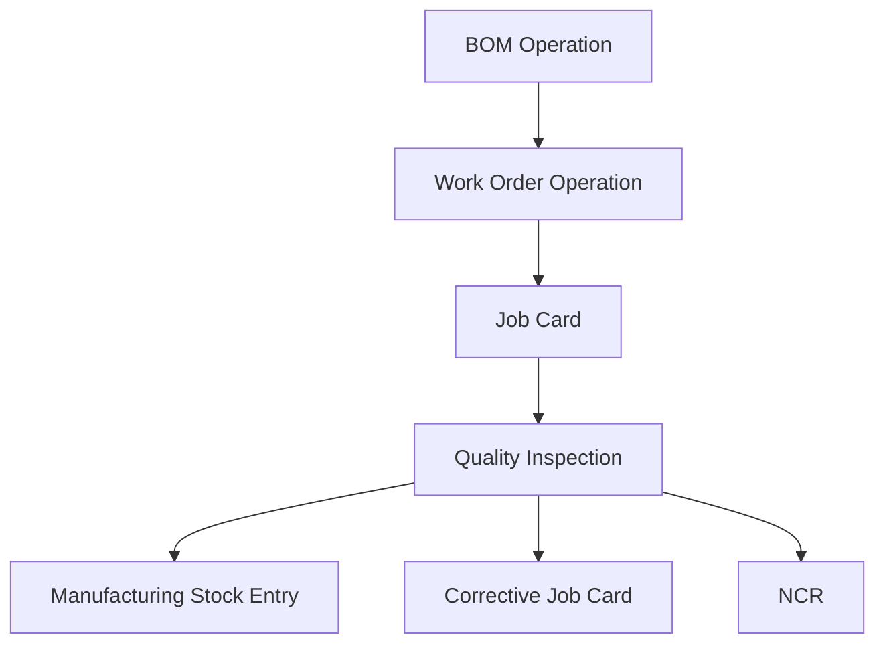

# In-Process Hold Point Architecture

This note captures the focused architecture decision for manufacturing in-process inspection and enforced hold points after the ERP manufacturing trace and the hold-point delegation wave.

## Why This Moved Up

- Manufacturing already contains most of the required execution records in ERPNext.
- The current gap is specific and valuable: hold-point inspection exists as an optional behavior, not a hard stop.
- Closing this gap creates an early manufacturing-quality control without waiting for the full exception, complaint, or DHR layer.

## Current Repo Truth

### ERPNext manufacturing

- `BOM` already contains manufacturing inspection intent through `inspection_required` and `quality_inspection_template`.
- `Work Order.make_stock_entry()` already copies the BOM inspection-required flag to manufacturing `Stock Entry`.
- `Job Card` already exposes `quality_inspection_template` and `quality_inspection`, and the client script prepares a routed `Quality Inspection` with `inspection_type = In Process` and `reference_type = Job Card`.
- `Job Card` already exposes corrective job card creation from the form.
- `Quality Inspection` already supports in-process `Job Card` references, but its current in-process validate path still rehydrates readings from the item-level inspection template instead of treating the job-card or routing template as authoritative.
- `Stock Entry.check_if_operations_completed()` already blocks manufacture when operation quantities are not complete and points the user back to `Job Card`.

### Narrow missing gap

- `job_card.py` does not currently contain server-side validation that an accepted in-process `Quality Inspection` exists before a hold-point `Job Card` can be completed.
- `QualityInspection.validate_inspection_required()` enforces purchase and delivery rules, not manufacturing hold-point policy.
- Manufacture posting is currently tied to operation completion, not to accepted hold-point inspection status.

## Recommended System Split

| Capability | System of record | Reason |
| --- | --- | --- |
| routing, work execution, job-card completion, inspection evidence, and manufacture posting | ERPNext | these are already the native manufacturing execution records |
| controlled instruction, checklist context, and formal exception route | `qms` | document governance and NCR or CAPA route belong there |
| operator or inspector qualification | HRMS plus training bridge | only needed when people qualification is enforced at the same gate |
| hold-point enforcement logic | ERPNext plus small bridge only if qualification is included | the gate should stay close to the manufacturing transaction |

## Minimal Domain Model

## Minimal New Fields And Logic

- Add `hold_point_required` to `BOM Operation`
- Copy the effective hold-point state to `Work Order Operation` and `Job Card`
- Reuse existing `quality_inspection_template` on routing and `Job Card`
- Add `hold_point_status` on `Job Card` for fast visibility
- make the job-card or routing inspection template win over the generic item template for in-process hold points
- Add server-side validation:
  - `Job Card` completion blocked without accepted in-process `Quality Inspection`
  - manufacturing `Stock Entry` blocked when hold-point operations remain unresolved

## Trigger And Gate Plan

| Trigger | Action | Mode |
| --- | --- | --- |
| approved routing setup | carry hold-point requirement forward from routing to execution | sync |
| `Job Card` completion action | verify accepted in-process `Quality Inspection` exists for hold-point job card | hard stop |
| `Quality Inspection.on_submit` with accepted result | mark hold point clear and allow next step | sync |
| `Quality Inspection.on_submit` with rejected result | show or create corrective job card and NCR route | sync prompt plus async follow-up |
| manufacturing `Stock Entry.validate` or `before_submit` | verify required hold points are clear before finished-goods posting | hard stop |

## Priority And Sequencing Decision

This slice should start as the first manufacturing hard-stop implementation immediately after the shared gate-service foundation because:

- most of the required ERP manufacturing structure already exists
- the missing rule is narrow and server-side
- it gives a strong operator-facing quality behavior with minimal duplicate record entry

The first end-to-end manufacturing slice should be:

1. one routing with a configured hold point
2. one `Job Card` hard stop
3. one `Quality Inspection` pass path
4. one reject path into corrective job card or NCR
5. one manufacture-posting hard stop

## Practical Reading Order

1. `SOP-MFG-001_in_process_inspection_and_hold_points.md`
2. `WTD-SOP-MFG-001_in_process_inspection_and_hold_points.md`
3. `04_EVENT_AND_INTEGRATION_MATRIX.md`
4. `17_FRAPPE_EVENT_AND_AUTOMATION_BLUEPRINT.md`
5. `09_PHASED_IMPLEMENTATION_ROADMAP.md`
