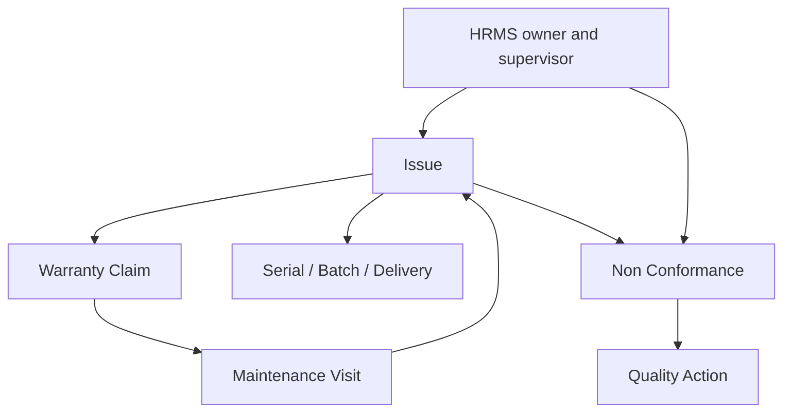

# Complaint Handling And Service Escalation Architecture

This note captures the focused architecture decision for complaint intake, product traceability, service follow-up, and escalation after the complaint-exception review wave.

## Why This Moved Up

- Complaint intake is one of the main operational doors into formal quality records.
- The repo already has usable complaint-like and service-like doctypes in ERPNext.
- The missing gap is not intake itself, but governed quality classification, escalation, and closure control.

## Current Repo Truth

### ERPNext intake and service surfaces

- `Issue` already supports communication-driven intake through customer, raised-by email, issue type, SLA fields, task creation, and split-thread handling.
- `Issue` can currently be closed or reopened directly from the form, and a task can be created from it.
- `Warranty Claim` already stores complaint date, customer, serial number, item, warranty context, and resolution details.
- `Warranty Claim` already exposes a mapped `Maintenance Visit` action while it is open or work in progress.
- `Maintenance Visit` already records completion status, maintenance type, and customer feedback, and on submit it writes resolution data back into the linked `Warranty Claim`.

### Narrow missing gap

- None of the current complaint or service doctypes carry governed complaint severity, reportability, escalation, or closure fields.
- None of the current complaint or service doctypes link directly into NCR or CAPA as a first-class controlled route.
- Current close behavior is support-oriented, not quality-governed.

## Recommended System Split

| Capability | System of record | Reason |
| --- | --- | --- |
| complaint intake, customer communication, product traceability, warranty, and service evidence | ERPNext | these are already the native operational records |
| owner, supervisor, and department context | HRMS | complaint accountability should come from people truth already in HRMS |
| governed escalation, CAPA, and management-review linkage | `qms` plus exception bridge | complaint becomes formal quality work only when it crosses into controlled exception flow |
| severity rules, reportability prompts, and complaint-to-NCR routing | bridge or small quality module | no current app owns this logic cleanly |

## Minimal Domain Model

## Minimal New Fields And Logic

- Extend `Issue` with complaint-classification and traceability fields
- Add direct links from `Issue` to `Warranty Claim`, `Maintenance Visit`, `Non Conformance`, and `Quality Action`
- Add workflow states for intake, triage, pending service, investigation, escalated, and closed
- Add governed close rules for required triage, investigation, and escalation outcome

## Trigger And Gate Plan

| Trigger | Action | Mode |
| --- | --- | --- |
| `Issue` create or first save | classify complaint and resolve product traceability context | sync |
| complaint workflow transition from intake or triage | require severity, investigation, and escalation assessment | hard stop |
| `Warranty Claim` mapped from complaint | carry complaint context into service or warranty follow-up | sync |
| `Maintenance Visit.on_submit` | write service outcome back into linked complaint path | sync |
| complaint severity or recurrence rule | prompt or create NCR seed and assign quality owner | sync prompt plus async follow-up |
| complaint close transition | block close when mandatory investigation or escalation is missing | hard stop |

## Priority And Sequencing Decision

This slice should lead Phase 3 because it is the most natural user-facing exception intake path:

- support and service users are already working in these ERP documents
- it minimizes duplicate entry if complaint, service, and traceability stay in the same chain
- it creates the clean intake route into NCR and CAPA

The first end-to-end complaint slice should be:

1. classify complaint in `Issue`
2. map to `Warranty Claim` only when service is needed
3. feed `Maintenance Visit` outcome back into the same chain
4. trigger NCR where severity or recurrence requires it
5. block close until required quality steps are complete

## Practical Reading Order

1. `SOP-QMS-004_complaint_handling_and_escalation.md`
2. `WTD-SOP-QMS-004_complaint_handling_and_escalation.md`
3. `04_EVENT_AND_INTEGRATION_MATRIX.md`
4. `17_FRAPPE_EVENT_AND_AUTOMATION_BLUEPRINT.md`
5. `09_PHASED_IMPLEMENTATION_ROADMAP.md`
