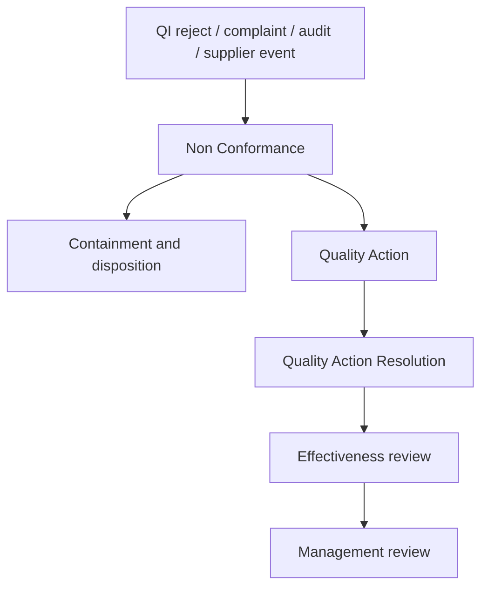

# Nonconformance, CAPA, And Effectiveness Architecture

This note captures the focused architecture decision for NCR, CAPA, and effectiveness verification after the complaint-exception review wave.

## Why This Moved Up

- NCR and CAPA are the core controlled route for rejected inspections, serious complaints, audit findings, and recurrence.
- ERPNext already contains NCR-like and action-like building blocks.
- The missing gap is the controlled lifecycle across source event, containment, disposition, root cause, action, effectiveness, and closure.

## Current Repo Truth

### ERPNext quality objects

- `Non Conformance` currently holds only subject, procedure, process owner, details, corrective-action text, preventive-action text, and a simple status.
- `Non Conformance` has no controller logic beyond the base document.
- `Quality Action` already supports corrective or preventive type plus child `Quality Action Resolution` rows with responsible user and completion date.
- `Quality Action.validate()` only derives overall status from whether child resolution rows remain open.
- `Quality Review` can already auto-create scheduled review records from `Quality Goal`.
- `Quality Feedback` already links into `Quality Action`.

### Narrow missing gap

- There is no direct first-class link between NCR and `Quality Action`.
- There is no source-event linkage from NCR to complaint, rejected inspection, supplier event, or shipment event.
- There is no current containment, disposition, concession, root-cause, effectiveness, or closure-approval model.
- There is no current governed close gate for NCR or CAPA beyond open child resolution rows.

## Recommended System Split

| Capability | System of record | Reason |
| --- | --- | --- |
| originating exception event and transaction context | ERPNext | source evidence should stay in the transaction that created it |
| NCR and CAPA execution records | ERPNext | local quality doctypes already exist there and can be extended |
| owner, supervisor, and accountable-role context | HRMS | responsible-person truth should come from HRMS |
| training, document, and change impact | `qms` | NCR outputs often affect controlled docs, training, and change control |
| cross-linking between source event, NCR, CAPA, and management review | bridge or small quality module | current apps do not enforce this chain |

## Minimal Domain Model

## Minimal New Fields And Logic

- Extend `Non Conformance` with source, traceability, containment, disposition, concession, root cause, owner, effectiveness, and closure fields
- Extend `Quality Action` with direct NCR or complaint links plus effectiveness fields
- Reuse `Quality Action Resolution` as the visible CAPA task layer
- Add workflow states across NCR and CAPA lifecycle stages

## Trigger And Gate Plan

| Trigger | Action | Mode |
| --- | --- | --- |
| rejected `Quality Inspection` or complaint escalation | create NCR seed with source context | sync prompt plus async follow-up |
| NCR transition to disposition | require containment first | hard stop |
| systemic-cause decision | require linked `Quality Action` | hard stop |
| CAPA task completion | update overall CAPA state from resolution rows | sync |
| NCR or CAPA close transition | require effectiveness review and closure authority | hard stop |

## Priority And Sequencing Decision

This slice should follow complaint governance immediately within Phase 3 because:

- complaint is one major NCR source
- rejected inspections and supplier events can reuse the same backbone
- management review only becomes useful when recurrence and effectiveness are systematic

The first end-to-end NCR/CAPA slice should be:

1. create NCR from one complaint or rejected inspection
2. record containment and disposition
3. open linked corrective action with named responsible users
4. record effectiveness review
5. block closure until the full chain is complete

## Practical Reading Order

1. `SOP-QMS-003_nonconformance_and_capa.md`
2. `WTD-SOP-QMS-003_nonconformance_and_capa.md`
3. `04_EVENT_AND_INTEGRATION_MATRIX.md`
4. `17_FRAPPE_EVENT_AND_AUTOMATION_BLUEPRINT.md`
5. `09_PHASED_IMPLEMENTATION_ROADMAP.md`
