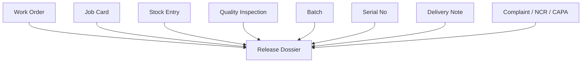

# Release Dossier And DHR Architecture

This note captures the focused architecture decision for release-dossier and DHR-like evidence assembly after the release-dossier review wave.

## Why This Moved Up

- ERP already stores the manufacturing, inspection, lot, serial, and shipment evidence needed for a release packet.
- The current gap is not traceability storage; it is governed assembly, completeness review, and freeze.
- Closing this gap reduces audit and release work without forcing users to maintain a second manual dossier system.

## Current Repo Truth

### ERPNext evidence chain

- `Work Order`, `Job Card`, and manufacturing `Stock Entry` already store production and completion evidence.
- `Stock Entry` already updates work-order quantities and writes quality-inspection references back into linked rows.
- `Quality Inspection.update_qc_reference()` already writes the current inspection link back to `Job Card` or item rows.
- `Batch` already stores supplier plus source document type and source document name.
- `Serial No` already stores work order, batch, employee, warranty, and maintenance status context.
- `Delivery Note` already stores shipment-side serial or batch bundle context and shipment references.

### Narrow missing gap

- No current record assembles these artifacts into one release packet.
- No current release packet is frozen as an audit snapshot.
- Current `Delivery Note` approval is commercial authority, not quality release authority.
- Unresolved complaint, NCR, CAPA, or concession links are not currently assembled into a single release decision view.

## Recommended System Split

| Capability | System of record | Reason |
| --- | --- | --- |
| manufacturing, inspection, traceability, and shipment evidence | ERPNext | the live evidence already resides in these transactional records |
| governed release checklist and approval context | `qms` plus authority bridge | release criteria and approver authority should be governed |
| release authority holder and qualification | HRMS plus training and authority bridge | approval identity should come from the people layer |
| dossier assembly, freeze, and retrieval | new release-dossier layer | no current app owns frozen packet assembly |

## Minimal Domain Model

## Minimal New Fields And Logic

- Add `Release Dossier` with scope, completeness, unresolved-exception, approval, and freeze fields
- Allow generation from stock, batch, serial, and shipment context
- Add child rows or evidence references that point to the linked ERP records
- Add packet freeze so the approval view is preserved for later retrieval

## Trigger And Gate Plan

| Trigger | Action | Mode |
| --- | --- | --- |
| finished-goods completion or shipment-preparation step | generate dossier from scoped transaction context | sync or background gather |
| dossier refresh | gather linked quality, batch, serial, and shipment evidence | async |
| dossier approve or release action | verify completeness and unresolved-exception state | hard stop |
| shipment release rule | require approved dossier where policy demands it | hard stop |

## Priority And Sequencing Decision

This slice should lead Phase 4 after release-critical gates and exception routes are already stable because:

- the evidence chain is already rich enough to assemble
- the packet is only defensible when complaint, NCR, CAPA, and release-gate data are trustworthy
- it is an aggregation and freeze problem, not a substitute for upstream controls

The first end-to-end dossier slice should be:

1. generate packet from one finished-goods stock entry or batch
2. gather linked work order, inspections, batch, serial, and shipment context
3. surface unresolved exceptions
4. approve and freeze one packet
5. retrieve it by batch, serial, or shipment

## Practical Reading Order

1. `SOP-TRC-002_device_history_record_and_release_dossier.md`
2. `WTD-SOP-TRC-002_device_history_record_and_release_dossier.md`
3. `04_EVENT_AND_INTEGRATION_MATRIX.md`
4. `17_FRAPPE_EVENT_AND_AUTOMATION_BLUEPRINT.md`
5. `09_PHASED_IMPLEMENTATION_ROADMAP.md`
