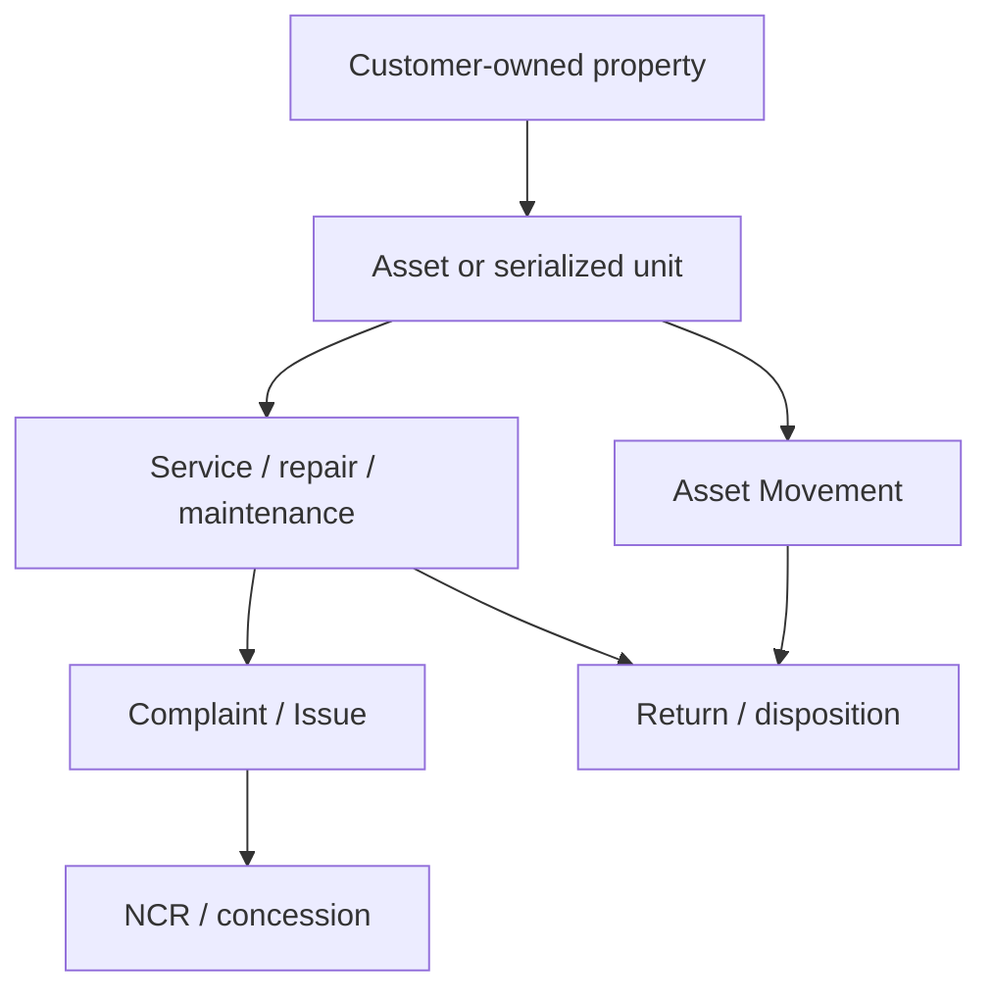

# Customer Property And Customer-Owned Product Control Architecture

This note captures the focused architecture decision for controlling customer-owned property using the local ERP service, asset, and exception surfaces.

## Why This Is Worth Drafting

- ERPNext already contains enough service and asset traces to make customer-property control more than a paper-only SOP.
- The strongest gap is not total absence of records, but the lack of one governed intake, condition, and disposition layer across those records.
- This slice helps cover service-returned units, customer-owned tools, samples, and other property that should not disappear into generic service remarks.

## Current Repo Truth

### ERPNext asset and custody surfaces

- `Asset` already supports customer ownership through `asset_owner = Customer` and a linked `customer`.
- `Asset Movement` already validates company, source location, target location, custodian, and purpose, then writes the latest location and custodian back to `Asset`.
- `Asset Movement` already writes an `Asset Activity` history line for issue, receipt, and transfer outcomes.
- `Asset Maintenance`, `Asset Maintenance Log`, and `Asset Repair` already provide planning, completion, certificate, and repair-cost evidence for managed assets.

### ERPNext service and product-history surfaces

- `Installation Note` already enforces serial-number consistency against the linked `Delivery Note`.
- `Warranty Claim` already holds customer, item, serial number, complaint text, and resolution fields.
- `Maintenance Visit` already feeds resolution status and details back to linked `Warranty Claim`.
- `Issue` already acts as the strongest general customer complaint or service-intake shell.
- `Serial No` already holds warranty, AMC, batch, and work-order context, which helps reconstruct service history for serialized customer-owned or customer-returned product.

### Narrow missing gap

- There is no dedicated customer-property receipt or disposition doctype in the traced local apps.
- There is no native lost, damaged, unsuitable, or returned-state workflow for customer-owned property across service and asset records.
- There is no single policy layer that forces service, complaint, and custody records to reference the same customer-owned object.

## Recommended System Split

| Capability | System of record | Reason |
| --- | --- | --- |
| customer-owned asset identity, custody, movement, maintenance, and repair | ERPNext | the asset and service records already live there |
| complaint, loss, damage, unsuitable-for-use, or concession escalation | ERPNext plus quality-exception layer | the event begins in ERP, but governed closure belongs in the exception backbone |
| governed SOP, acknowledgment, and any controlled forms | `qms` | document governance remains there |
| ownership and escalation context | HRMS | supervisor and department resolution should come from HRMS |

## Minimal Domain Model

## Minimal New Fields And Logic

- Add customer-property classification on service intake or receipt path
- Add receipt-condition and final-disposition fields
- Add explicit `lost`, `damaged`, and `unsuitable for use` states
- Add guided links from service records to the governed customer-property object
- Add guided escalation from customer-property damage or loss into complaint, NCR, or concession flow

## Trigger And Gate Plan

| Trigger | Action | Mode |
| --- | --- | --- |
| customer-owned property intake | create or link customer-owned `Asset` or equivalent property record | sync guidance |
| custody handoff | require `Asset Movement` with location or custodian change | sync |
| service / repair activity | link service record to controlled customer-property object | sync guidance |
| property damaged, lost, or unsuitable | create complaint, NCR, or concession route | sync prompt plus async follow-up |
| return / final disposition | record closure against same property chain | sync |

## Sequencing Decision

This should be drafted now as a light-adaptation SOP because:

- the service and custody evidence is already mostly present
- the missing layer is narrow and procedural
- it naturally reuses the complaint and exception backbone instead of inventing a separate subsystem

## Practical Reading Order

1. `SOP-SRV-003_customer_property_and_customer_owned_product_control.md`
2. `WTD-SOP-SRV-003_customer_property_and_customer_owned_product_control.md`
3. `21_COMPLAINT_HANDLING_AND_SERVICE_ESCALATION_ARCHITECTURE.md`
4. `22_NONCONFORMANCE_CAPA_AND_EFFECTIVENESS_ARCHITECTURE.md`
