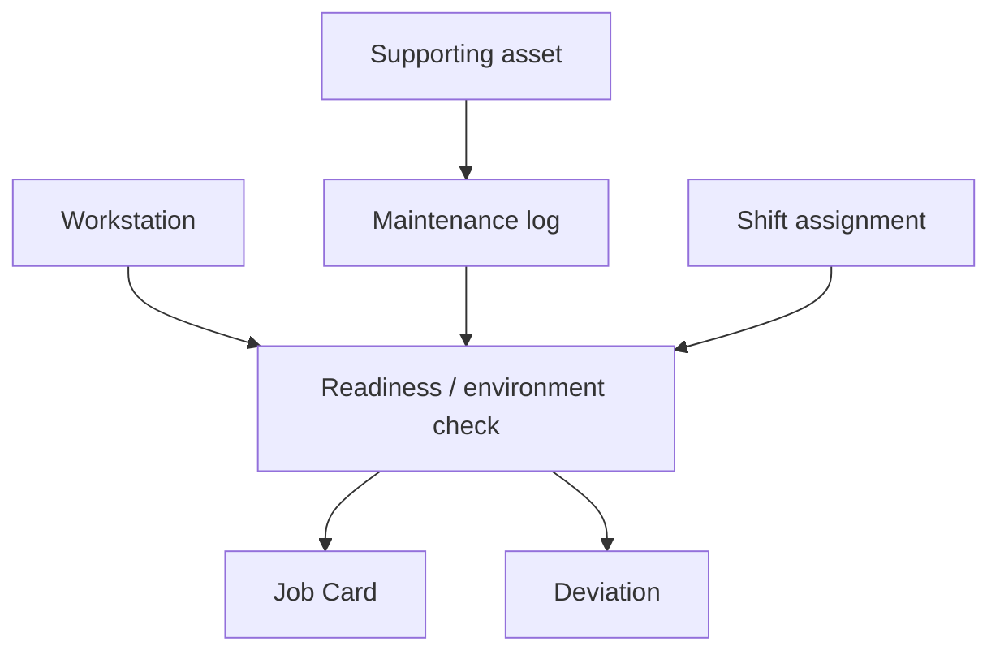

# Work Environment And Workstation Readiness Architecture

This note captures the focused architecture decision for workstation readiness, supporting infrastructure state, and environment-sensitive pre-start evidence.

## Why This Should Be Written Carefully

- ERPNext already contains meaningful workstation, job execution, maintenance, and shift records.
- Those records are strong enough for readiness and infrastructure control, but not yet strong enough for full contamination-control rigor.
- The architecture should therefore support a light-adaptation SOP now while keeping microbiological or cleanroom-grade contamination controls explicitly conditional on product scope.

## Current Repo Truth

### ERPNext production and equipment surfaces

- `Workstation` already supports status, plant floor, working hours, holiday list, and workstation-driven job actions.
- `Job Card` already carries workstation, employee time logs, and updates workstation status during execution.
- `Work Order` already binds execution to workstation or workstation type and scheduling sequence.
- `Asset Maintenance`, `Asset Maintenance Log`, and `Asset Repair` already support planned upkeep, due status, completion evidence, and certificate attachments for supporting assets.

### HRMS people and presence surfaces

- `Shift Assignment` already validates active employee, overlapping shifts, and shift-location assignment.
- `Employee Checkin` already resolves shift and can enforce check-in radius against the configured shift location.

### Narrow missing gap

- There is no first-class line-clearance, readiness-checklist, or environment-condition doctype tied to `Job Card` or `Workstation`.
- There is no native room-state or cleanliness log tied to product batch or operation.
- There is no hard gate today that blocks production because the workstation, environment, or assigned special-condition supervision is not ready.

## Recommended System Split

| Capability | System of record | Reason |
| --- | --- | --- |
| workstation state, production execution, supporting asset upkeep | ERPNext | production already lives there |
| people assignment, shift coverage, and location-presence context | HRMS | shift and attendance evidence already lives there |
| governed instruction, environment requirements, and role-specific acknowledgment | `qms` | those requirements should remain governed documents |
| contamination or readiness deviation route | quality-exception layer | deviations should re-use the same backbone as other quality exceptions |

## Minimal Domain Model

## Minimal New Fields And Logic

- Add `quality_critical_workstation` or equivalent scope
- Add readiness state and blocked reason
- Add pre-start checklist for line clearance, cleaning, or environment-sensitive checks
- Add special-condition supervision or competence confirmation where required
- Add contamination or readiness deviation route

## Trigger And Gate Plan

| Trigger | Action | Mode |
| --- | --- | --- |
| shift start or pre-production start | surface workstation readiness state and checklist | sync guidance |
| supporting asset overdue / blocked | mark readiness blocked for linked critical workstation | sync or async refresh |
| `Job Card` start or completion | verify required readiness state before controlled work | sync warning or hard stop by policy |
| failed readiness or cleanliness check | create readiness deviation or NCR route | sync prompt plus async follow-up |

## Sequencing Decision

This belongs after the stronger foundation and exception slices because:

- it is valuable, but less critical than receipt, authority, complaint, and NCR control
- the contamination-specific part must remain scope-driven
- the ERP evidence is good enough for readiness, but not enough yet for claiming full contamination-control automation

## Practical Reading Order

1. `SOP-MFG-005_workstation_readiness_and_environment_control.md`
2. `WTD-SOP-MFG-005_workstation_readiness_and_environment_control.md`
3. `20_IN_PROCESS_HOLD_POINT_ARCHITECTURE.md`
4. `17_FRAPPE_EVENT_AND_AUTOMATION_BLUEPRINT.md`
