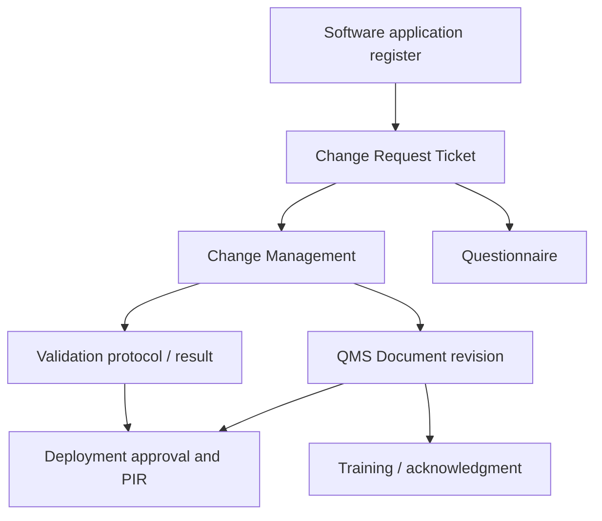

# Computer Software Validation And ERP Change Control Architecture

This note captures the focused architecture decision for governing quality-relevant software changes across ERPNext, `qms`, HRMS, and connected customizations.

## Why This Should Not Stay A Generic Gap

- The local `qms` app already contains a real document and change backbone.
- That backbone is not yet rigorous enough for software-validation evidence, but it is strong enough to build on.
- Because ERP, `qms`, and HRMS are being positioned as the operating QMS, software change validation becomes part of the quality system itself, not just an IT housekeeping topic.

## Current Repo Truth

### qms document and change backbone

- `QMS Document` already supports review, approval, release, archive, previous-version handling, and distribution.
- `Change Request Ticket` already enforces one active ticket per impacted document and can expand impact questions from `Questionnaire` through selected `Change Type`.
- `Change Management` already validates released source documents, requires new version files to start implementation, and creates new `QMS Document` versions.
- `External Origin Document` already supports controlled third-party or vendor document receipt and obsolescence.
- `Distribution Log` already preserves document distribution evidence.

### Narrow missing gap

- There is no software-application register for ERPNext, `qms`, HRMS, reports, scripts, or integrations.
- There is no validation-protocol, test-result, defect, rollback, or post-implementation-review model in the current change package.
- `qms/hooks.py` still leaves app-wide doc events and scheduler automation commented out, so intended automation is not yet active repo truth.

## Recommended System Split

| Capability | System of record | Reason |
| --- | --- | --- |
| software change request, impact assessment, linked controlled docs, and release evidence | `qms` | current change and document lifecycle already lives there |
| application behavior under change, deployment target, and runtime release impact | ERPNext + HRMS + bridge | the affected behavior is cross-app |
| training or acknowledgment impact | `qms` + HRMS | released SOPs and employee assignment should remain controlled |
| technical deployment or implementation evidence | small new module or qms extension | current qms change objects do not model test execution rigor deeply enough |

## Minimal Domain Model

## Minimal New Fields And Logic

- Add a software application register and quality relevance flag
- Add software-specific change categories and question templates
- Add validation protocol, execution result, defect, approval, rollback, and post-implementation review tables
- Add a deployment approval checkpoint before closure
- Add training impact linkage when the software change alters user workflow or controlled records

## Trigger And Gate Plan

| Trigger | Action | Mode |
| --- | --- | --- |
| software change need | raise `Change Request Ticket` with software impact type | sync |
| change review | expand software-specific questions and affected docs | sync |
| implementation start | require new version files and planned validation evidence | sync |
| validation complete | verify evidence before deployment approval | hard stop |
| software release affects SOP or transaction behavior | release revised docs and generate training or acknowledgment impact | sync plus async fan-out |
| post-implementation review due | require final evidence before close | sync close check |

## Sequencing Decision

This should be drafted now, but implemented after the stronger operator-facing gates, because:

- it governs the platform itself rather than day-to-day manufacturing or purchasing action
- the local `qms` foundation is already strong enough to extend
- it becomes more important as the ERP/qms/hrms stack starts enforcing regulated behavior

## Practical Reading Order

1. `SOP-QMS-011_computer_software_validation_and_erp_change_control.md`
2. `WTD-SOP-QMS-011_computer_software_validation_and_erp_change_control.md`
3. `03_SYSTEM_BOUNDARIES_ERP_VS_QMS_VS_CUSTOM.md`
4. `17_FRAPPE_EVENT_AND_AUTOMATION_BLUEPRINT.md`
