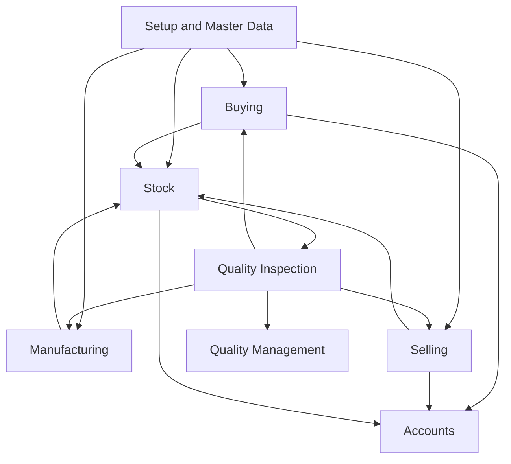

# Module Inventory And SOP Map

## ERPNext Modules Seen In Local Codebase

| Module | ISO 13485 Relevance | Primary SOP Need |
| --- | --- | --- |
| Setup | High | master data governance, item templates, role design, numbering |
| Stock | High | traceability, receipt, issue, batch/serial control, quality inspection |
| Buying | High | supplier controls, PO discipline, receipt evidence |
| Subcontracting | High | external process control and receipt verification |
| Manufacturing | High | production planning, work order execution, in-process and final records |
| Selling | High | controlled release, delivery evidence, outgoing inspection |
| Accounts | High | financial audit trail for regulated transactions |
| Quality Management | High | goals, procedures, reviews, actions, nonconformance-style oversight |
| Support | Medium | complaint / feedback handling if used that way |
| Maintenance | Medium | servicing and post-delivery support evidence |
| Assets | Medium | equipment / infrastructure control, calibration-adjacent SOP potential |
| Projects | Medium | engineering / validation project governance if adopted |
| CRM | Low to Medium | pre-order commercial records, limited QMS value by default |
| Utilities / Communication / Portal / Shopping Cart / Telephony / Integrations | Context dependent | peripheral SOP only if used in validated process |

## Recommended SOP Packet Structure

1. Master data and role governance
2. Supplier qualification and purchasing
3. Incoming inspection and stock receipt
4. Manufacturing execution and in-process control
5. Finished goods release and customer delivery
6. Quality review, action, and nonconformance handling
7. Financial posting and audit trail review
8. Traceability and retention

## Cross-Module Control Model

## Practical SOP Rule

ERPNext should be treated as the system of record only if employees are instructed exactly:

- which document to create first
- which links must never be bypassed
- when Quality Inspection is mandatory
- who can review, submit, reject, or cancel
- what evidence must be attached before submit
